# Awesome AI Fun · Fun AI creations and things to try

[简体中文](README.zh-CN.md) | **English**

> A collection of fun things people make with AI: 3D worlds to explore, little games, animations, and odd interactive ideas.
>
> Browse the previews, try something you like, or see how its creator made it.

**62 works and collections** · [Open the gallery](https://java4ye.github.io/awesome-ai-fun/site/) · [Full catalog](docs/en/INDEX.md)

## All works

[Games](#category-games) · [3D & Spaces](#category-3d) · [Animation & Physics](#category-animation) · [Apps & Interaction](#category-applications) · [SVG Art](#category-svg)

### Games · 10

<table>
  <tr>
    <td width="33%" valign="top"><a href="https://aitestmuseum.com/results/claude-opus-5-5/kart-racer/output.html">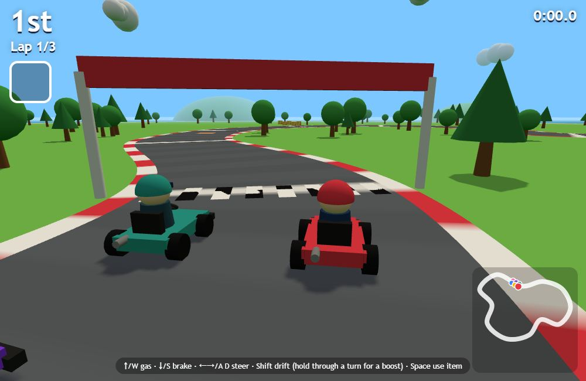</a> <strong><a href="docs/en/categories/games.md#one-shot-kart-racing-game">One-shot kart racing game</a></strong> <a href="https://aitestmuseum.com/results/claude-opus-5-5/kart-racer/output.html">Play</a> · <a href="https://aitestmuseum.com/zh/tests/kart-racer">Source</a></td>
    <td width="33%" valign="top"><a href="https://aitestmuseum.com/results/claude-opus-5-5/flappy-bird/output.html">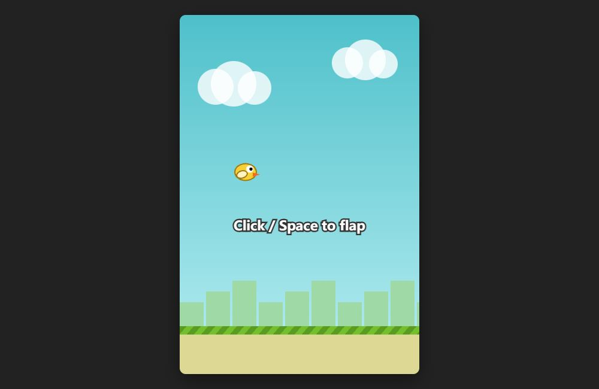</a> <strong><a href="docs/en/categories/games.md#flappy-bird-in-one-file">Flappy Bird in one file</a></strong> <a href="https://aitestmuseum.com/results/claude-opus-5-5/flappy-bird/output.html">Play</a> · <a href="https://aitestmuseum.com/zh/tests/flappy-bird">Source</a></td>
    <td width="33%" valign="top"><a href="https://aitestmuseum.com/results/claude-opus-5-5/tetris/output.html">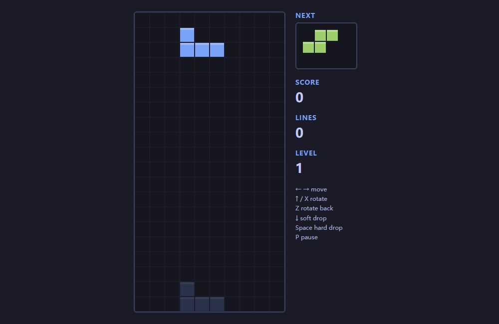</a> <strong><a href="docs/en/COLLECTIONS.md#museum-010">Tetris</a></strong> <a href="https://aitestmuseum.com/results/claude-opus-5-5/tetris/output.html">Play</a> · <a href="https://aitestmuseum.com/zh/tests/tetris">Source</a></td>
  </tr>
  <tr>
    <td width="33%" valign="top"><a href="https://aitestmuseum.com/results/claude-opus-5-5/flight-sim/output.html">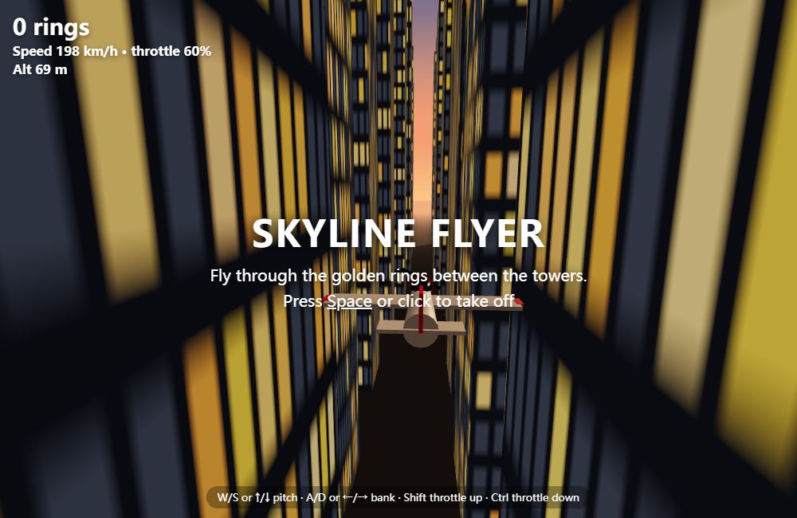</a> <strong><a href="docs/en/categories/games.md#3d-flight-game-among-skyscrapers">3D flight game among skyscrapers</a></strong> <a href="https://aitestmuseum.com/results/claude-opus-5-5/flight-sim/output.html">Play</a> · <a href="https://aitestmuseum.com/zh/tests/flight-sim">Source</a></td>
    <td width="33%" valign="top"><a href="https://storage.googleapis.com/gweb-uniblog-publish-prod/original_videos/Google-AIS-FSR_LaserTag_06-DR.mp4">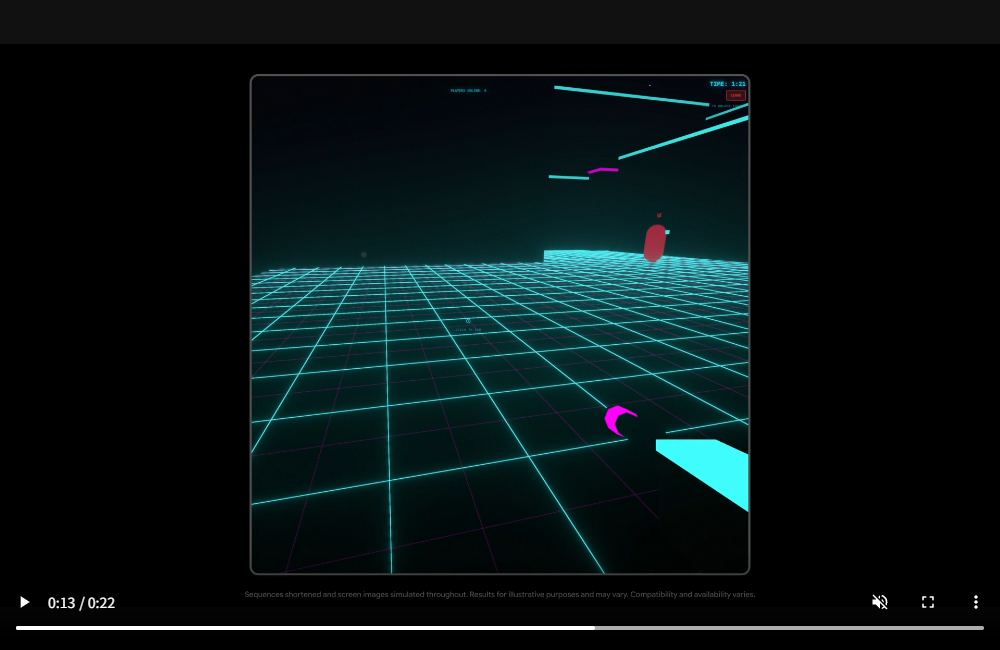</a> <strong><a href="docs/en/categories/games.md#neon-arena-multiplayer-laser-tag">Neon Arena multiplayer laser tag</a></strong> <a href="https://blog.google/innovation-and-ai/technology/developers-tools/full-stack-vibe-coding-google-ai-studio/">Source</a></td>
    <td width="33%" valign="top"><a href="https://storage.googleapis.com/gweb-uniblog-publish-prod/original_videos/FSR_NeonClaw_v06_1.mp4">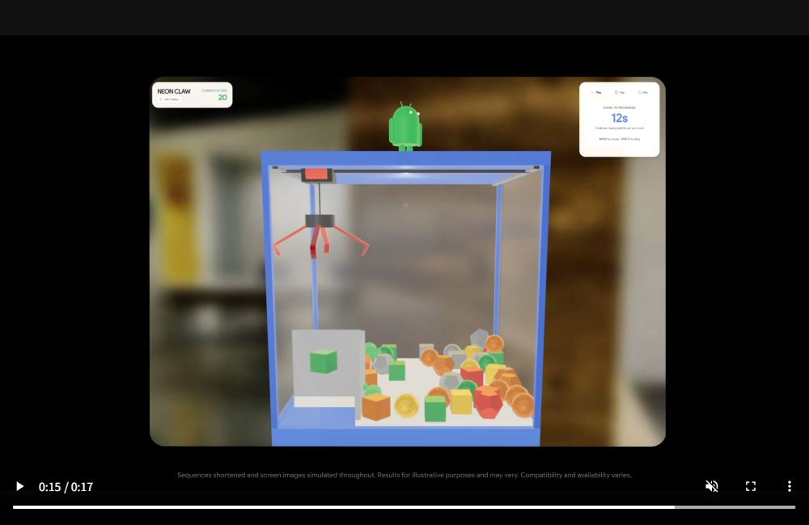</a> <strong><a href="docs/en/categories/games.md#neon-claw-physics-claw-machine">Neon Claw physics claw machine</a></strong> <a href="https://blog.google/innovation-and-ai/technology/developers-tools/full-stack-vibe-coding-google-ai-studio/">Source</a></td>
  </tr>
  <tr>
    <td width="33%" valign="top"> <strong><a href="docs/en/categories/games.md#coastal-fishing-and-trading-game">Coastal fishing and trading game</a></strong> <a href="https://dgreenheck.github.io/tidewater/">Play</a> · <a href="https://github.com/dgreenheck/tidewater/blob/4811ba48d795197de5621985f404e765c0b7c0ef/docs/screenshot.jpg">Source</a></td>
    <td width="33%" valign="top"> <strong><a href="docs/en/categories/games.md#harpoon-fishing-game">Harpoon fishing game</a></strong> <a href="https://x.com/nachat_dayo/status/2102773498037023140">Source</a></td>
    <td width="33%" valign="top"> <strong><a href="docs/en/categories/games.md#flower-planting-and-beekeeping-game">Flower planting and beekeeping game</a></strong> <a href="https://x.com/oguzthedev/status/2102476490344730950">Source</a></td>
  </tr>
  <tr>
    <td width="33%" valign="top"><a href="https://video.twimg.com/amplify_video/2109941568253927424/vid/avc1/3840x2160/_NUImXhsfraGu0Tb.mp4?tag=29">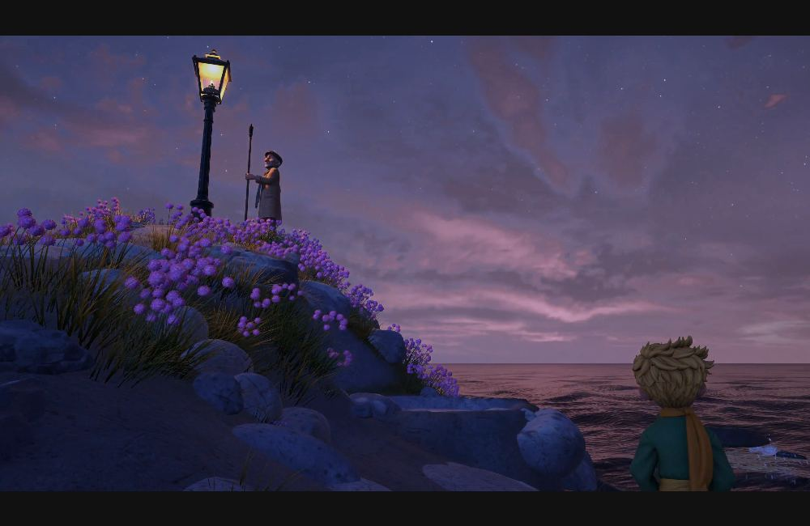</a> <strong><a href="docs/en/categories/games.md#the-little-prince-across-the-stars">The Little Prince: Across the Stars</a></strong> <a href="https://littleprince.dev/">Play</a> · <a href="https://x.com/Saccc_c/status/2109962425512734739">Source</a></td>
    <td></td>
    <td></td>
  </tr>
</table>

### 3D & Spaces · 13

<table>
  <tr>
    <td width="33%" valign="top"><a href="https://aitestmuseum.com/results/claude-opus-5-5/voxel-pagoda/output.html">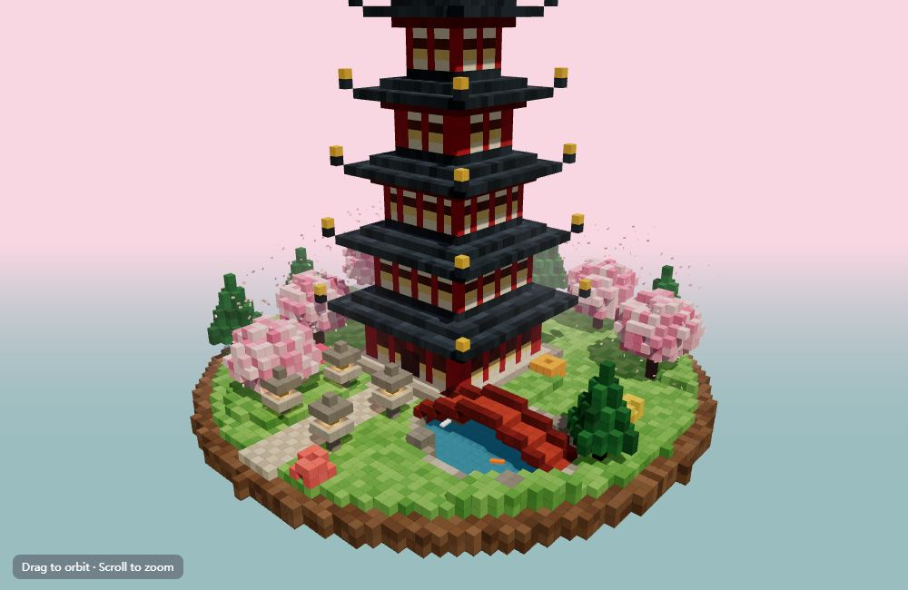</a> <strong><a href="docs/en/categories/3d.md#voxel-pagoda-garden">Voxel pagoda garden</a></strong> <a href="https://aitestmuseum.com/results/claude-opus-5-5/voxel-pagoda/output.html">Play</a> · <a href="https://aitestmuseum.com/zh/tests/voxel-pagoda">Source</a></td>
    <td width="33%" valign="top"><a href="https://aitestmuseum.com/results/claude-opus-5-5/minecraft-web/output.html">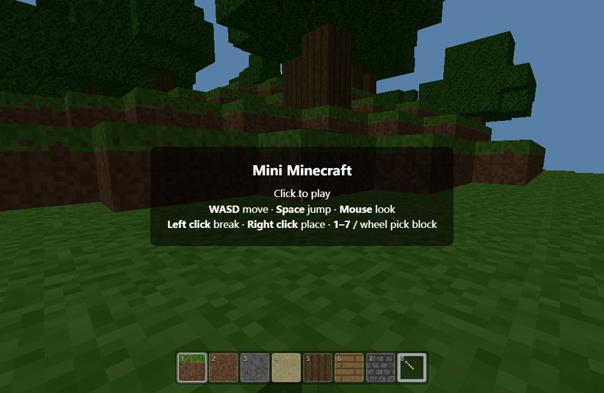</a> <strong><a href="docs/en/categories/3d.md#minecraft-in-threejs">Minecraft in three.js</a></strong> <a href="https://aitestmuseum.com/results/claude-opus-5-5/minecraft-web/output.html">Play</a> · <a href="https://aitestmuseum.com/zh/tests/minecraft-web">Source</a></td>
    <td width="33%" valign="top"><a href="https://aitestmuseum.com/results/claude-opus-5-5/rubiks-cube/output.html">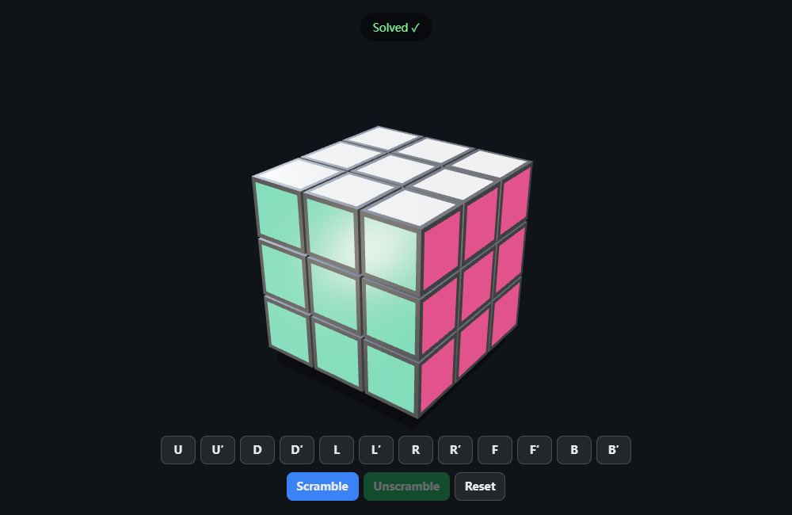</a> <strong><a href="docs/en/categories/3d.md#self-solving-rubiks-cube">Self-solving Rubik&#x27;s cube</a></strong> <a href="https://aitestmuseum.com/results/claude-opus-5-5/rubiks-cube/output.html">Play</a> · <a href="https://aitestmuseum.com/zh/tests/rubiks-cube">Source</a></td>
  </tr>
  <tr>
    <td width="33%" valign="top"><a href="https://aitestmuseum.com/results/claude-opus-5-5/meteor-city/output.html">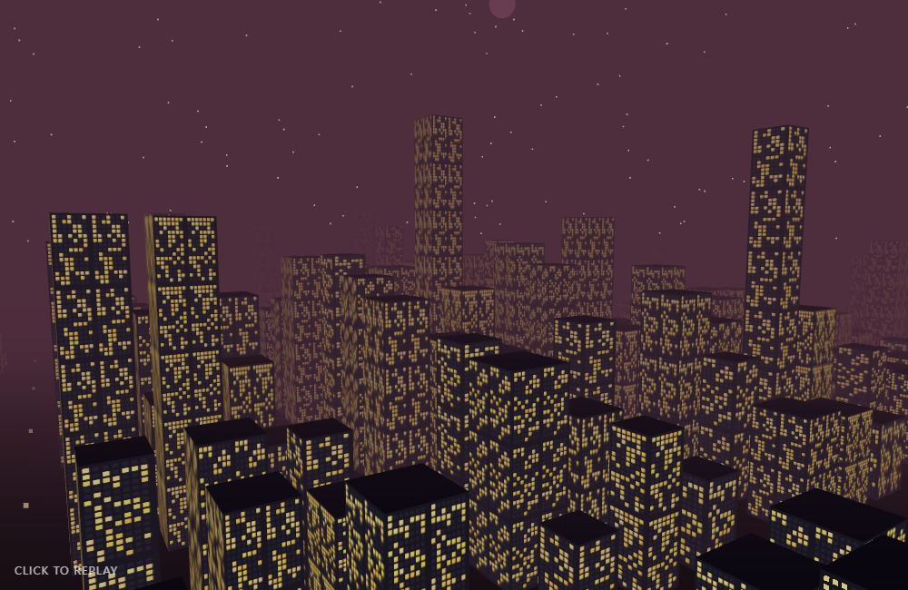</a> <strong><a href="docs/en/categories/3d.md#meteor-hitting-a-city">Meteor hitting a city</a></strong> <a href="https://aitestmuseum.com/results/claude-opus-5-5/meteor-city/output.html">Play</a> · <a href="https://aitestmuseum.com/zh/tests/meteor-city">Source</a></td>
    <td width="33%" valign="top"><a href="https://aitestmuseum.com/results/claude-opus-5-5/solar-system/output.html">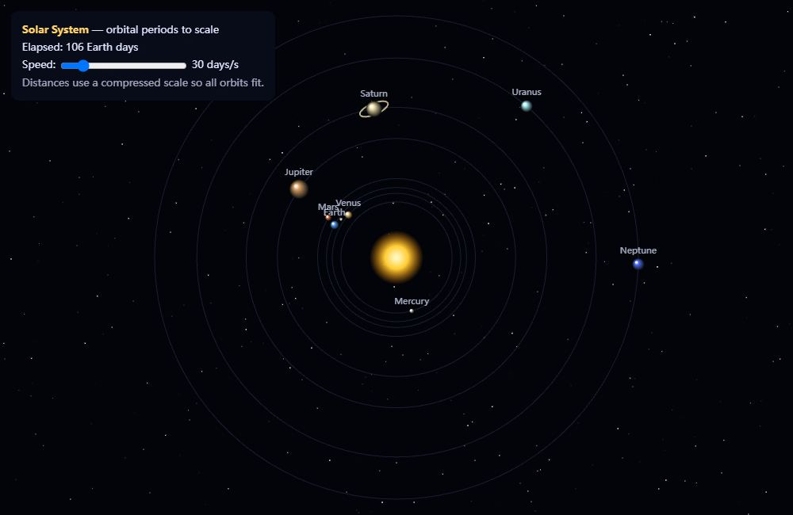</a> <strong><a href="docs/en/categories/3d.md#solar-system-simulation">Solar system simulation</a></strong> <a href="https://aitestmuseum.com/results/claude-opus-5-5/solar-system/output.html">Play</a> · <a href="https://aitestmuseum.com/zh/tests/solar-system">Source</a></td>
    <td width="33%" valign="top"><a href="https://aitestmuseum.com/results/claude-opus-5-5/mars-round-trip/output.html">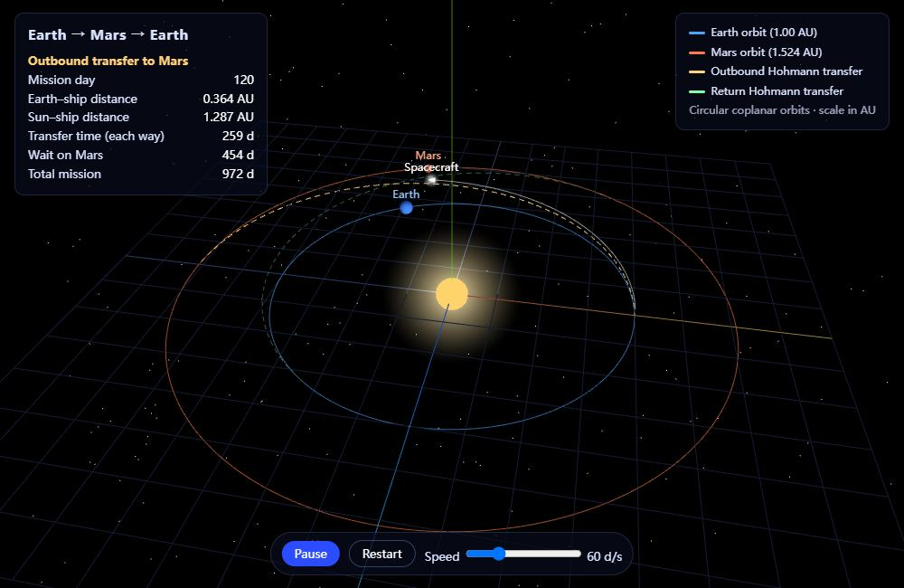</a> <strong><a href="docs/en/categories/3d.md#earth-mars-round-trip">Earth-Mars round trip</a></strong> <a href="https://aitestmuseum.com/results/claude-opus-5-5/mars-round-trip/output.html">Play</a> · <a href="https://aitestmuseum.com/zh/tests/mars-round-trip">Source</a></td>
  </tr>
  <tr>
    <td width="33%" valign="top"><a href="https://electricazimuth.github.io/LocalLLM_VisualCodeTest/results/2025.04.28/html/claude37_lightshow_20250425_174000.html">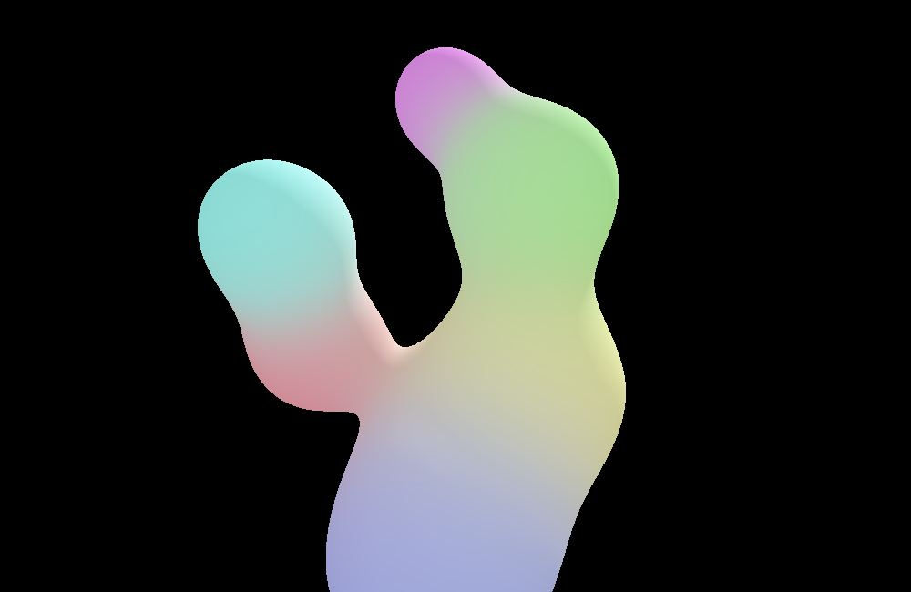</a> <strong><a href="docs/en/categories/3d.md#ray-marched-psychedelic-metaballs">Ray-marched psychedelic metaballs</a></strong> <a href="https://github.com/electricazimuth/LocalLLM_VisualCodeTest/blob/7e7004885221fafb8b1de360cacc2b8281cf934a/code_prompts/lightshow.md">Source</a></td>
    <td width="33%" valign="top"><a href="https://deveraux-parker.github.io/thrillernight/">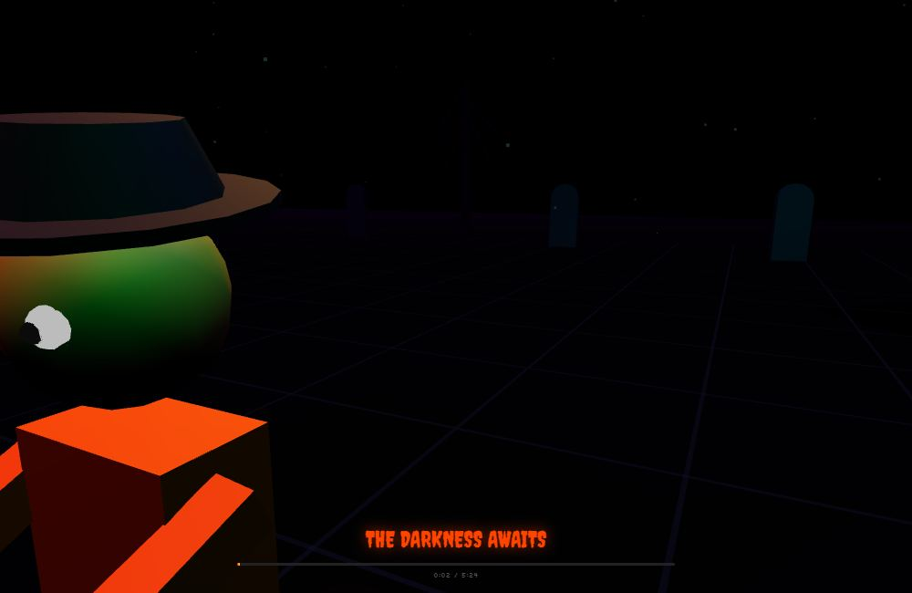</a> <strong><a href="docs/en/categories/3d.md#synchronized-multi-character-threejs-dance">Synchronized multi-character Three.js dance</a></strong> <a href="https://www.reddit.com/r/LocalLLaMA/comments/1rqlaw4/new_benchmark_just_dropped/">Source</a></td>
    <td width="33%" valign="top"> <strong><a href="docs/en/categories/3d.md#explorable-peach-blossom-land">Explorable Peach Blossom Land</a></strong> <a href="https://s.baoyu.io/files/taohuayuan/index.html">Play</a> · <a href="https://x.com/dotey/status/2102940980379017293">Source</a></td>
  </tr>
  <tr>
    <td width="33%" valign="top"> <strong><a href="docs/en/categories/3d.md#photo-to-cel-shaded-autumn-railway">Photo-to-cel-shaded autumn railway</a></strong> <a href="https://x.com/ishuagra02/status/2102543638689460488">Source</a></td>
    <td width="33%" valign="top"> <strong><a href="docs/en/categories/3d.md#from-accelerator-tunnel-to-proton-collision">From accelerator tunnel to proton collision</a></strong> <a href="https://x.com/superalesha/status/2102779758408774104">Source</a></td>
    <td width="33%" valign="top"> <strong><a href="docs/en/categories/3d.md#from-line-sketch-to-3d-house">From line sketch to 3D house</a></strong> <a href="https://x.com/techartist_/status/2102503719762018434">Source</a></td>
  </tr>
  <tr>
    <td width="33%" valign="top"> <strong><a href="docs/en/categories/3d.md#word-driven-soft-colored-village">Word-driven soft-colored village</a></strong> <a href="https://powapowa.pages.dev/">Play</a> · <a href="https://x.com/studio_veco/status/2102684366996738511">Source</a></td>
    <td></td>
    <td></td>
  </tr>
</table>

### Animation & Physics · 27

<table>
  <tr>
    <td width="33%" valign="top"><a href="https://aitestmuseum.com/results/claude-opus-5-5/pelican-bicycle/output.html">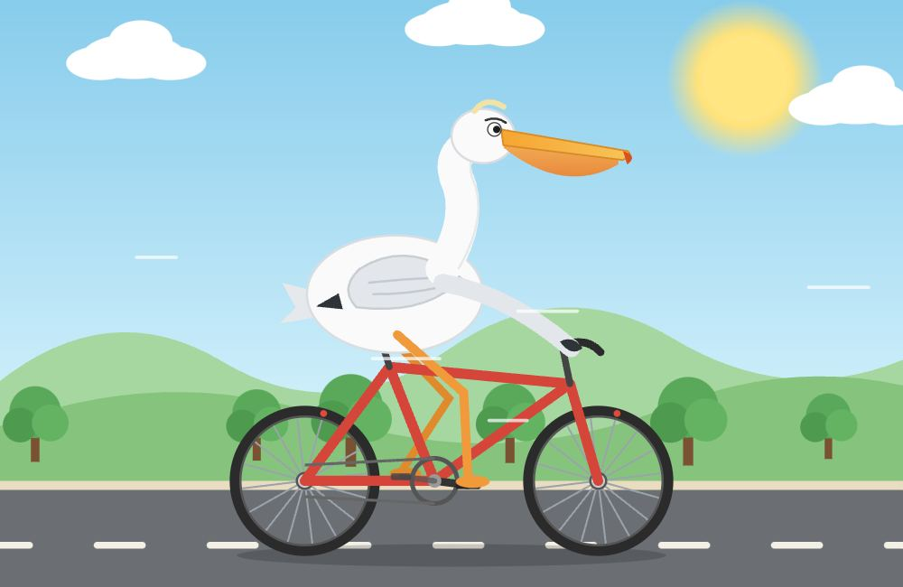</a> <strong><a href="docs/en/COLLECTIONS.md#museum-001">Pelican on a Bicycle</a></strong> <a href="https://aitestmuseum.com/results/claude-opus-5-5/pelican-bicycle/output.html">Play</a> · <a href="https://aitestmuseum.com/zh/tests/pelican-bicycle">Source</a></td>
    <td width="33%" valign="top"><a href="https://aitestmuseum.com/results/claude-opus-5-5/bouncing-ball-hexagon/output.html">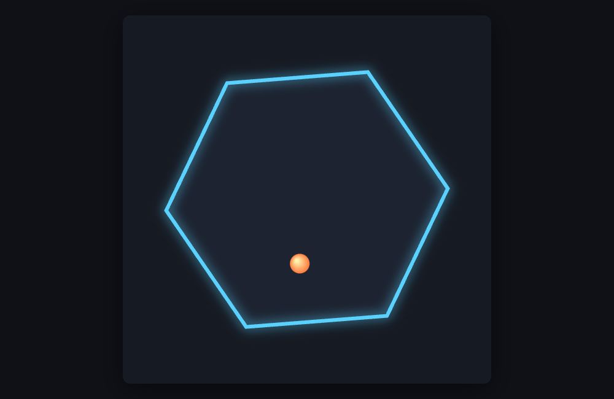</a> <strong><a href="docs/en/COLLECTIONS.md#museum-002">Bouncing Balls and Collisions</a></strong> <a href="https://aitestmuseum.com/results/claude-opus-5-5/bouncing-ball-hexagon/output.html">Play</a> · <a href="https://aitestmuseum.com/zh/tests/bouncing-ball-hexagon">Source</a></td>
    <td width="33%" valign="top"><a href="https://aitestmuseum.com/results/claude-opus-5-5/supernova/output.html">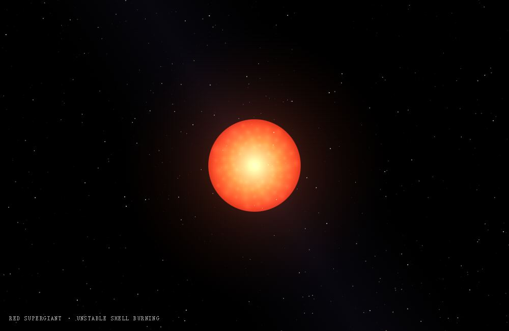</a> <strong><a href="docs/en/categories/animation.md#supernova-explosion">Supernova explosion</a></strong> <a href="https://aitestmuseum.com/results/claude-opus-5-5/supernova/output.html">Play</a> · <a href="https://aitestmuseum.com/zh/tests/supernova">Source</a></td>
  </tr>
  <tr>
    <td width="33%" valign="top"><a href="https://aitestmuseum.com/results/claude-opus-5-5/drowned-gothic-city/output.html">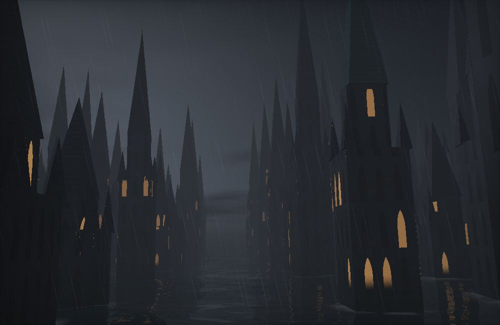</a> <strong><a href="docs/en/categories/animation.md#drowned-gothic-city-shader">Drowned Gothic city shader</a></strong> <a href="https://aitestmuseum.com/results/claude-opus-5-5/drowned-gothic-city/output.html">Play</a> · <a href="https://aitestmuseum.com/zh/tests/drowned-gothic-city">Source</a></td>
    <td width="33%" valign="top"><a href="https://aitestmuseum.com/results/claude-opus-5-5/hand-gesture-particles/output.html">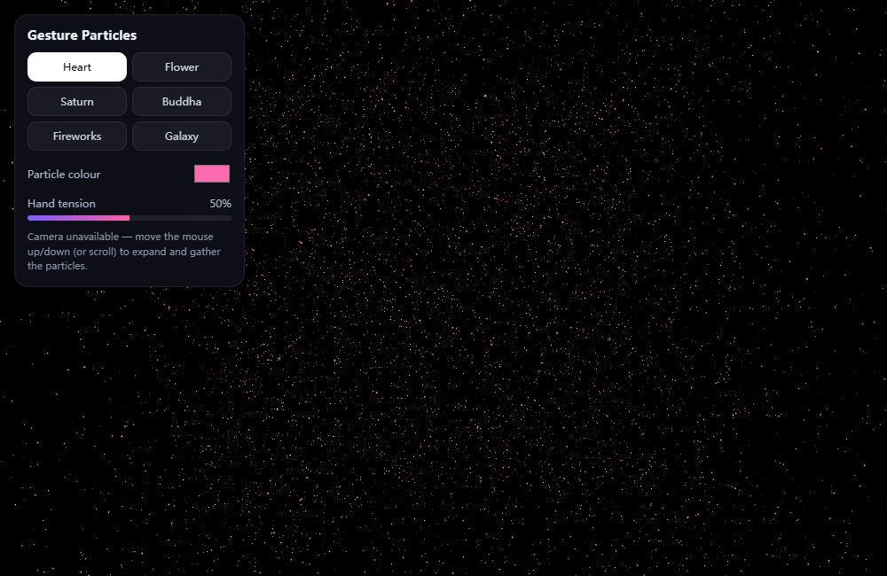</a> <strong><a href="docs/en/categories/animation.md#hand-controlled-particles">Hand-controlled particles</a></strong> <a href="https://aitestmuseum.com/results/claude-opus-5-5/hand-gesture-particles/output.html">Play</a> · <a href="https://aitestmuseum.com/zh/tests/hand-gesture-particles">Source</a></td>
    <td width="33%" valign="top"><a href="https://aitestmuseum.com/results/claude-opus-5-5/starship-control-panel/output.html">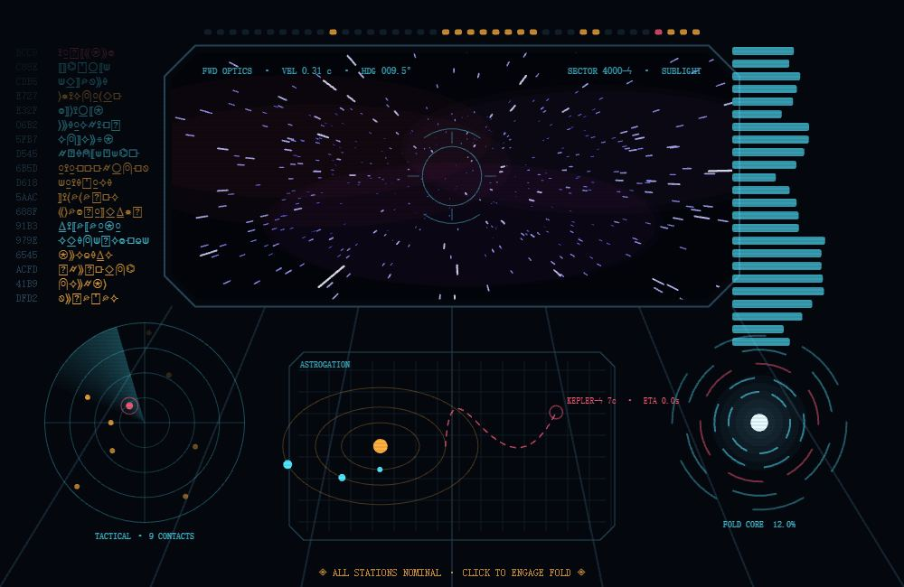</a> <strong><a href="docs/en/categories/animation.md#starship-control-panel">Starship control panel</a></strong> <a href="https://aitestmuseum.com/results/claude-opus-5-5/starship-control-panel/output.html">Play</a> · <a href="https://aitestmuseum.com/zh/tests/starship-control-panel">Source</a></td>
  </tr>
  <tr>
    <td width="33%" valign="top"><a href="https://aitestmuseum.com/results/claude-opus-5-5/ai-world-clock/output.html">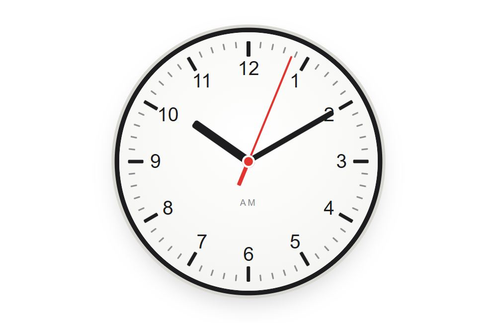</a> <strong><a href="docs/en/categories/animation.md#analog-clock-showing-1010">Analog clock showing 10:10</a></strong> <a href="https://aitestmuseum.com/results/claude-opus-5-5/ai-world-clock/output.html">Play</a> · <a href="https://aitestmuseum.com/zh/tests/ai-world-clock">Source</a></td>
    <td width="33%" valign="top"><a href="https://electricazimuth.github.io/LocalLLM_VisualCodeTest/results/2025.04.28/html/GLM-4-32B-0414-F16-Q4_K_M_aquarium_20250425_171639.html">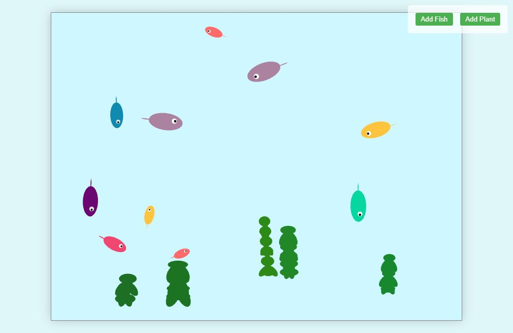</a> <strong><a href="docs/en/categories/animation.md#autonomous-aquarium">Autonomous aquarium</a></strong> <a href="https://github.com/electricazimuth/LocalLLM_VisualCodeTest/blob/7e7004885221fafb8b1de360cacc2b8281cf934a/code_prompts/aquarium.md">Source</a></td>
    <td width="33%" valign="top"><a href="https://electricazimuth.github.io/LocalLLM_VisualCodeTest/results/2025.04.28/html/GLM-4-32B-0414-F16-Q4_K_M_chicken_20250425_172543.html">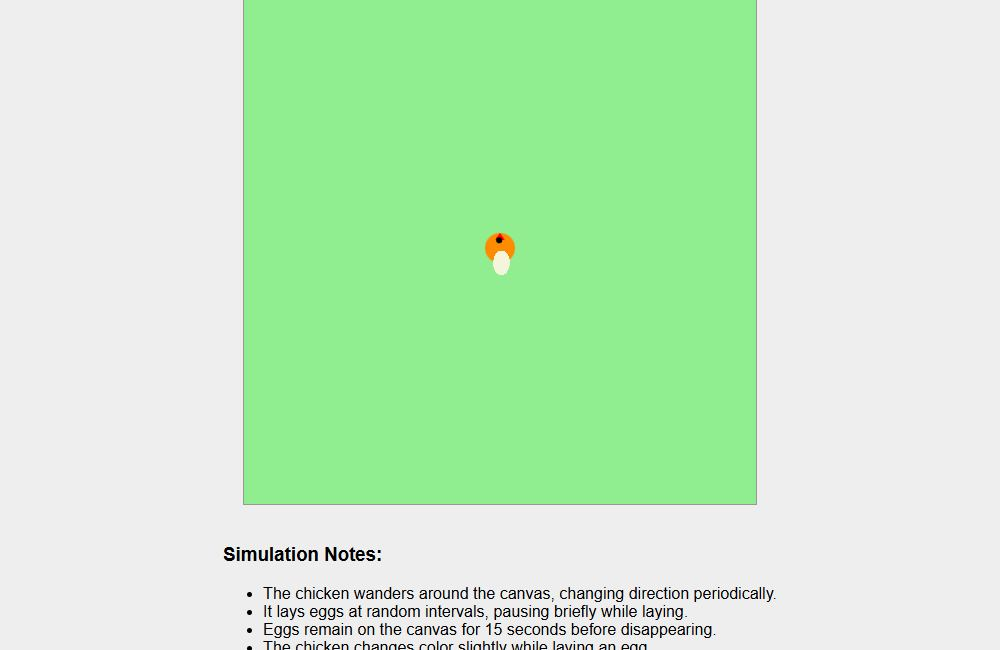</a> <strong><a href="docs/en/categories/animation.md#wandering-and-egg-laying-chicken">Wandering and egg-laying chicken</a></strong> <a href="https://github.com/electricazimuth/LocalLLM_VisualCodeTest/blob/7e7004885221fafb8b1de360cacc2b8281cf934a/code_prompts/chicken.md">Source</a></td>
  </tr>
  <tr>
    <td width="33%" valign="top"><a href="https://electricazimuth.github.io/LocalLLM_VisualCodeTest/results/2025.04.28/html/GLM-4-32B-0414-F16-Q4_K_M_fireworks_20250425_172956.html">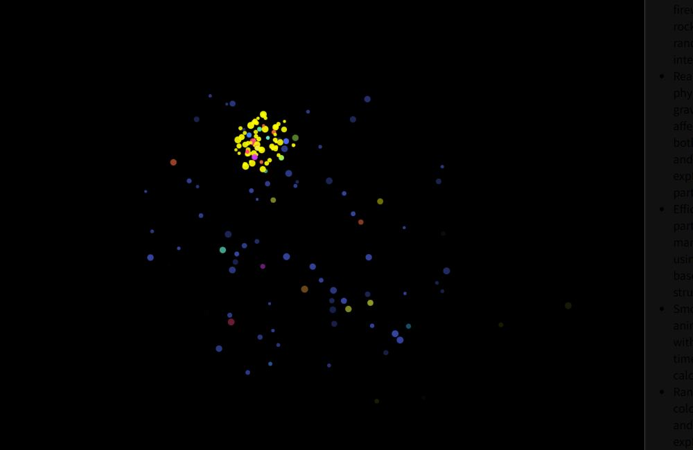</a> <strong><a href="docs/en/categories/animation.md#autonomous-fireworks-particles">Autonomous fireworks particles</a></strong> <a href="https://github.com/electricazimuth/LocalLLM_VisualCodeTest/blob/7e7004885221fafb8b1de360cacc2b8281cf934a/code_prompts/fireworks.md">Source</a></td>
    <td width="33%" valign="top"><a href="https://electricazimuth.github.io/LocalLLM_VisualCodeTest/results/2025.04.28/html/claude37_vehicles_20250425_174000.html">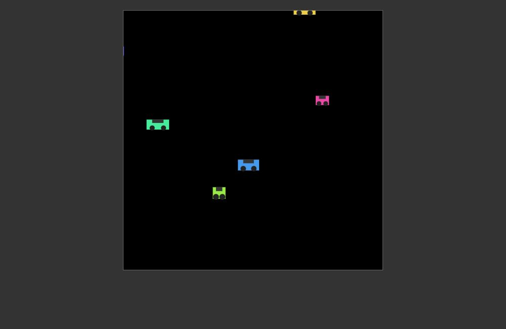</a> <strong><a href="docs/en/categories/animation.md#vehicle-collision-and-restart">Vehicle collision and restart</a></strong> <a href="https://github.com/electricazimuth/LocalLLM_VisualCodeTest/blob/7e7004885221fafb8b1de360cacc2b8281cf934a/code_prompts/vehicles.md">Source</a></td>
    <td width="33%" valign="top"><a href="https://raw.githubusercontent.com/stock42/test-llm-coding/5dd2e8e63f026337ddfa39195d7f1008806bca1d/codex/gpt-5.5/1kg-block-bounces/index.html">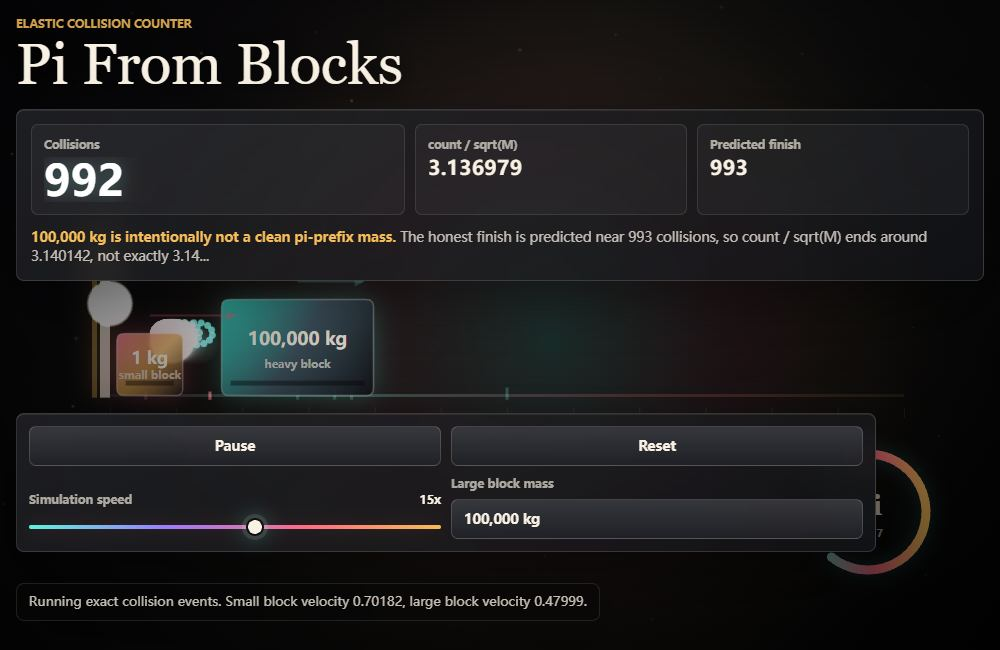</a> <strong><a href="docs/en/categories/animation.md#pi-through-block-collisions">Pi through block collisions</a></strong> <a href="https://github.com/stock42/test-llm-coding/blob/5dd2e8e63f026337ddfa39195d7f1008806bca1d/promptings/1kg-block-bounces.md">Source</a></td>
  </tr>
  <tr>
    <td width="33%" valign="top"><a href="https://raw.githubusercontent.com/stock42/test-llm-coding/5dd2e8e63f026337ddfa39195d7f1008806bca1d/codex/gpt-5.5/balls-fall/index.html">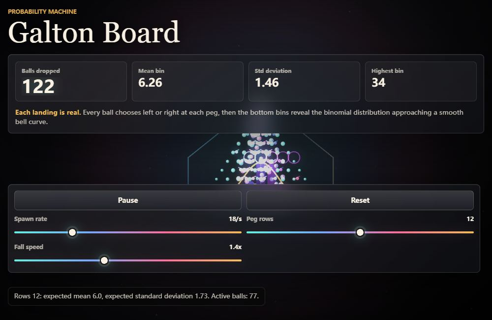</a> <strong><a href="docs/en/categories/animation.md#galton-board-and-bell-curve">Galton board and bell curve</a></strong> <a href="https://github.com/stock42/test-llm-coding/blob/5dd2e8e63f026337ddfa39195d7f1008806bca1d/promptings/balls-fall.md">Source</a></td>
    <td width="33%" valign="top"><a href="https://raw.githubusercontent.com/KCORES/kcores-llm-arena/8f09c63e78189858377a760d03f69fb744b19aa2/benchmark-mandelbrot-set-meet-libai/src/mandelbrot-set-meet-libai-benchmark-Gemini-2.5-Pro-Experimental-03-25-turn-2-high-score.html">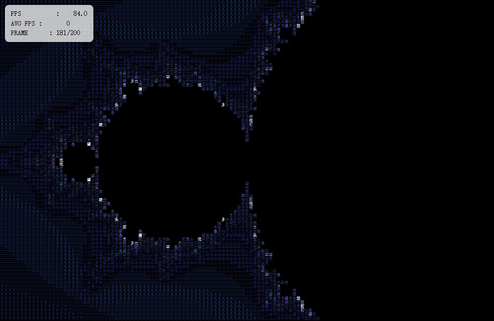</a> <strong><a href="docs/en/categories/animation.md#mandelbrot-fractal-drawn-with-li-bai-characters">Mandelbrot fractal drawn with Li Bai characters</a></strong> <a href="https://github.com/KCORES/kcores-llm-arena/blob/8f09c63e78189858377a760d03f69fb744b19aa2/benchmark-mandelbrot-set-meet-libai/README.md">Source</a></td>
    <td width="33%" valign="top"><a href="https://storage.googleapis.com/gweb-uniblog-publish-prod/original_videos/2_GeminiHacks_Fractal_NoPrompt_16x9.mp4">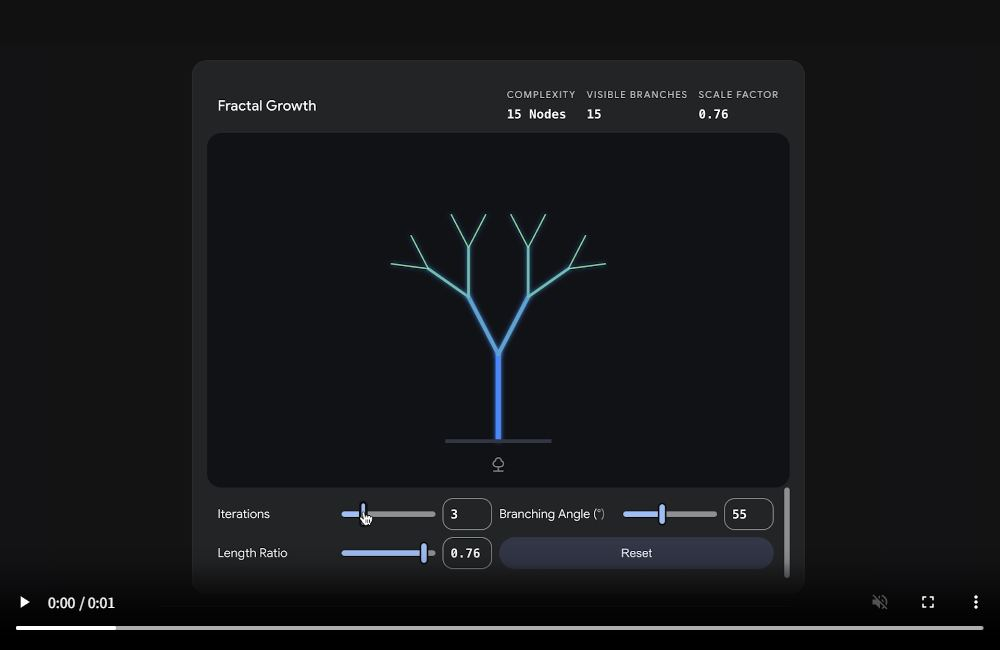</a> <strong><a href="docs/en/categories/animation.md#interactive-fractal-visualization">Interactive fractal visualization</a></strong> <a href="https://blog.google/innovation-and-ai/products/gemini-app/3d-models-charts/">Source</a></td>
  </tr>
  <tr>
    <td width="33%" valign="top"><a href="https://storage.googleapis.com/gweb-uniblog-publish-prod/original_videos/4_GeminiHacks_DoubleSlit_NoPrompt_16x9.mp4">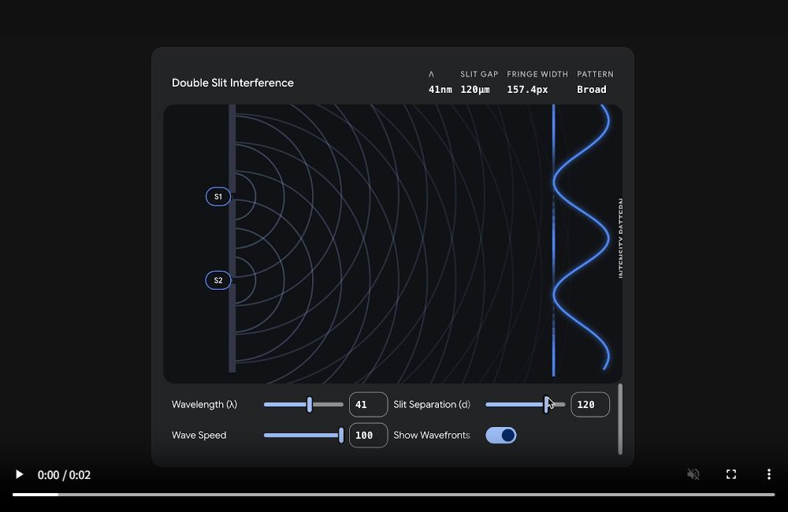</a> <strong><a href="docs/en/categories/animation.md#interactive-double-slit-interference">Interactive double-slit interference</a></strong> <a href="https://blog.google/innovation-and-ai/products/gemini-app/3d-models-charts/">Source</a></td>
    <td width="33%" valign="top"><a href="https://raw.githubusercontent.com/stock42/test-llm-coding/5dd2e8e63f026337ddfa39195d7f1008806bca1d/codex/gpt-5.5/triple-pendulum/index.html">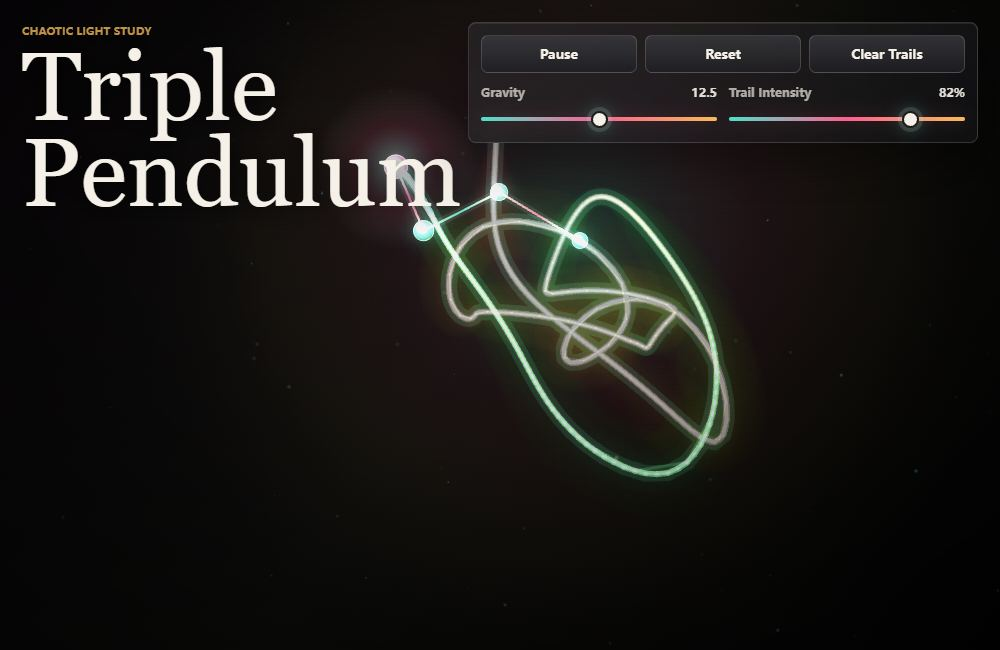</a> <strong><a href="docs/en/COLLECTIONS.md#google-sim-double-pendulum">Chaotic Pendulums</a></strong> <a href="https://github.com/stock42/test-llm-coding/blob/5dd2e8e63f026337ddfa39195d7f1008806bca1d/promptings/triple-pendulum.md">Source</a></td>
    <td width="33%" valign="top"> <strong><a href="docs/en/categories/animation.md#glass-bridge-fracture-and-loading">Glass bridge fracture and loading</a></strong> <a href="https://x.com/EntelligenceAI/status/2075282696008532097">Source</a></td>
  </tr>
  <tr>
    <td width="33%" valign="top"> <strong><a href="docs/en/categories/animation.md#code-film-of-four-seasons-through-a-train-window">Code film of four seasons through a train window</a></strong> <a href="https://x.com/itsolelehmann/status/2103124033365762215">Source</a></td>
    <td width="33%" valign="top"> <strong><a href="docs/en/categories/animation.md#inverse-kinematics-pixel-horse">Inverse-kinematics pixel horse</a></strong> <a href="https://x.com/victormustar/status/2102707412704919910">Source</a></td>
    <td width="33%" valign="top"> <strong><a href="docs/en/categories/animation.md#interactive-steam-morph-stop-motion">Interactive steam-morph stop motion</a></strong> <a href="https://x.com/chetaslua/status/2102501773705670994">Source</a></td>
  </tr>
  <tr>
    <td width="33%" valign="top"><a href="https://video.twimg.com/amplify_video/2102502315185803264/vid/avc1/1080x1080/sAv8kDNKSV7KmtgO.mp4?tag=29">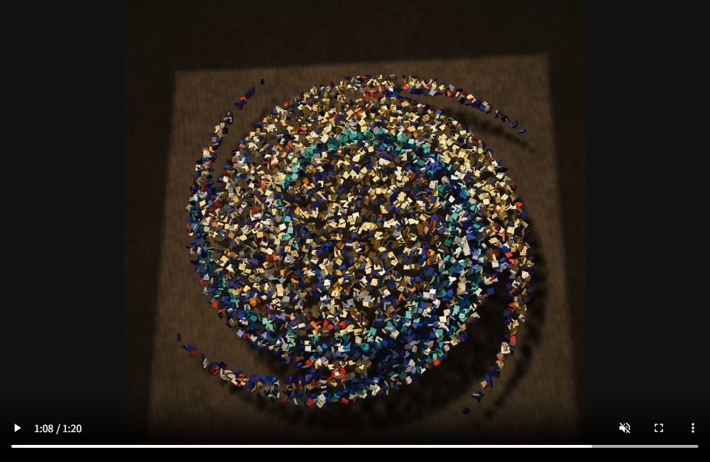</a> <strong><a href="docs/en/categories/animation.md#reassembling-glass-and-gold-mosaic">Reassembling glass-and-gold mosaic</a></strong> <a href="https://x.com/LCSlates/status/2102503027340988559">Source</a></td>
    <td width="33%" valign="top"> <strong><a href="docs/en/categories/animation.md#autonomous-cosmic-pixel-dash">Autonomous cosmic pixel dash</a></strong> <a href="https://x.com/riku720720/status/2102515055116063144">Source</a></td>
    <td width="33%" valign="top"> <strong><a href="docs/en/categories/animation.md#pixel-animation-of-neural-network-training">Pixel animation of neural-network training</a></strong> <a href="https://x.com/DotCSV/status/2102737776219168939">Source</a></td>
  </tr>
  <tr>
    <td width="33%" valign="top"> <strong><a href="docs/en/categories/animation.md#40-second-coded-browser-explainer">40-second coded browser explainer</a></strong> <a href="https://x.com/addyosmani/status/2103009037164110327">Source</a></td>
    <td width="33%" valign="top"> <strong><a href="docs/en/categories/animation.md#blender-claymation-style-animation">Blender claymation-style animation</a></strong> <a href="https://x.com/alexalbert__/status/2102458348511879448">Source</a></td>
    <td width="33%" valign="top"> <strong><a href="docs/en/categories/animation.md#javascript-music-theory-audiovisual">JavaScript music-theory audiovisual</a></strong> <a href="https://x.com/dadabots/status/2103039181266338276">Source</a></td>
  </tr>
</table>

### Apps & Interaction · 9

<table>
  <tr>
    <td width="33%" valign="top"><a href="https://aitestmuseum.com/results/claude-opus-5-5/web-os-desktop/output.html">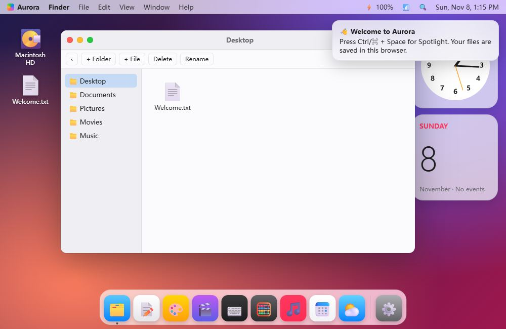</a> <strong><a href="docs/en/categories/applications.md#an-operating-system-in-one-html-file">An operating system in one HTML file</a></strong> <a href="https://aitestmuseum.com/results/claude-opus-5-5/web-os-desktop/output.html">Play</a> · <a href="https://aitestmuseum.com/zh/tests/web-os-desktop">Source</a></td>
    <td width="33%" valign="top"><a href="https://aitestmuseum.com/results/claude-opus-5-5/brick-builder/output.html">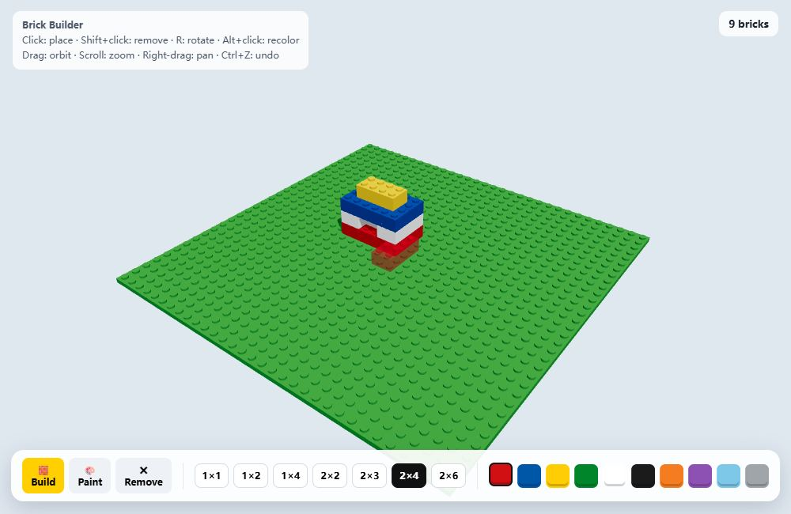</a> <strong><a href="docs/en/categories/applications.md#brick-builder">Brick builder</a></strong> <a href="https://aitestmuseum.com/results/claude-opus-5-5/brick-builder/output.html">Play</a> · <a href="https://aitestmuseum.com/zh/tests/brick-builder">Source</a></td>
    <td width="33%" valign="top"><a href="https://storage.googleapis.com/gweb-uniblog-publish-prod/original_videos/Google_AIS_FSR_CosmicFlow_05_DR.mp4">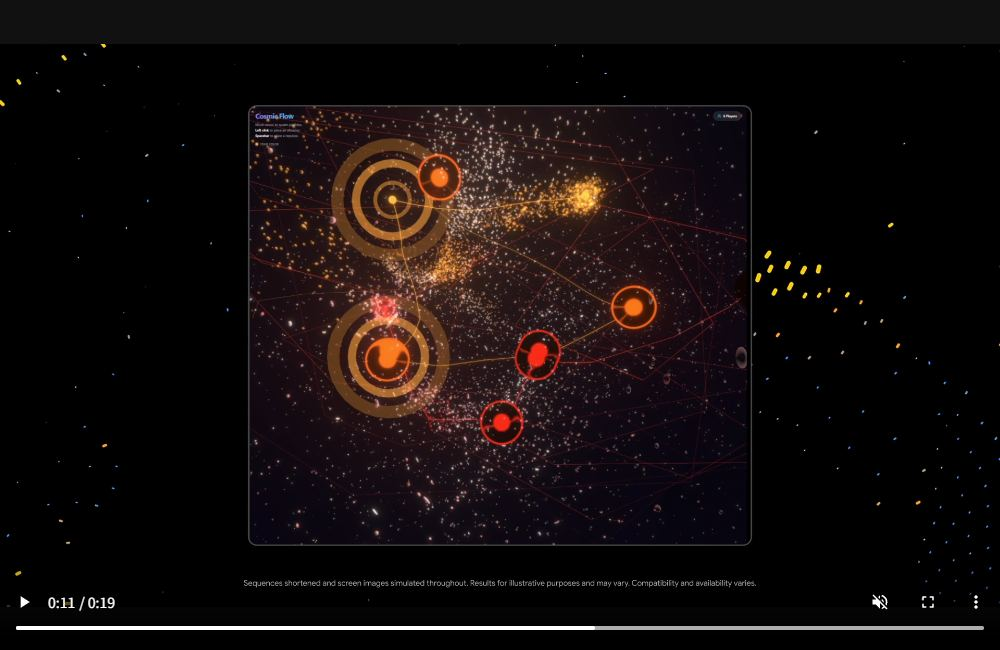</a> <strong><a href="docs/en/categories/applications.md#cosmic-flow-shared-particles">Cosmic Flow shared particles</a></strong> <a href="https://blog.google/innovation-and-ai/technology/developers-tools/full-stack-vibe-coding-google-ai-studio/">Source</a></td>
  </tr>
  <tr>
    <td width="33%" valign="top"><a href="https://storage.googleapis.com/gweb-uniblog-publish-prod/original_videos/Google-AIS-FSR_GeoSeeker_07-DR.mp4">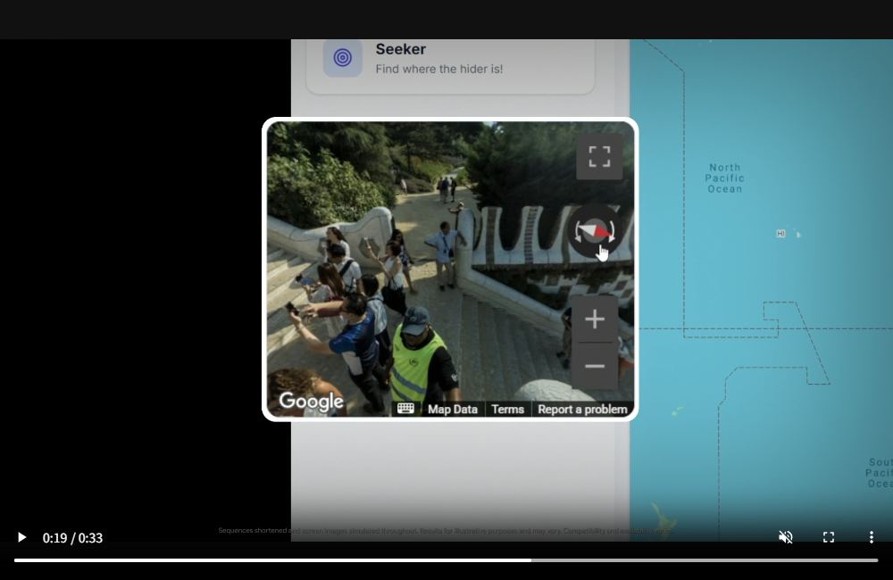</a> <strong><a href="docs/en/categories/applications.md#geoseeker-map-interaction-app">GeoSeeker map interaction app</a></strong> <a href="https://blog.google/innovation-and-ai/technology/developers-tools/full-stack-vibe-coding-google-ai-studio/">Source</a></td>
    <td width="33%" valign="top"> <strong><a href="docs/en/categories/applications.md#heirloom-recipes-collaborative-cookbook">Heirloom Recipes collaborative cookbook</a></strong> <a href="https://blog.google/innovation-and-ai/technology/developers-tools/full-stack-vibe-coding-google-ai-studio/">Source</a></td>
    <td width="33%" valign="top"> <strong><a href="docs/en/categories/applications.md#an-interactive-story-where-you-are-the-model">An interactive story where you are the model</a></strong> <a href="https://chrisjz.github.io/between-tokens/">Play</a> · <a href="https://github.com/chrisjz/between-tokens/blob/93561477667dfc27df77f451e747353a15654f46/assets/screenshot.png">Source</a></td>
  </tr>
  <tr>
    <td width="33%" valign="top"> <strong><a href="docs/en/categories/applications.md#upload-a-photo-and-watch-it-painted">Upload a photo and watch it painted</a></strong> <a href="https://x.com/petergyang/status/2102849349122470205">Source</a></td>
    <td width="33%" valign="top"> <strong><a href="docs/en/categories/applications.md#interactive-focus-and-aperture-lab">Interactive focus and aperture lab</a></strong> <a href="https://x.com/RyanSael/status/2102591147927654847">Source</a></td>
    <td width="33%" valign="top"> <strong><a href="docs/en/categories/applications.md#bedroom-bed-placement-planner">Bedroom bed-placement planner</a></strong> <a href="https://x.com/scheemunai/status/2103059885361598633">Source</a></td>
  </tr>
</table>

### SVG Art · 3

<table>
  <tr>
    <td width="33%" valign="top"> <strong><a href="docs/en/COLLECTIONS.md#svg-001">Odd Creatures and Machines</a></strong> <a href="https://gally.net/temp/20260914pelican-alternatives/index.html#prompt-10">Source</a></td>
    <td width="33%" valign="top"><a href="https://springprompt.com/playground/unicorn">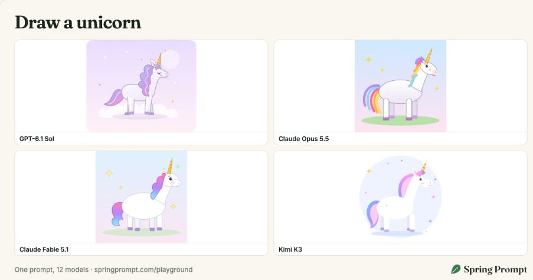</a> <strong><a href="docs/en/categories/svg.md#draw-a-unicorn-in-svg">Draw a unicorn in SVG</a></strong> <a href="https://springprompt.com/playground/unicorn">Source</a></td>
    <td width="33%" valign="top"><a href="https://qwen3-6-27b-benchmark.vercel.app/">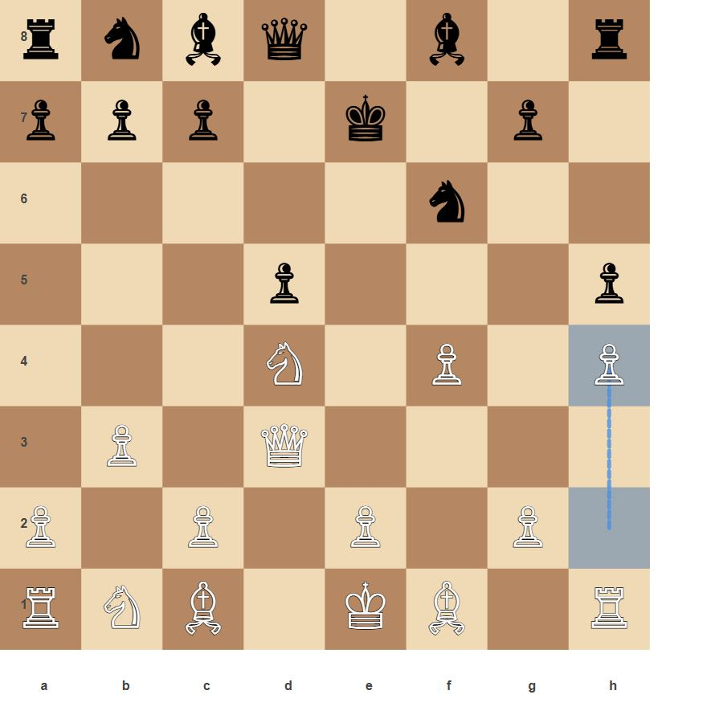</a> <strong><a href="docs/en/categories/svg.md#render-the-final-pgn-position-as-svg">Render the final PGN position as SVG</a></strong> <a href="https://www.reddit.com/r/LocalLLaMA/comments/1t53dhp/quality_comparison_between_qwen_36_27b/">Source</a></td>
  </tr>
</table>

[8 hands-on prompts](docs/en/INDEX.md) · [Historical records](docs/en/HISTORY.md)

## Suggest a work

[Open an Issue](https://github.com/Java4ye/awesome-ai-fun/issues/new/choose) with an original link and a short description. Maintainers check submissions and update the collection. Please use Issues for submissions and corrections.

[Sources](docs/en/SOURCES.md) · [History](docs/en/HISTORY.md) · [Research leads](docs/en/RESEARCH.md) · [Guide](docs/en/GUIDE.md) · [Maintenance](docs/en/MAINTENANCE.md) · [Media credits](docs/en/THIRD_PARTY_MEDIA.md) · [Changelog](docs/en/CHANGELOG.md)

Previews are credited to their sources. Original content and code: [MIT](LICENSE). Third-party media retain their owners’ rights.
