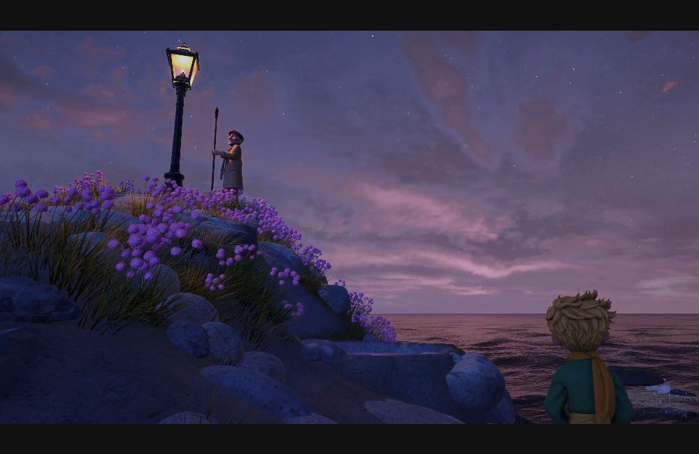
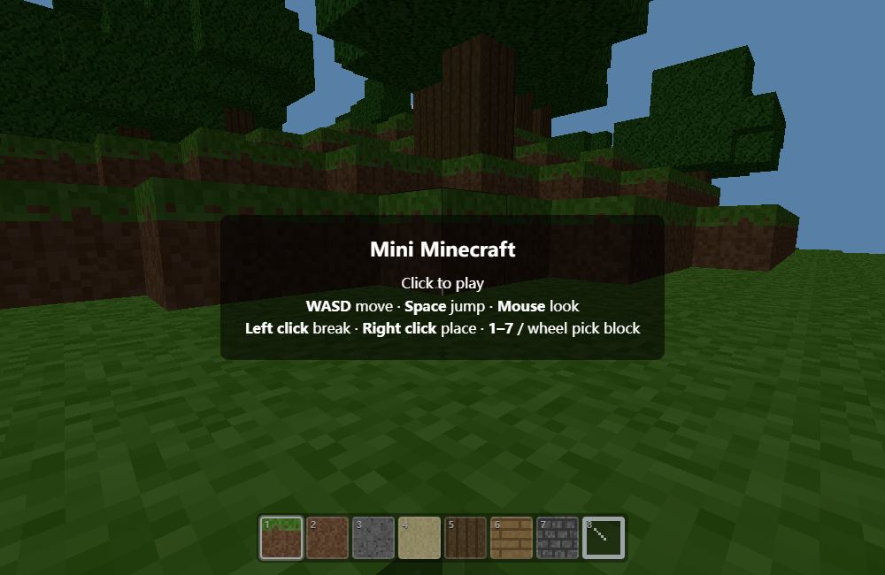
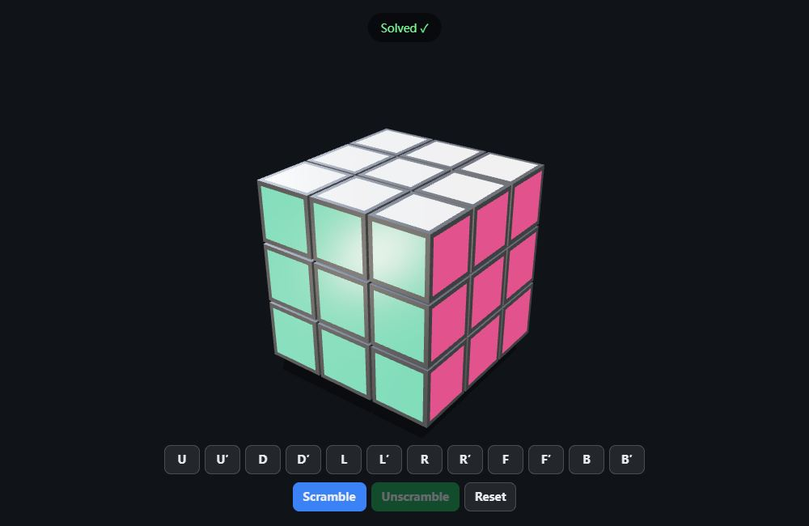
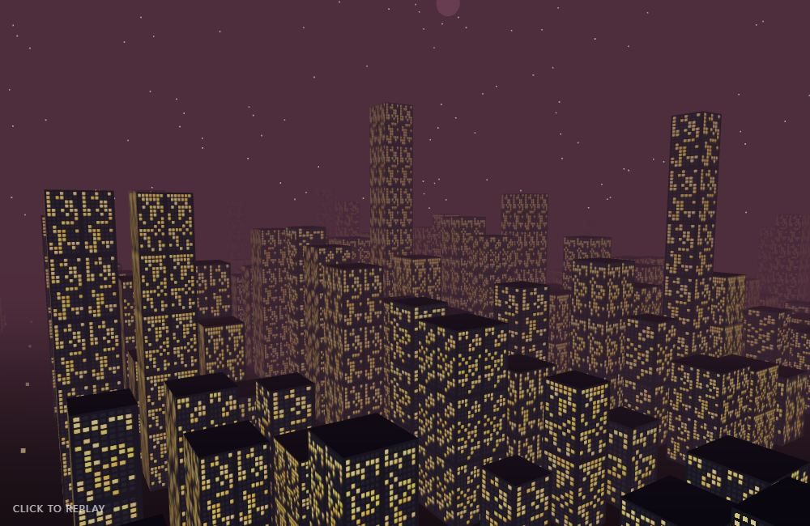
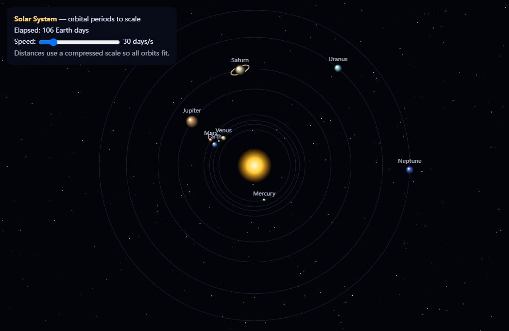
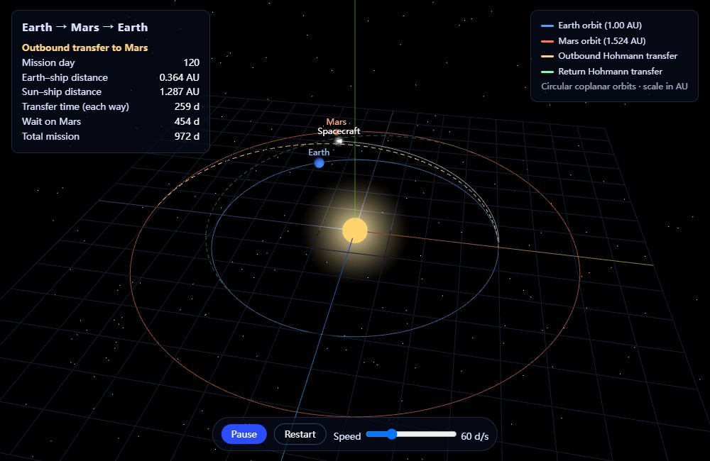
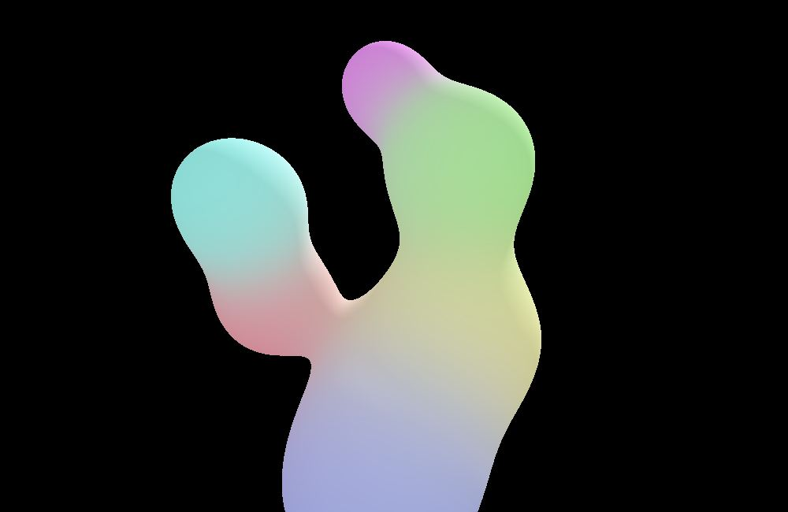
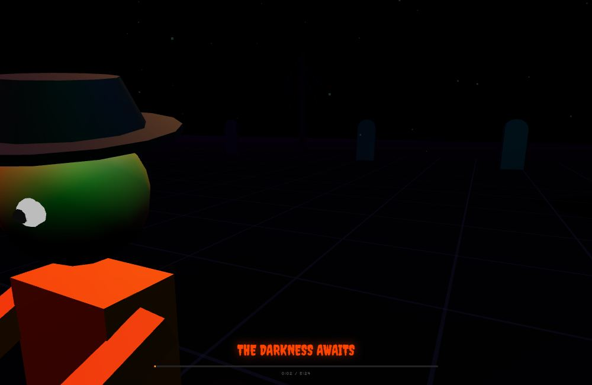
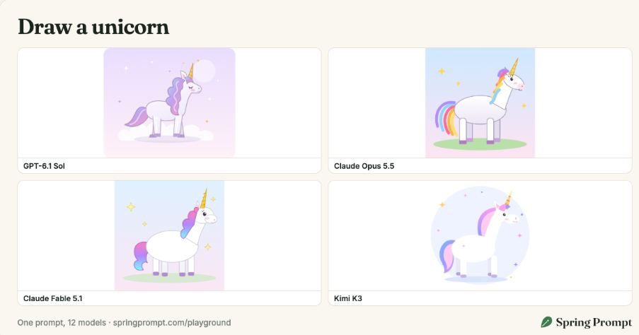
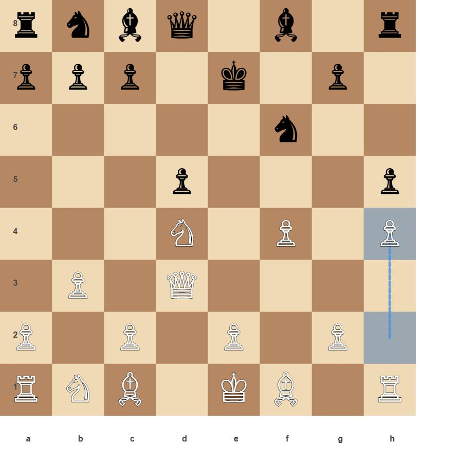

# Awesome AI Fun · 有趣的 AI 作品与玩法合集

**简体中文** | [English](README.md)

> 收集大家用 AI 做出来的好玩作品：能逛的 3D 世界、小游戏、动画，还有各种奇怪的交互点子。
>
> 往下看效果，喜欢就去试玩，或者看看作者是怎么做出来的。

**62 个作品与专题** · [打开作品画廊](https://java4ye.github.io/awesome-ai-fun/site/?lang=zh) · [完整索引](docs/INDEX.md)

## 全部作品

[游戏](#category-games) · [3D 与空间](#category-3d) · [动画与物理](#category-animation) · [应用与交互](#category-applications) · [SVG 绘画](#category-svg)

### 游戏 · 10

<table>
  <tr>
    <td width="33%" valign="top"> <strong><a href="docs/categories/games.md#一次写出卡丁车游戏">一次写出卡丁车游戏</a></strong> <a href="https://aitestmuseum.com/results/claude-opus-5-5/kart-racer/output.html">试玩</a> · <a href="https://aitestmuseum.com/zh/tests/kart-racer">原出处</a></td>
    <td width="33%" valign="top"> <strong><a href="docs/categories/games.md#一个文件写出-flappy-bird">一个文件写出 Flappy Bird</a></strong> <a href="https://aitestmuseum.com/results/claude-opus-5-5/flappy-bird/output.html">试玩</a> · <a href="https://aitestmuseum.com/zh/tests/flappy-bird">原出处</a></td>
    <td width="33%" valign="top"> <strong><a href="docs/COLLECTIONS.md#museum-010">俄罗斯方块</a></strong> <a href="https://aitestmuseum.com/results/claude-opus-5-5/tetris/output.html">试玩</a> · <a href="https://aitestmuseum.com/zh/tests/tetris">原出处</a></td>
  </tr>
  <tr>
    <td width="33%" valign="top"> <strong><a href="docs/categories/games.md#摩天楼间的-3d-飞行游戏">摩天楼间的 3D 飞行游戏</a></strong> <a href="https://aitestmuseum.com/results/claude-opus-5-5/flight-sim/output.html">试玩</a> · <a href="https://aitestmuseum.com/zh/tests/flight-sim">原出处</a></td>
    <td width="33%" valign="top"> <strong><a href="docs/categories/games.md#neon-arena-多人激光对战">Neon Arena 多人激光对战</a></strong> <a href="https://blog.google/innovation-and-ai/technology/developers-tools/full-stack-vibe-coding-google-ai-studio/">原出处</a></td>
    <td width="33%" valign="top"> <strong><a href="docs/categories/games.md#neon-claw-物理抓娃娃机">Neon Claw 物理抓娃娃机</a></strong> <a href="https://blog.google/innovation-and-ai/technology/developers-tools/full-stack-vibe-coding-google-ai-studio/">原出处</a></td>
  </tr>
  <tr>
    <td width="33%" valign="top"> <strong><a href="docs/categories/games.md#海岸钓鱼与买卖升级游戏">海岸钓鱼与买卖升级游戏</a></strong> <a href="https://dgreenheck.github.io/tidewater/">试玩</a> · <a href="https://github.com/dgreenheck/tidewater/blob/4811ba48d795197de5621985f404e765c0b7c0ef/docs/screenshot.jpg">原出处</a></td>
    <td width="33%" valign="top"> <strong><a href="docs/categories/games.md#鱼叉捕鱼小游戏">鱼叉捕鱼小游戏</a></strong> <a href="https://x.com/nachat_dayo/status/2102773498037023140">原出处</a></td>
    <td width="33%" valign="top"> <strong><a href="docs/categories/games.md#种花养蜂与采蜜游戏">种花养蜂与采蜜游戏</a></strong> <a href="https://x.com/oguzthedev/status/2102476490344730950">原出处</a></td>
  </tr>
  <tr>
    <td width="33%" valign="top"> <strong><a href="docs/categories/games.md#小王子星辰之旅">小王子：星辰之旅</a></strong> <a href="https://littleprince.dev/">试玩</a> · <a href="https://x.com/Saccc_c/status/2109962425512734739">原出处</a></td>
    <td></td>
    <td></td>
  </tr>
</table>

### 3D 与空间 · 13

<table>
  <tr>
    <td width="33%" valign="top"> <strong><a href="docs/categories/3d.md#体素宝塔花园">体素宝塔花园</a></strong> <a href="https://aitestmuseum.com/results/claude-opus-5-5/voxel-pagoda/output.html">试玩</a> · <a href="https://aitestmuseum.com/zh/tests/voxel-pagoda">原出处</a></td>
    <td width="33%" valign="top"> <strong><a href="docs/categories/3d.md#threejs-版-minecraft">three.js 版 Minecraft</a></strong> <a href="https://aitestmuseum.com/results/claude-opus-5-5/minecraft-web/output.html">试玩</a> · <a href="https://aitestmuseum.com/zh/tests/minecraft-web">原出处</a></td>
    <td width="33%" valign="top"> <strong><a href="docs/categories/3d.md#会自己还原的魔方">会自己还原的魔方</a></strong> <a href="https://aitestmuseum.com/results/claude-opus-5-5/rubiks-cube/output.html">试玩</a> · <a href="https://aitestmuseum.com/zh/tests/rubiks-cube">原出处</a></td>
  </tr>
  <tr>
    <td width="33%" valign="top"> <strong><a href="docs/categories/3d.md#陨石撞击城市">陨石撞击城市</a></strong> <a href="https://aitestmuseum.com/results/claude-opus-5-5/meteor-city/output.html">试玩</a> · <a href="https://aitestmuseum.com/zh/tests/meteor-city">原出处</a></td>
    <td width="33%" valign="top"> <strong><a href="docs/categories/3d.md#太阳系模拟">太阳系模拟</a></strong> <a href="https://aitestmuseum.com/results/claude-opus-5-5/solar-system/output.html">试玩</a> · <a href="https://aitestmuseum.com/zh/tests/solar-system">原出处</a></td>
    <td width="33%" valign="top"> <strong><a href="docs/categories/3d.md#地球到火星往返">地球到火星往返</a></strong> <a href="https://aitestmuseum.com/results/claude-opus-5-5/mars-round-trip/output.html">试玩</a> · <a href="https://aitestmuseum.com/zh/tests/mars-round-trip">原出处</a></td>
  </tr>
  <tr>
    <td width="33%" valign="top"> <strong><a href="docs/categories/3d.md#光线步进迷幻融合球">光线步进迷幻融合球</a></strong> <a href="https://github.com/electricazimuth/LocalLLM_VisualCodeTest/blob/7e7004885221fafb8b1de360cacc2b8281cf934a/code_prompts/lightshow.md">原出处</a></td>
    <td width="33%" valign="top"> <strong><a href="docs/categories/3d.md#多人角色同步舞蹈-threejs-场景">多人角色同步舞蹈 Three.js 场景</a></strong> <a href="https://www.reddit.com/r/LocalLLaMA/comments/1rqlaw4/new_benchmark_just_dropped/">原出处</a></td>
    <td width="33%" valign="top"> <strong><a href="docs/categories/3d.md#可循文探索的桃花源记">可循文探索的桃花源记</a></strong> <a href="https://s.baoyu.io/files/taohuayuan/index.html">试玩</a> · <a href="https://x.com/dotey/status/2102940980379017293">原出处</a></td>
  </tr>
  <tr>
    <td width="33%" valign="top"> <strong><a href="docs/categories/3d.md#从照片重建卡通秋日铁路">从照片重建卡通秋日铁路</a></strong> <a href="https://x.com/ishuagra02/status/2102543638689460488">原出处</a></td>
    <td width="33%" valign="top"> <strong><a href="docs/categories/3d.md#从加速器隧道到质子碰撞">从加速器隧道到质子碰撞</a></strong> <a href="https://x.com/superalesha/status/2102779758408774104">原出处</a></td>
    <td width="33%" valign="top"> <strong><a href="docs/categories/3d.md#从线稿逐步长成三维房屋">从线稿逐步长成三维房屋</a></strong> <a href="https://x.com/techartist_/status/2102503719762018434">原出处</a></td>
  </tr>
  <tr>
    <td width="33%" valign="top"> <strong><a href="docs/categories/3d.md#可输入词语探索的柔彩村庄">可输入词语探索的柔彩村庄</a></strong> <a href="https://powapowa.pages.dev/">试玩</a> · <a href="https://x.com/studio_veco/status/2102684366996738511">原出处</a></td>
    <td></td>
    <td></td>
  </tr>
</table>

### 动画与物理 · 27

<table>
  <tr>
    <td width="33%" valign="top"> <strong><a href="docs/COLLECTIONS.md#museum-001">鹈鹕骑自行车</a></strong> <a href="https://aitestmuseum.com/results/claude-opus-5-5/pelican-bicycle/output.html">试玩</a> · <a href="https://aitestmuseum.com/zh/tests/pelican-bicycle">原出处</a></td>
    <td width="33%" valign="top"> <strong><a href="docs/COLLECTIONS.md#museum-002">弹球与碰撞</a></strong> <a href="https://aitestmuseum.com/results/claude-opus-5-5/bouncing-ball-hexagon/output.html">试玩</a> · <a href="https://aitestmuseum.com/zh/tests/bouncing-ball-hexagon">原出处</a></td>
    <td width="33%" valign="top"> <strong><a href="docs/categories/animation.md#超新星爆发">超新星爆发</a></strong> <a href="https://aitestmuseum.com/results/claude-opus-5-5/supernova/output.html">试玩</a> · <a href="https://aitestmuseum.com/zh/tests/supernova">原出处</a></td>
  </tr>
  <tr>
    <td width="33%" valign="top"> <strong><a href="docs/categories/animation.md#沉没的哥特城市着色器">沉没的哥特城市着色器</a></strong> <a href="https://aitestmuseum.com/results/claude-opus-5-5/drowned-gothic-city/output.html">试玩</a> · <a href="https://aitestmuseum.com/zh/tests/drowned-gothic-city">原出处</a></td>
    <td width="33%" valign="top"> <strong><a href="docs/categories/animation.md#用双手控制的粒子">用双手控制的粒子</a></strong> <a href="https://aitestmuseum.com/results/claude-opus-5-5/hand-gesture-particles/output.html">试玩</a> · <a href="https://aitestmuseum.com/zh/tests/hand-gesture-particles">原出处</a></td>
    <td width="33%" valign="top"> <strong><a href="docs/categories/animation.md#星舰控制台">星舰控制台</a></strong> <a href="https://aitestmuseum.com/results/claude-opus-5-5/starship-control-panel/output.html">试玩</a> · <a href="https://aitestmuseum.com/zh/tests/starship-control-panel">原出处</a></td>
  </tr>
  <tr>
    <td width="33%" valign="top"> <strong><a href="docs/categories/animation.md#指向-1010-的指针时钟">指向 10:10 的指针时钟</a></strong> <a href="https://aitestmuseum.com/results/claude-opus-5-5/ai-world-clock/output.html">试玩</a> · <a href="https://aitestmuseum.com/zh/tests/ai-world-clock">原出处</a></td>
    <td width="33%" valign="top"> <strong><a href="docs/categories/animation.md#自主游动的水族箱">自主游动的水族箱</a></strong> <a href="https://github.com/electricazimuth/LocalLLM_VisualCodeTest/blob/7e7004885221fafb8b1de360cacc2b8281cf934a/code_prompts/aquarium.md">原出处</a></td>
    <td width="33%" valign="top"> <strong><a href="docs/categories/animation.md#会散步和下蛋的母鸡">会散步和下蛋的母鸡</a></strong> <a href="https://github.com/electricazimuth/LocalLLM_VisualCodeTest/blob/7e7004885221fafb8b1de360cacc2b8281cf934a/code_prompts/chicken.md">原出处</a></td>
  </tr>
  <tr>
    <td width="33%" valign="top"> <strong><a href="docs/categories/animation.md#自动发射的烟花粒子">自动发射的烟花粒子</a></strong> <a href="https://github.com/electricazimuth/LocalLLM_VisualCodeTest/blob/7e7004885221fafb8b1de360cacc2b8281cf934a/code_prompts/fireworks.md">原出处</a></td>
    <td width="33%" valign="top"> <strong><a href="docs/categories/animation.md#车辆碰撞爆炸与重新开始">车辆碰撞爆炸与重新开始</a></strong> <a href="https://github.com/electricazimuth/LocalLLM_VisualCodeTest/blob/7e7004885221fafb8b1de360cacc2b8281cf934a/code_prompts/vehicles.md">原出处</a></td>
    <td width="33%" valign="top"> <strong><a href="docs/categories/animation.md#用方块碰撞次数观察-π">用方块碰撞次数观察 π</a></strong> <a href="https://github.com/stock42/test-llm-coding/blob/5dd2e8e63f026337ddfa39195d7f1008806bca1d/promptings/1kg-block-bounces.md">原出处</a></td>
  </tr>
  <tr>
    <td width="33%" valign="top"> <strong><a href="docs/categories/animation.md#高尔顿板与钟形分布">高尔顿板与钟形分布</a></strong> <a href="https://github.com/stock42/test-llm-coding/blob/5dd2e8e63f026337ddfa39195d7f1008806bca1d/promptings/balls-fall.md">原出处</a></td>
    <td width="33%" valign="top"> <strong><a href="docs/categories/animation.md#李白诗句绘制-mandelbrot-分形">李白诗句绘制 Mandelbrot 分形</a></strong> <a href="https://github.com/KCORES/kcores-llm-arena/blob/8f09c63e78189858377a760d03f69fb744b19aa2/benchmark-mandelbrot-set-meet-libai/README.md">原出处</a></td>
    <td width="33%" valign="top"> <strong><a href="docs/categories/animation.md#交互式分形可视化">交互式分形可视化</a></strong> <a href="https://blog.google/innovation-and-ai/products/gemini-app/3d-models-charts/">原出处</a></td>
  </tr>
  <tr>
    <td width="33%" valign="top"> <strong><a href="docs/categories/animation.md#双缝干涉交互演示">双缝干涉交互演示</a></strong> <a href="https://blog.google/innovation-and-ai/products/gemini-app/3d-models-charts/">原出处</a></td>
    <td width="33%" valign="top"> <strong><a href="docs/COLLECTIONS.md#google-sim-double-pendulum">混沌摆</a></strong> <a href="https://github.com/stock42/test-llm-coding/blob/5dd2e8e63f026337ddfa39195d7f1008806bca1d/promptings/triple-pendulum.md">原出处</a></td>
    <td width="33%" valign="top"> <strong><a href="docs/categories/animation.md#玻璃桥破裂与受力演示">玻璃桥破裂与受力演示</a></strong> <a href="https://x.com/EntelligenceAI/status/2075282696008532097">原出处</a></td>
  </tr>
  <tr>
    <td width="33%" valign="top"> <strong><a href="docs/categories/animation.md#列车窗外四季变换的代码短片">列车窗外四季变换的代码短片</a></strong> <a href="https://x.com/itsolelehmann/status/2103124033365762215">原出处</a></td>
    <td width="33%" valign="top"> <strong><a href="docs/categories/animation.md#逆运动学像素奔马">逆运动学像素奔马</a></strong> <a href="https://x.com/victormustar/status/2102707412704919910">原出处</a></td>
    <td width="33%" valign="top"> <strong><a href="docs/categories/animation.md#蒸汽变形的交互定格动画">蒸汽变形的交互定格动画</a></strong> <a href="https://x.com/chetaslua/status/2102501773705670994">原出处</a></td>
  </tr>
  <tr>
    <td width="33%" valign="top"> <strong><a href="docs/categories/animation.md#会翻转重组的玻璃金箔马赛克">会翻转重组的玻璃金箔马赛克</a></strong> <a href="https://x.com/LCSlates/status/2102503027340988559">原出处</a></td>
    <td width="33%" valign="top"> <strong><a href="docs/categories/animation.md#自动闪避的宇宙像素冲刺">自动闪避的宇宙像素冲刺</a></strong> <a href="https://x.com/riku720720/status/2102515055116063144">原出处</a></td>
    <td width="33%" valign="top"> <strong><a href="docs/categories/animation.md#像素动画解释神经网络训练">像素动画解释神经网络训练</a></strong> <a href="https://x.com/DotCSV/status/2102737776219168939">原出处</a></td>
  </tr>
  <tr>
    <td width="33%" valign="top"> <strong><a href="docs/categories/animation.md#40-秒代码动画解释浏览器">40 秒代码动画解释浏览器</a></strong> <a href="https://x.com/addyosmani/status/2103009037164110327">原出处</a></td>
    <td width="33%" valign="top"> <strong><a href="docs/categories/animation.md#用-blender-制作黏土风动画">用 Blender 制作黏土风动画</a></strong> <a href="https://x.com/alexalbert__/status/2102458348511879448">原出处</a></td>
    <td width="33%" valign="top"> <strong><a href="docs/categories/animation.md#纯-javascript-乐理视听实验">纯 JavaScript 乐理视听实验</a></strong> <a href="https://x.com/dadabots/status/2103039181266338276">原出处</a></td>
  </tr>
</table>

### 应用与交互 · 9

<table>
  <tr>
    <td width="33%" valign="top"> <strong><a href="docs/categories/applications.md#一个-html-文件里的操作系统">一个 HTML 文件里的操作系统</a></strong> <a href="https://aitestmuseum.com/results/claude-opus-5-5/web-os-desktop/output.html">试玩</a> · <a href="https://aitestmuseum.com/zh/tests/web-os-desktop">原出处</a></td>
    <td width="33%" valign="top"> <strong><a href="docs/categories/applications.md#积木搭建器">积木搭建器</a></strong> <a href="https://aitestmuseum.com/results/claude-opus-5-5/brick-builder/output.html">试玩</a> · <a href="https://aitestmuseum.com/zh/tests/brick-builder">原出处</a></td>
    <td width="33%" valign="top"> <strong><a href="docs/categories/applications.md#cosmic-flow-多人共享粒子">Cosmic Flow 多人共享粒子</a></strong> <a href="https://blog.google/innovation-and-ai/technology/developers-tools/full-stack-vibe-coding-google-ai-studio/">原出处</a></td>
  </tr>
  <tr>
    <td width="33%" valign="top"> <strong><a href="docs/categories/applications.md#geoseeker-地图交互应用">GeoSeeker 地图交互应用</a></strong> <a href="https://blog.google/innovation-and-ai/technology/developers-tools/full-stack-vibe-coding-google-ai-studio/">原出处</a></td>
    <td width="33%" valign="top"> <strong><a href="docs/categories/applications.md#heirloom-recipes-家庭协作食谱">Heirloom Recipes 家庭协作食谱</a></strong> <a href="https://blog.google/innovation-and-ai/technology/developers-tools/full-stack-vibe-coding-google-ai-studio/">原出处</a></td>
    <td width="33%" valign="top"> <strong><a href="docs/categories/applications.md#扮演语言模型的交互叙事">扮演语言模型的交互叙事</a></strong> <a href="https://chrisjz.github.io/between-tokens/">试玩</a> · <a href="https://github.com/chrisjz/between-tokens/blob/93561477667dfc27df77f451e747353a15654f46/assets/screenshot.png">原出处</a></td>
  </tr>
  <tr>
    <td width="33%" valign="top"> <strong><a href="docs/categories/applications.md#上传照片观看逐笔绘画">上传照片观看逐笔绘画</a></strong> <a href="https://x.com/petergyang/status/2102849349122470205">原出处</a></td>
    <td width="33%" valign="top"> <strong><a href="docs/categories/applications.md#可调焦距与光圈的镜头实验室">可调焦距与光圈的镜头实验室</a></strong> <a href="https://x.com/RyanSael/status/2102591147927654847">原出处</a></td>
    <td width="33%" valign="top"> <strong><a href="docs/categories/applications.md#卧室新床摆放规划器">卧室新床摆放规划器</a></strong> <a href="https://x.com/scheemunai/status/2103059885361598633">原出处</a></td>
  </tr>
</table>

### SVG 绘画 · 3

<table>
  <tr>
    <td width="33%" valign="top"> <strong><a href="docs/COLLECTIONS.md#svg-001">奇怪生物与机械</a></strong> <a href="https://gally.net/temp/20260914pelican-alternatives/index.html#prompt-10">原出处</a></td>
    <td width="33%" valign="top"> <strong><a href="docs/categories/svg.md#用-svg-画独角兽">用 SVG 画独角兽</a></strong> <a href="https://springprompt.com/playground/unicorn">原出处</a></td>
    <td width="33%" valign="top"> <strong><a href="docs/categories/svg.md#从-pgn-棋谱推演并绘制-svg-棋盘">从 PGN 棋谱推演并绘制 SVG 棋盘</a></strong> <a href="https://www.reddit.com/r/LocalLLaMA/comments/1t53dhp/quality_comparison_between_qwen_36_27b/">原出处</a></td>
  </tr>
</table>

[8 道动手题](docs/INDEX.md) · [历史记录](docs/HISTORY.md)

## 推荐作品

欢迎[提交 Issue](https://github.com/Java4ye/awesome-ai-fun/issues/new/choose)，附上原始链接和一句话介绍。维护者核对后统一收录；投稿和更正都走 Issue。

[来源导航](docs/SOURCES.md) · [历史档案](docs/HISTORY.md) · [社区线索](docs/RESEARCH.md) · [使用指南](docs/GUIDE.md) · [维护说明](docs/MAINTENANCE.md) · [素材署名](docs/THIRD_PARTY_MEDIA.md) · [更新日志](docs/CHANGELOG.md)

效果预览附原始出处。仓库原创内容与代码采用 [MIT](LICENSE)，第三方素材的权利归原权利人。
