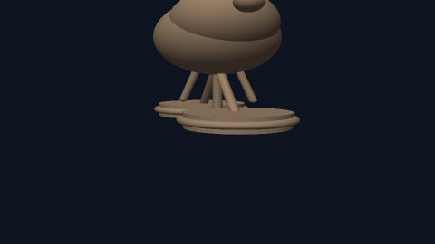
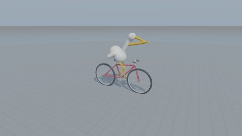
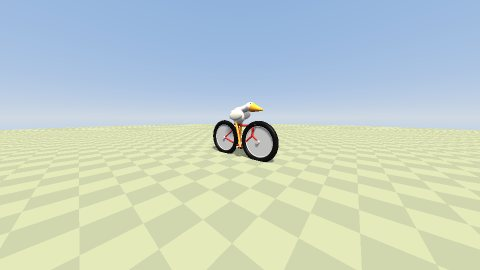

# 3D 与空间

**简体中文** | [English](../en/categories/3d.md)

> 把空间关系做正确 · 共 **16 道**

[← 返回首页](../../README.md) · [全部案例](../INDEX.md)

> 下文简介和观察点为本库整理，不是原始提示词或官方评分规则。

## 光线步进迷幻融合球

**编号**：`electricazimuth-lightshow` · **收录来源**：[David Harris / LocalLLM Visual Code Test](https://github.com/electricazimuth/LocalLLM_VisualCodeTest/blob/7e7004885221fafb8b1de360cacc2b8281cf934a/code_prompts/lightshow.md)（本库来源组内序号 5）

**英文标题**：Ray-marched psychedelic metaballs

使用 WebGL 和 SDF 表现移动球体的平滑融合。

**原站署名 / 来源线索**：David Harris / LocalLLM Visual Code Test

**题面情况**：公开题面

**可以观察什么？**

- 是否真的使用距离场和光线步进
- 融合与表面光照是否连续

**标签**：`三维场景`, `来源整理`

**提示词与作品**：[前往原站查看](https://github.com/electricazimuth/LocalLLM_VisualCodeTest/blob/7e7004885221fafb8b1de360cacc2b8281cf934a/code_prompts/lightshow.md) · **本库测试情况**：未实测

### 历史效果

**GLM-4-32B-0414-F16-Q4_K_M** · 2025-04-25 · David Harris / electricazimuth

[查看效果 / 体验](https://electricazimuth.github.io/LocalLLM_VisualCodeTest/results/2025.04.28/html/GLM-4-32B-0414-F16-Q4_K_M_lightshow_20250425_174301.html) · [来源记录](https://github.com/electricazimuth/LocalLLM_VisualCodeTest/blob/7e7004885221fafb8b1de360cacc2b8281cf934a/code_prompts/lightshow.md) · [测试背景](https://azimuth.substack.com/p/local-llm-visual-benchmark)

来源方发布的输出，未在本库运行；题面、模型名称和条件以原站为准。

---

## 体素宝塔花园

**编号**：`museum-003` · **收录来源**：[AI 考题博物馆](https://aitestmuseum.com/zh/tests/voxel-pagoda)（本库来源组内序号 3）

**英文标题**：Voxel pagoda garden

只靠文字构建带樱花树的彩色体素宝塔花园。

**原站署名 / 来源线索**：Google AI

**可以观察什么？**

- 体素的层次与构图是否清楚
- 场景能否在浏览器加载
- 能按题目要求运行或交互，不以截图代替验收

**标签**：`3D`, `审美`

**提示词与作品**：[前往原站查看](https://aitestmuseum.com/zh/tests/voxel-pagoda) · **本库测试情况**：未实测

### 历史效果

**Claude Opus 5.5** · 2026-10-19 · AI Test Museum

[查看效果 / 体验](https://aitestmuseum.com/results/claude-opus-5-5/voxel-pagoda/output.html) · [来源记录](https://aitestmuseum.com/zh/tests/voxel-pagoda) · [测试背景](https://aitestmuseum.com/zh#methodology)

原站 Claude Code agent 环境，包含其系统提示词；不等同裸 API。原站说明失败题可能重答，不将页面展示视作统一的一次成功记录。

---

## three.js 版 Minecraft

**编号**：`museum-004` · **收录来源**：[AI 考题博物馆](https://aitestmuseum.com/zh/tests/minecraft-web)（本库来源组内序号 4）

**英文标题**：Minecraft in three.js

尝试一次性生成带方块世界的浏览器 Minecraft 简化版。

**原站署名 / 来源线索**：Greg Brockman

**可以观察什么？**

- 移动、碰撞、放置及拆除方块是否可用
- 地形与贴图是否正常显示
- 能按题目要求运行或交互，不以截图代替验收

**标签**：`3D`, `世界生成`

**提示词与作品**：[前往原站查看](https://aitestmuseum.com/zh/tests/minecraft-web) · **本库测试情况**：未实测

### 历史效果

**Claude Opus 5.5** · 2026-10-19 · AI Test Museum

[查看效果 / 体验](https://aitestmuseum.com/results/claude-opus-5-5/minecraft-web/output.html) · [来源记录](https://aitestmuseum.com/zh/tests/minecraft-web) · [测试背景](https://aitestmuseum.com/zh#methodology)

原站 Claude Code agent 环境，包含其系统提示词；不等同裸 API。原站说明失败题可能重答，不将页面展示视作统一的一次成功记录。

---

## 会自己还原的魔方

**编号**：`museum-005` · **收录来源**：[AI 考题博物馆](https://aitestmuseum.com/zh/tests/rubiks-cube)（本库来源组内序号 5）

**英文标题**：Self-solving Rubik's cube

在 3D 页面实现可打乱、逐步旋转和自动还原的魔方。

**原站署名 / 来源线索**：@nobody_qwert

**可以观察什么？**

- 多次操作后色块位置是否保持正确
- 打乱后能否按记录逆向还原
- 能按题目要求运行或交互，不以截图代替验收

**标签**：`3D`, `状态管理`

**提示词与作品**：[前往原站查看](https://aitestmuseum.com/zh/tests/rubiks-cube) · **本库测试情况**：未实测

### 历史效果

**Claude Opus 5.5** · 2026-10-19 · AI Test Museum

[查看效果 / 体验](https://aitestmuseum.com/results/claude-opus-5-5/rubiks-cube/output.html) · [来源记录](https://aitestmuseum.com/zh/tests/rubiks-cube) · [测试背景](https://aitestmuseum.com/zh#methodology)

原站 Claude Code agent 环境，包含其系统提示词；不等同裸 API。原站说明失败题可能重答，不将页面展示视作统一的一次成功记录。

---

## 陨石撞击城市

**编号**：`museum-007` · **收录来源**：[AI 考题博物馆](https://aitestmuseum.com/zh/tests/meteor-city)（本库来源组内序号 7）

**英文标题**：Meteor hitting a city

生成包含陨石坠落、冲击波和城市变化的浏览器演示。

**原站署名 / 来源线索**：AI/ML API 模型对比

**可以观察什么？**

- 冲击事件先后顺序是否连贯
- 城市建筑与特效是否可辨
- 能按题目要求运行或交互，不以截图代替验收

**标签**：`3D`, `特效`

**提示词与作品**：[前往原站查看](https://aitestmuseum.com/zh/tests/meteor-city) · **本库测试情况**：未实测

### 历史效果

**Claude Opus 5.5** · 2026-10-19 · AI Test Museum

[查看效果 / 体验](https://aitestmuseum.com/results/claude-opus-5-5/meteor-city/output.html) · [来源记录](https://aitestmuseum.com/zh/tests/meteor-city) · [测试背景](https://aitestmuseum.com/zh#methodology)

原站 Claude Code agent 环境，包含其系统提示词；不等同裸 API。原站说明失败题可能重答，不将页面展示视作统一的一次成功记录。

---

## 太阳系模拟

**编号**：`museum-011` · **收录来源**：[AI 考题博物馆](https://aitestmuseum.com/zh/tests/solar-system)（本库来源组内序号 11）

**英文标题**：Solar system simulation

以浏览器动画展示太阳和行星的运行关系。

**原站署名 / 来源线索**：社区经典题

**可以观察什么？**

- 轨道运行与行星层次是否清楚
- 是否对运行速度或比例进行说明
- 能按题目要求运行或交互，不以截图代替验收

**标签**：`3D`, `科普`

**提示词与作品**：[前往原站查看](https://aitestmuseum.com/zh/tests/solar-system) · **本库测试情况**：未实测

### 历史效果

**Claude Opus 5.5** · 2026-10-19 · AI Test Museum

[查看效果 / 体验](https://aitestmuseum.com/results/claude-opus-5-5/solar-system/output.html) · [来源记录](https://aitestmuseum.com/zh/tests/solar-system) · [测试背景](https://aitestmuseum.com/zh#methodology)

原站 Claude Code agent 环境，包含其系统提示词；不等同裸 API。原站说明失败题可能重答，不将页面展示视作统一的一次成功记录。

---

## 地球到火星往返

**编号**：`museum-020` · **收录来源**：[AI 考题博物馆](https://aitestmuseum.com/zh/tests/mars-round-trip)（本库来源组内序号 20）

**英文标题**：Earth-Mars round trip

用 three.js 演示从地球到火星、再按发射窗口返回的轨道动画。

**原站署名 / 来源线索**：xAI Grok 3 发布演示（题面改写）

**可以观察什么？**

- 转移轨道和时序表达是否合理
- 发射、着陆、返航阶段是否清楚
- 能按题目要求运行或交互，不以截图代替验收

**标签**：`3D`, `轨道`

**提示词与作品**：[前往原站查看](https://aitestmuseum.com/zh/tests/mars-round-trip) · **本库测试情况**：未实测

### 历史效果

**Claude Opus 5.5** · 2026-10-19 · AI Test Museum

[查看效果 / 体验](https://aitestmuseum.com/results/claude-opus-5-5/mars-round-trip/output.html) · [来源记录](https://aitestmuseum.com/zh/tests/mars-round-trip) · [测试背景](https://aitestmuseum.com/zh#methodology)

原站 Claude Code agent 环境，包含其系统提示词；不等同裸 API。原站说明失败题可能重答，不将页面展示视作统一的一次成功记录。

---

## 用 SDF 构建可交互的 3D 鹈鹕骑车

**编号**：`pelican-sdf-001` · **收录来源**：[Pelican SDF](https://github.com/AzatJalilov/PelicanSdf/blob/63190d7e5fb883175b8612374de5e7f094293548/benchmark/prompt.txt)（本库来源组内序号 1）

**英文标题**：Interactive 3D pelican on a bicycle with SDFs

用代码定义有符号距离场、光线步进、材质和相机，构建可旋转、缩放检查的 3D 鹈鹕骑车场景。这是独立的 3D 延伸题，不是 SVG 动画题的同题结果。

**原站署名 / 来源线索**：AzatJalilov / Pelican SDF contributors（3D 延伸题）

**可以观察什么？**

- 鸟、车轮、车架和骑车姿态能否从多个角度辨认
- 旋转、缩放与近距离观察是否正常
- 初始构图是否完整，是否出现裁切或空白画面

**标签**：`3D`, `SDF`, `光线步进`, `相机控制`

**提示词与作品**：[前往原站查看](https://github.com/AzatJalilov/PelicanSdf/blob/63190d7e5fb883175b8612374de5e7f094293548/benchmark/prompt.txt) · **本库测试情况**：未实测

### 历史效果

**gpt-5.5** · 2026-07-18 · AzatJalilov / Pelican SDF contributors

[查看效果 / 体验](https://pelican.vibe-overflow.com/result.html?id=gpt-5-5-run-01) · [来源记录](https://github.com/AzatJalilov/PelicanSdf/blob/63190d7e5fb883175b8612374de5e7f094293548/data/results/gpt-5-5-run-01.json) · [测试背景](https://github.com/AzatJalilov/PelicanSdf/blob/63190d7e5fb883175b8612374de5e7f094293548/README.md)

Codex CLI；推理档位未记录；上游状态为 unverified。

缩略图中主体大部分位于画面之外；保留该构图问题。

图片出处：AzatJalilov / Pelican SDF contributors · [MIT 许可](https://github.com/AzatJalilov/PelicanSdf/blob/63190d7e5fb883175b8612374de5e7f094293548/LICENSE) · [原图](https://raw.githubusercontent.com/AzatJalilov/PelicanSdf/63190d7e5fb883175b8612374de5e7f094293548/assets/thumbnails/gpt-5-5-run-01.jpg) · 原项目缩略图，未修改。

**claude-haiku-4-5-20251001** · 2026-07-18 · AzatJalilov / Pelican SDF contributors

[查看效果 / 体验](https://pelican.vibe-overflow.com/result.html?id=claude-haiku-4-5-high-run-01) · [来源记录](https://github.com/AzatJalilov/PelicanSdf/blob/63190d7e5fb883175b8612374de5e7f094293548/data/results/claude-haiku-4-5-high-run-01.json) · [测试背景](https://github.com/AzatJalilov/PelicanSdf/blob/63190d7e5fb883175b8612374de5e7f094293548/README.md)

Claude Code CLI；推理档位 high，其余采样参数未公开；上游状态为 unverified。

缩略图上方有裁切；静态预览不证明交互或自行车结构正确。

图片出处：AzatJalilov / Pelican SDF contributors · [MIT 许可](https://github.com/AzatJalilov/PelicanSdf/blob/63190d7e5fb883175b8612374de5e7f094293548/LICENSE) · [原图](https://raw.githubusercontent.com/AzatJalilov/PelicanSdf/63190d7e5fb883175b8612374de5e7f094293548/assets/thumbnails/claude-haiku-4-5-high-run-01.jpg) · 原项目缩略图，未修改。

**google/gemini-3.1-pro-preview** · 2026-07-18 · AzatJalilov / Pelican SDF contributors

[查看效果 / 体验](https://pelican.vibe-overflow.com/result.html?id=gemini-3-1-pro-high-run-01) · [来源记录](https://github.com/AzatJalilov/PelicanSdf/blob/63190d7e5fb883175b8612374de5e7f094293548/data/results/gemini-3-1-pro-high-run-01.json) · [测试背景](https://github.com/AzatJalilov/PelicanSdf/blob/63190d7e5fb883175b8612374de5e7f094293548/README.md)

pi SDK；推理档位 high，其余采样参数未公开；上游状态为 unverified。

可辨认鸟和自行车；是否满足全部交互要求请到原页检查。

图片出处：AzatJalilov / Pelican SDF contributors · [MIT 许可](https://github.com/AzatJalilov/PelicanSdf/blob/63190d7e5fb883175b8612374de5e7f094293548/LICENSE) · [原图](https://raw.githubusercontent.com/AzatJalilov/PelicanSdf/63190d7e5fb883175b8612374de5e7f094293548/assets/thumbnails/gemini-3-1-pro-high-run-01.jpg) · 原项目缩略图，未修改。

**deepseek/deepseek-v4-pro** · 2026-07-18 · AzatJalilov / Pelican SDF contributors

[查看效果 / 体验](https://pelican.vibe-overflow.com/result.html?id=deepseek-v4-pro-high-run-01) · [来源记录](https://github.com/AzatJalilov/PelicanSdf/blob/63190d7e5fb883175b8612374de5e7f094293548/data/results/deepseek-v4-pro-high-run-01.json) · [测试背景](https://github.com/AzatJalilov/PelicanSdf/blob/63190d7e5fb883175b8612374de5e7f094293548/README.md)

pi SDK；推理档位 high，其余采样参数未公开；上游状态为 unverified。

原项目缩略图显示为单色画面，照原样保留；不据此推断所有视角均为空白。

图片出处：AzatJalilov / Pelican SDF contributors · [MIT 许可](https://github.com/AzatJalilov/PelicanSdf/blob/63190d7e5fb883175b8612374de5e7f094293548/LICENSE) · [原图](https://raw.githubusercontent.com/AzatJalilov/PelicanSdf/63190d7e5fb883175b8612374de5e7f094293548/assets/thumbnails/deepseek-v4-pro-high-run-01.jpg) · 原项目缩略图，未修改。

**z-ai/glm-5.2** · 2026-07-18 · AzatJalilov / Pelican SDF contributors

[查看效果 / 体验](https://pelican.vibe-overflow.com/result.html?id=glm-5-2-high-run-01) · [来源记录](https://github.com/AzatJalilov/PelicanSdf/blob/63190d7e5fb883175b8612374de5e7f094293548/data/results/glm-5-2-high-run-01.json) · [测试背景](https://github.com/AzatJalilov/PelicanSdf/blob/63190d7e5fb883175b8612374de5e7f094293548/README.md)

pi SDK；推理档位 high，其余采样参数未公开；上游状态为 unverified。

可辨认场景与自行车轮廓；静态图不能用于判断控制是否可用。

图片出处：AzatJalilov / Pelican SDF contributors · [MIT 许可](https://github.com/AzatJalilov/PelicanSdf/blob/63190d7e5fb883175b8612374de5e7f094293548/LICENSE) · [原图](https://raw.githubusercontent.com/AzatJalilov/PelicanSdf/63190d7e5fb883175b8612374de5e7f094293548/assets/thumbnails/glm-5-2-high-run-01.jpg) · 原项目缩略图，未修改。

---

## Python 软件渲染 3D 游戏

**编号**：`psydox-09` · **收录来源**：[psydox / Local LLM Coding Benchmark](https://github.com/psydox/Local-LLM-Coding-Benchmark/blob/061dec9d8918b0b1d302678e070247f866471fa9/09_Python_Software_Rendered_3D_Game_Test.txt)（本库来源组内序号 8）

**英文标题**：Python software-rendered 3D game

不用图形引擎，在标准库约束下完成三维投影和游戏状态。

**原站署名 / 来源线索**：psydox / Local LLM Coding Benchmark

**题面情况**：公开题面

尚未找到历史效果；本条仅提供原始题面，不补造模型输出。

**可以观察什么？**

- 遮挡、裁剪与投影是否正确
- 碰撞与性能是否支持持续游玩

**标签**：`三维场景`, `来源整理`

**提示词与作品**：[前往原站查看](https://github.com/psydox/Local-LLM-Coding-Benchmark/blob/061dec9d8918b0b1d302678e070247f866471fa9/09_Python_Software_Rendered_3D_Game_Test.txt) · **本库测试情况**：未实测

---

## 旋转烤肉串与燃气加热器

**编号**：`reddit-doner-doner` · **收录来源**：[r/LocalLLaMA 原帖 / original thread](https://www.reddit.com/r/LocalLLaMA/comments/1ua1na0/whats_more_impressive_glm_51_52_or_qwen_35_36/)（本库来源组内序号 1）

**英文标题**：Rotating doner skewer and gas heater

不用外部库，在 Canvas 中呈现旋转肉串、热源与立体质感。

**原站署名 / 来源线索**：r/LocalLLaMA 原帖 / original thread

**题面情况**：公开题面

**可以观察什么？**

- 肉串是否绕竖直轴旋转
- 热源、遮挡与明暗是否一致

**标签**：`三维场景`, `来源整理`

**提示词与作品**：[前往原站查看](https://www.reddit.com/r/LocalLLaMA/comments/1ua1na0/whats_more_impressive_glm_51_52_or_qwen_35_36/) · **本库测试情况**：未实测

### 历史效果

**多个模型与量化，见原帖 / Multiple models and quants** · 运行日期未公开 · r/LocalLLaMA 原帖 / original thread

[查看效果 / 体验](https://www.reddit.com/r/LocalLLaMA/comments/1ua1na0/whats_more_impressive_glm_51_52_or_qwen_35_36/) · [来源记录](https://www.reddit.com/r/LocalLLaMA/comments/1ua1na0/whats_more_impressive_glm_51_52_or_qwen_35_36/) · [测试背景](https://www.reddit.com/r/LocalLLaMA/comments/1ua1na0/whats_more_impressive_glm_51_52_or_qwen_35_36/)

原帖或评论中的历史效果，由发帖者报告；本库未验证运行成功或科学准确性。不同量化、硬件、工具和迭代条件不能混同比较。

---

## 多人角色同步舞蹈 Three.js 场景

**编号**：`reddit-thriller-thriller` · **收录来源**：[r/LocalLLaMA 原帖及评论 / original thread and comments](https://www.reddit.com/r/LocalLLaMA/comments/1rqlaw4/new_benchmark_just_dropped/)（本库来源组内序号 1）

**英文标题**：Synchronized multi-character Three.js dance

把多个人物、舞蹈动作、灯光与镜头组合到同一场景；原帖公开了指定角色题面。

**原站署名 / 来源线索**：r/LocalLLaMA 原帖及评论 / original thread and comments

**题面情况**：公开题面

**可以观察什么？**

- 角色是否保持结构与动作连续
- 多角色动作与音乐节拍是否同步

**标签**：`三维场景`, `来源整理`

**提示词与作品**：[前往原站查看](https://www.reddit.com/r/LocalLLaMA/comments/1rqlaw4/new_benchmark_just_dropped/) · **本库测试情况**：未实测

### 历史效果

**多个模型，见原帖 / Multiple models; see source** · 运行日期未公开 · r/LocalLLaMA 原帖及评论 / original thread and comments

[查看效果 / 体验](https://www.reddit.com/r/LocalLLaMA/comments/1rqlaw4/new_benchmark_just_dropped/) · [来源记录](https://www.reddit.com/r/LocalLLaMA/comments/1rqlaw4/new_benchmark_just_dropped/) · [测试背景](https://www.reddit.com/r/LocalLLaMA/comments/1rqlaw4/new_benchmark_just_dropped/)

原帖或评论中的历史效果，由发帖者报告；本库未验证运行成功或科学准确性。不同量化、硬件、工具和迭代条件不能混同比较。

---

## 可循文探索的桃花源记

**编号**：`x-dotey-2102940980379017293` · **收录来源**：[@dotey / X](https://x.com/dotey/status/2102940980379017293)（本库来源组内序号 1）

**英文标题**：Explorable Peach Blossom Land

由公开作品整理的挑战方向：可循文探索的桃花源记。完整题面未逐字确认时，请勿当成原始提示词。

**原站署名 / 来源线索**：@dotey；发现入口：[Awesome Opus Animation](https://github.com/krillinai/awesome-opus-animation/blob/main/categories/3d-scenes.md#case-2102940980379017293)；原帖通过公开读取服务核对。

**题面情况**：完整原题未确认，按作品整理

**可以观察什么？**

- 文字与场景位置是否对应
- 是否披露外部模型与多轮迭代

**标签**：`三维场景`, `来源整理`

**提示词与作品**：[前往原站查看](https://x.com/dotey/status/2102940980379017293) · **本库测试情况**：未实测

### 历史效果

**Opus 5.5** · 运行日期未公开 · @dotey

[查看效果 / 体验](https://x.com/dotey/status/2102940980379017293) · [来源记录](https://x.com/dotey/status/2102940980379017293) · [测试背景](https://s.baoyu.io/files/taohuayuan/index.html)

通过 FxTwitter 公共读取接口核对原帖 ID、账号和文字；未直接登录 X，也未独立运行或验证视频。作品介绍部分参考发现索引；完整题面、素材来源与迭代次数未公开的部分不推测。发布时间不是运行时间。

---

## 从照片重建卡通秋日铁路

**编号**：`x-ishuagra02-2102543638689460488` · **收录来源**：[@ishuagra02 / X](https://x.com/ishuagra02/status/2102543638689460488)（本库来源组内序号 1）

**英文标题**：Photo-to-cel-shaded autumn railway

由公开作品整理的挑战方向：从照片重建卡通秋日铁路。完整题面未逐字确认时，请勿当成原始提示词。

**原站署名 / 来源线索**：@ishuagra02；发现入口：[Awesome Opus Animation](https://github.com/krillinai/awesome-opus-animation/blob/main/categories/3d-scenes.md#case-2102543638689460488)；原帖通过公开读取服务核对。

**题面情况**：完整原题未确认，按作品整理

**可以观察什么？**

- 构图与参照照片是否对应
- 探索和对照模式是否有效

**标签**：`三维场景`, `来源整理`

**提示词与作品**：[前往原站查看](https://x.com/ishuagra02/status/2102543638689460488) · **本库测试情况**：未实测

### 历史效果

**Opus 5.5** · 运行日期未公开 · @ishuagra02

[查看效果 / 体验](https://x.com/ishuagra02/status/2102543638689460488) · [来源记录](https://x.com/ishuagra02/status/2102543638689460488) · [测试背景](https://autumn-line.vercel.app/)

通过 FxTwitter 公共读取接口核对原帖 ID、账号和文字；未直接登录 X，也未独立运行或验证视频。作品介绍部分参考发现索引；完整题面、素材来源与迭代次数未公开的部分不推测。发布时间不是运行时间。

---

## 可输入词语探索的柔彩村庄

**编号**：`x-studio_veco-2102684366996738511` · **收录来源**：[@studio_veco / X](https://x.com/studio_veco/status/2102684366996738511)（本库来源组内序号 1）

**英文标题**：Word-driven soft-colored village

由公开作品整理的挑战方向：可输入词语探索的柔彩村庄。完整题面未逐字确认时，请勿当成原始提示词。

**原站署名 / 来源线索**：@studio_veco；发现入口：[Awesome Opus Animation](https://github.com/krillinai/awesome-opus-animation/blob/main/categories/3d-scenes.md#case-2102684366996738511)；原帖通过公开读取服务核对。

**题面情况**：完整原题未确认，按作品整理

**可以观察什么？**

- 输入与场景反馈是否有关系
- 角色与环境尺度是否统一

**标签**：`三维场景`, `来源整理`

**提示词与作品**：[前往原站查看](https://x.com/studio_veco/status/2102684366996738511) · **本库测试情况**：未实测

### 历史效果

**Opus5.5** · 运行日期未公开 · @studio_veco

[查看效果 / 体验](https://x.com/studio_veco/status/2102684366996738511) · [来源记录](https://x.com/studio_veco/status/2102684366996738511) · [测试背景](https://powapowa.pages.dev/)

通过 FxTwitter 公共读取接口核对原帖 ID、账号和文字；未直接登录 X，也未独立运行或验证视频。作品介绍部分参考发现索引；完整题面、素材来源与迭代次数未公开的部分不推测。发布时间不是运行时间。

---

## 从加速器隧道到质子碰撞

**编号**：`x-superalesha-2102779758408774104` · **收录来源**：[@superalesha / X](https://x.com/superalesha/status/2102779758408774104)（本库来源组内序号 1）

**英文标题**：From accelerator tunnel to proton collision

由公开作品整理的挑战方向：从加速器隧道到质子碰撞。完整题面未逐字确认时，请勿当成原始提示词。

**原站署名 / 来源线索**：@superalesha；发现入口：[Awesome Opus Animation](https://github.com/krillinai/awesome-opus-animation/blob/main/categories/explainers.md#case-2102779758408774104)；原帖通过公开读取服务核对。

**题面情况**：完整原题未确认，按作品整理

**可以观察什么？**

- 隧道探测器与镜头是否空间连续
- 粒子轨迹的物理依据是否说明

**标签**：`三维场景`, `来源整理`

**提示词与作品**：[前往原站查看](https://x.com/superalesha/status/2102779758408774104) · **本库测试情况**：未实测

### 历史效果

**Opus 5.5** · 运行日期未公开 · @superalesha

[查看效果 / 体验](https://x.com/superalesha/status/2102779758408774104) · [来源记录](https://x.com/superalesha/status/2102779758408774104) · [测试背景](https://github.com/krillinai/awesome-opus-animation/blob/main/categories/explainers.md#case-2102779758408774104)

通过 FxTwitter 公共读取接口核对原帖 ID、账号和文字；未直接登录 X，也未独立运行或验证视频。作品介绍部分参考发现索引；完整题面、素材来源与迭代次数未公开的部分不推测。发布时间不是运行时间。

---

## 从线稿逐步长成三维房屋

**编号**：`x-techartist_-2102503719762018434` · **收录来源**：[@techartist_ / X](https://x.com/techartist_/status/2102503719762018434)（本库来源组内序号 1）

**英文标题**：From line sketch to 3D house

由公开作品整理的挑战方向：从线稿逐步长成三维房屋。完整题面未逐字确认时，请勿当成原始提示词。

**原站署名 / 来源线索**：@techartist_；发现入口：[Awesome Opus Animation](https://github.com/krillinai/awesome-opus-animation/blob/main/categories/3d-scenes.md#case-2102503719762018434)；原帖通过公开读取服务核对。

**题面情况**：完整原题未确认，按作品整理

**可以观察什么？**

- 线稿体块细节之间是否连续
- 各阶段是否保持同一建筑结构

**标签**：`三维场景`, `来源整理`

**提示词与作品**：[前往原站查看](https://x.com/techartist_/status/2102503719762018434) · **本库测试情况**：未实测

### 历史效果

**Opus 5.5** · 运行日期未公开 · @techartist_

[查看效果 / 体验](https://x.com/techartist_/status/2102503719762018434) · [来源记录](https://x.com/techartist_/status/2102503719762018434) · [测试背景](https://github.com/krillinai/awesome-opus-animation/blob/main/categories/3d-scenes.md#case-2102503719762018434)

通过 FxTwitter 公共读取接口核对原帖 ID、账号和文字；未直接登录 X，也未独立运行或验证视频。作品介绍部分参考发现索引；完整题面、素材来源与迭代次数未公开的部分不推测。发布时间不是运行时间。

---
