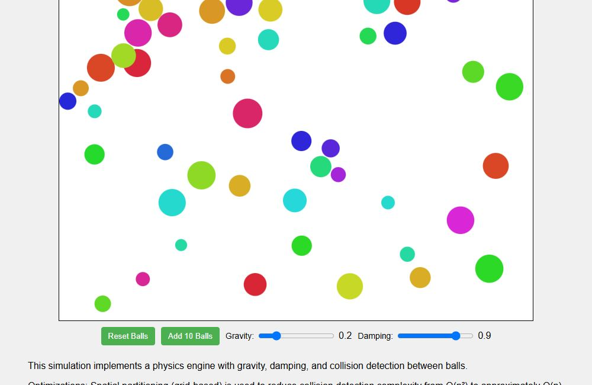
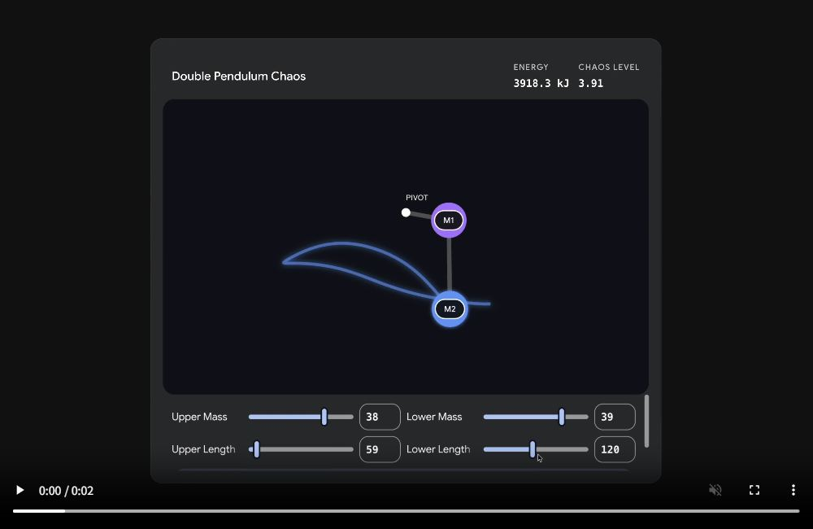
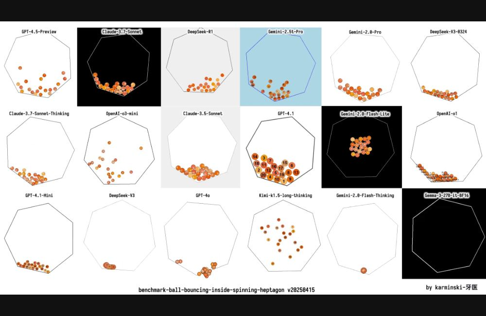
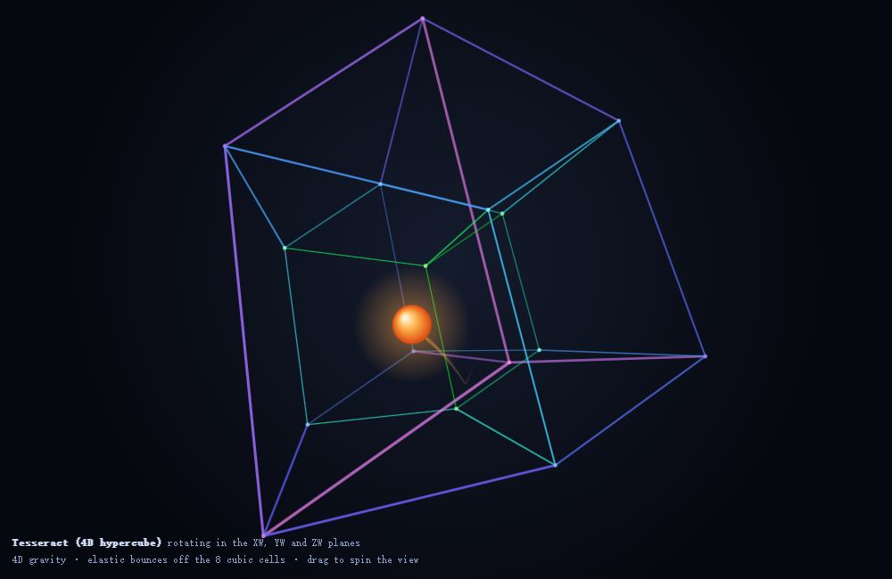

# 动画与物理

**简体中文** | [English](../en/categories/animation.md)

[← 返回首页](../../README.zh-CN.md) · [作品索引](../INDEX.md)

> 下文简介和观察点为本库整理，不是原始提示词或官方评分规则。

## 自主游动的水族箱

**编号**：`electricazimuth-aquarium` · **收录来源**：[David Harris / LocalLLM Visual Code Test](https://github.com/electricazimuth/LocalLLM_VisualCodeTest/blob/7e7004885221fafb8b1de360cacc2b8281cf934a/code_prompts/aquarium.md)（本库来源组内序号 1）

**英文标题**：Autonomous aquarium

**模型：** GLM-4-32B-0414-F16-Q4_K_M · **作者 / 发布者：** David Harris / electricazimuth

图片署名：David Harris / electricazimuth · [原图 / 作品出处](https://electricazimuth.github.io/LocalLLM_VisualCodeTest/results/2025.04.28/html/GLM-4-32B-0414-F16-Q4_K_M_aquarium_20250425_171639.html) · [素材说明](../../docs/THIRD_PARTY_MEDIA.md)

来源方已发布历史作品的浏览器截图（2026-11-08），不是重新调用模型；静帧不代表功能实测通过。

多条鱼自主游动，在鱼缸边缘平滑转向。

**原站署名 / 来源线索**：David Harris / LocalLLM Visual Code Test

**题面情况**：公开题面

**可以观察什么？**

- 鱼是否自然转向并留在边界内
- 动画是否随帧率变化而改变速度

**标签**：`动画与物理`, `来源整理`

**提示词与作品**：[前往原站查看](https://github.com/electricazimuth/LocalLLM_VisualCodeTest/blob/7e7004885221fafb8b1de360cacc2b8281cf934a/code_prompts/aquarium.md) · **本库测试情况**：未实测

### 历史效果

**GLM-4-32B-0414-F16-Q4_K_M** · 2025-04-25 · David Harris / electricazimuth

[查看效果 / 体验](https://electricazimuth.github.io/LocalLLM_VisualCodeTest/results/2025.04.28/html/GLM-4-32B-0414-F16-Q4_K_M_aquarium_20250425_171639.html) · [来源记录](https://github.com/electricazimuth/LocalLLM_VisualCodeTest/blob/7e7004885221fafb8b1de360cacc2b8281cf934a/code_prompts/aquarium.md) · [测试背景](https://azimuth.substack.com/p/local-llm-visual-benchmark)

来源方发布的输出，未在本库运行；题面、模型名称和条件以原站为准。

---

## 多球重力与阻尼碰撞

**编号**：`electricazimuth-ball_bound` · **收录来源**：[David Harris / LocalLLM Visual Code Test](https://github.com/electricazimuth/LocalLLM_VisualCodeTest/blob/7e7004885221fafb8b1de360cacc2b8281cf934a/code_prompts/ball_bound.md)（本库来源组内序号 2）

**英文标题**：Many-ball gravity and damping

**模型：** GLM-4-32B-0414-F16-Q4_K_M · **作者 / 发布者：** David Harris / electricazimuth

图片署名：David Harris / electricazimuth · [原图 / 作品出处](https://electricazimuth.github.io/LocalLLM_VisualCodeTest/results/2025.04.28/html/GLM-4-32B-0414-F16-Q4_K_M_ball_bound_20250425_172122.html) · [素材说明](../../docs/THIRD_PARTY_MEDIA.md)

来源方已发布历史作品的浏览器截图（2026-11-08），不是重新调用模型；静帧不代表功能实测通过。

在方形容器中模拟多球碰撞与能量损耗。

**原站署名 / 来源线索**：David Harris / LocalLLM Visual Code Test

**题面情况**：公开题面

**可以观察什么？**

- 球体碰撞后是否分离
- 重力和阻尼是否实际影响轨迹

**标签**：`动画与物理`, `来源整理`

**提示词与作品**：[前往原站查看](https://github.com/electricazimuth/LocalLLM_VisualCodeTest/blob/7e7004885221fafb8b1de360cacc2b8281cf934a/code_prompts/ball_bound.md) · **本库测试情况**：未实测

### 历史效果

**GLM-4-32B-0414-F16-Q4_K_M** · 2025-04-25 · David Harris / electricazimuth

[查看效果 / 体验](https://electricazimuth.github.io/LocalLLM_VisualCodeTest/results/2025.04.28/html/GLM-4-32B-0414-F16-Q4_K_M_ball_bound_20250425_172122.html) · [来源记录](https://github.com/electricazimuth/LocalLLM_VisualCodeTest/blob/7e7004885221fafb8b1de360cacc2b8281cf934a/code_prompts/ball_bound.md) · [测试背景](https://azimuth.substack.com/p/local-llm-visual-benchmark)

来源方发布的输出，未在本库运行；题面、模型名称和条件以原站为准。

---

## 会散步和下蛋的母鸡

**编号**：`electricazimuth-chicken` · **收录来源**：[David Harris / LocalLLM Visual Code Test](https://github.com/electricazimuth/LocalLLM_VisualCodeTest/blob/7e7004885221fafb8b1de360cacc2b8281cf934a/code_prompts/chicken.md)（本库来源组内序号 3）

**英文标题**：Wandering and egg-laying chicken

**模型：** GLM-4-32B-0414-F16-Q4_K_M · **作者 / 发布者：** David Harris / electricazimuth

图片署名：David Harris / electricazimuth · [原图 / 作品出处](https://electricazimuth.github.io/LocalLLM_VisualCodeTest/results/2025.04.28/html/GLM-4-32B-0414-F16-Q4_K_M_chicken_20250425_172543.html) · [素材说明](../../docs/THIRD_PARTY_MEDIA.md)

来源方已发布历史作品的浏览器截图（2026-11-08），不是重新调用模型；静帧不代表功能实测通过。

母鸡在散步和下蛋状态间切换，鸡蛋留在产生的位置。

**原站署名 / 来源线索**：David Harris / LocalLLM Visual Code Test

**题面情况**：公开题面

**可以观察什么？**

- 下蛋期间是否暂停移动
- 鸡蛋是否被正确创建和保留

**标签**：`动画与物理`, `来源整理`

**提示词与作品**：[前往原站查看](https://github.com/electricazimuth/LocalLLM_VisualCodeTest/blob/7e7004885221fafb8b1de360cacc2b8281cf934a/code_prompts/chicken.md) · **本库测试情况**：未实测

### 历史效果

**GLM-4-32B-0414-F16-Q4_K_M** · 2025-04-25 · David Harris / electricazimuth

[查看效果 / 体验](https://electricazimuth.github.io/LocalLLM_VisualCodeTest/results/2025.04.28/html/GLM-4-32B-0414-F16-Q4_K_M_chicken_20250425_172543.html) · [来源记录](https://github.com/electricazimuth/LocalLLM_VisualCodeTest/blob/7e7004885221fafb8b1de360cacc2b8281cf934a/code_prompts/chicken.md) · [测试背景](https://azimuth.substack.com/p/local-llm-visual-benchmark)

来源方发布的输出，未在本库运行；题面、模型名称和条件以原站为准。

---

## 自动发射的烟花粒子

**编号**：`electricazimuth-fireworks` · **收录来源**：[David Harris / LocalLLM Visual Code Test](https://github.com/electricazimuth/LocalLLM_VisualCodeTest/blob/7e7004885221fafb8b1de360cacc2b8281cf934a/code_prompts/fireworks.md)（本库来源组内序号 4）

**英文标题**：Autonomous fireworks particles

**模型：** GLM-4-32B-0414-F16-Q4_K_M · **作者 / 发布者：** David Harris / electricazimuth

图片署名：David Harris / electricazimuth · [原图 / 作品出处](https://electricazimuth.github.io/LocalLLM_VisualCodeTest/results/2025.04.28/html/GLM-4-32B-0414-F16-Q4_K_M_fireworks_20250425_172956.html) · [素材说明](../../docs/THIRD_PARTY_MEDIA.md)

来源方已发布历史作品的浏览器截图（2026-11-08），不是重新调用模型；静帧不代表功能实测通过。

火箭升空后爆炸成受重力影响、逐渐消失的粒子。

**原站署名 / 来源线索**：David Harris / LocalLLM Visual Code Test

**题面情况**：公开题面

**可以观察什么？**

- 火箭和爆炸粒子的生命周期是否正确
- 粒子是否被及时清理

**标签**：`动画与物理`, `来源整理`

**提示词与作品**：[前往原站查看](https://github.com/electricazimuth/LocalLLM_VisualCodeTest/blob/7e7004885221fafb8b1de360cacc2b8281cf934a/code_prompts/fireworks.md) · **本库测试情况**：未实测

### 历史效果

**GLM-4-32B-0414-F16-Q4_K_M** · 2025-04-25 · David Harris / electricazimuth

[查看效果 / 体验](https://electricazimuth.github.io/LocalLLM_VisualCodeTest/results/2025.04.28/html/GLM-4-32B-0414-F16-Q4_K_M_fireworks_20250425_172956.html) · [来源记录](https://github.com/electricazimuth/LocalLLM_VisualCodeTest/blob/7e7004885221fafb8b1de360cacc2b8281cf934a/code_prompts/fireworks.md) · [测试背景](https://azimuth.substack.com/p/local-llm-visual-benchmark)

来源方发布的输出，未在本库运行；题面、模型名称和条件以原站为准。

---

## 车辆碰撞爆炸与重新开始

**编号**：`electricazimuth-vehicles` · **收录来源**：[David Harris / LocalLLM Visual Code Test](https://github.com/electricazimuth/LocalLLM_VisualCodeTest/blob/7e7004885221fafb8b1de360cacc2b8281cf934a/code_prompts/vehicles.md)（本库来源组内序号 6）

**英文标题**：Vehicle collision and restart

**模型：** claude37（原站名称 / source label） · **作者 / 发布者：** David Harris / electricazimuth

图片署名：David Harris / electricazimuth · [原图 / 作品出处](https://electricazimuth.github.io/LocalLLM_VisualCodeTest/results/2025.04.28/html/claude37_vehicles_20250425_174000.html) · [素材说明](../../docs/THIRD_PARTY_MEDIA.md)

来源方已发布历史作品的浏览器截图（2026-11-08），不是重新调用模型；静帧不代表功能实测通过。

车辆从屏幕另一侧重现，碰撞触发爆炸并重新初始化场景。

**原站署名 / 来源线索**：David Harris / LocalLLM Visual Code Test

**题面情况**：公开题面

**可以观察什么？**

- 穿越边缘后是否从对侧出现
- 爆炸结束后是否清理并重启

**标签**：`动画与物理`, `来源整理`

**提示词与作品**：[前往原站查看](https://github.com/electricazimuth/LocalLLM_VisualCodeTest/blob/7e7004885221fafb8b1de360cacc2b8281cf934a/code_prompts/vehicles.md) · **本库测试情况**：未实测

### 历史效果

**GLM-4-32B-0414-F16-Q4_K_M** · 2025-04-25 · David Harris / electricazimuth

[查看效果 / 体验](https://electricazimuth.github.io/LocalLLM_VisualCodeTest/results/2025.04.28/html/GLM-4-32B-0414-F16-Q4_K_M_vehicles_20250425_174812.html) · [来源记录](https://github.com/electricazimuth/LocalLLM_VisualCodeTest/blob/7e7004885221fafb8b1de360cacc2b8281cf934a/code_prompts/vehicles.md) · [测试背景](https://azimuth.substack.com/p/local-llm-visual-benchmark)

来源方发布的输出，未在本库运行；题面、模型名称和条件以原站为准。

---

## 交互式分形可视化

**编号**：`google-sim-fractals` · **收录来源**：[Google / Gemini interactive visualizations](https://blog.google/innovation-and-ai/products/gemini-app/3d-models-charts/)（本库来源组内序号 1）

**英文标题**：Interactive fractal visualization

**模型：** Gemini Pro（官方未列完整版本 / exact version not listed） · **作者 / 发布者：** Google

图片署名：Google · [原图 / 作品出处](https://storage.googleapis.com/gweb-uniblog-publish-prod/original_videos/2_GeminiHacks_Fractal_NoPrompt_16x9.mp4) · [素材说明](../../docs/THIRD_PARTY_MEDIA.md)

Google 官方演示视频的画面截图，点击播放原视频。

从官方分形演示观察缩放与细节变化。

**原站署名 / 来源线索**：Google / Gemini interactive visualizations

**题面情况**：示例请求或部分题面

**可以观察什么？**

- 缩放是否产生一致的细节
- 交互是否真的改变计算结果

**标签**：`动画与物理`, `来源整理`

**提示词与作品**：[前往原站查看](https://blog.google/innovation-and-ai/products/gemini-app/3d-models-charts/) · **本库测试情况**：未实测

### 历史效果

**Gemini Pro（官方未列完整版本 / exact version not listed）** · 运行日期未公开 · Google

[查看效果 / 体验](https://blog.google/innovation-and-ai/products/gemini-app/3d-models-charts/) · [来源记录](https://blog.google/innovation-and-ai/products/gemini-app/3d-models-charts/) · [测试背景](https://blog.google/innovation-and-ai/products/gemini-app/3d-models-charts/)

官方文章内有演示视频。只公开示例请求，未公开完整系统提示词、采样参数或独立结果代码；本库未复现。

---

## 双缝干涉交互演示

**编号**：`google-sim-double-slit` · **收录来源**：[Google / Gemini interactive visualizations](https://blog.google/innovation-and-ai/products/gemini-app/3d-models-charts/)（本库来源组内序号 2）

**英文标题**：Interactive double-slit interference

**模型：** Gemini Pro（官方未列完整版本 / exact version not listed） · **作者 / 发布者：** Google

图片署名：Google · [原图 / 作品出处](https://storage.googleapis.com/gweb-uniblog-publish-prod/original_videos/4_GeminiHacks_DoubleSlit_NoPrompt_16x9.mp4) · [素材说明](../../docs/THIRD_PARTY_MEDIA.md)

Google 官方演示视频的画面截图，点击播放原视频。

以官方双缝实验演示为测试方向，观察参数与干涉图样。

**原站署名 / 来源线索**：Google / Gemini interactive visualizations

**题面情况**：示例请求或部分题面

**可以观察什么？**

- 参数变化是否对应条纹变化
- 能否区分演示近似和物理结论

**标签**：`动画与物理`, `来源整理`

**提示词与作品**：[前往原站查看](https://blog.google/innovation-and-ai/products/gemini-app/3d-models-charts/) · **本库测试情况**：未实测

### 历史效果

**Gemini Pro（官方未列完整版本 / exact version not listed）** · 运行日期未公开 · Google

[查看效果 / 体验](https://blog.google/innovation-and-ai/products/gemini-app/3d-models-charts/) · [来源记录](https://blog.google/innovation-and-ai/products/gemini-app/3d-models-charts/) · [测试背景](https://blog.google/innovation-and-ai/products/gemini-app/3d-models-charts/)

官方文章内有演示视频。只公开示例请求，未公开完整系统提示词、采样参数或独立结果代码；本库未复现。

---

## 双摆混沌交互演示

**编号**：`google-sim-double-pendulum` · **收录来源**：[Google / Gemini interactive visualizations](https://blog.google/innovation-and-ai/products/gemini-app/3d-models-charts/)（本库来源组内序号 3）

**英文标题**：Interactive double-pendulum chaos

**模型：** Gemini Pro（官方未列完整版本 / exact version not listed） · **作者 / 发布者：** Google

图片署名：Google · [原图 / 作品出处](https://storage.googleapis.com/gweb-uniblog-publish-prod/original_videos/PENDULUM_NEW_FINAL_1.mp4) · [素材说明](../../docs/THIRD_PARTY_MEDIA.md)

Google 官方演示视频的画面截图，点击播放原视频。

通过官方双摆演示观察初始条件与运动变化。

**原站署名 / 来源线索**：Google / Gemini interactive visualizations

**题面情况**：示例请求或部分题面

**可以观察什么？**

- 轨迹是否由双摆耦合产生
- 能否调整参数并重新开始

**标签**：`动画与物理`, `来源整理`

**提示词与作品**：[前往原站查看](https://blog.google/innovation-and-ai/products/gemini-app/3d-models-charts/) · **本库测试情况**：未实测

### 历史效果

**Gemini Pro（官方未列完整版本 / exact version not listed）** · 运行日期未公开 · Google

[查看效果 / 体验](https://blog.google/innovation-and-ai/products/gemini-app/3d-models-charts/) · [来源记录](https://blog.google/innovation-and-ai/products/gemini-app/3d-models-charts/) · [测试背景](https://blog.google/innovation-and-ai/products/gemini-app/3d-models-charts/)

官方文章内有演示视频。只公开示例请求，未公开完整系统提示词、采样参数或独立结果代码；本库未复现。

---

## 旋转七边形中的 20 个编号小球

**编号**：`kcores-ball-bouncing-inside-spinning-heptagon` · **收录来源**：[KCORES LLM Arena](https://github.com/KCORES/kcores-llm-arena/blob/8f09c63e78189858377a760d03f69fb744b19aa2/benchmark-ball-bouncing-inside-spinning-heptagon/README.md)（本库来源组内序号 1）

**英文标题**：20 numbered balls in a spinning heptagon

**模型：** 原仓库未标明 / Not disclosed · **作者 / 发布者：** KCORES team

图片署名：KCORES team · [原图 / 作品出处](https://raw.githubusercontent.com/KCORES/kcores-llm-arena/8f09c63e78189858377a760d03f69fb744b19aa2/assets/images/ball-bouncing-gif.gif) · [素材说明](../../docs/THIRD_PARTY_MEDIA.md)

原仓库七边形弹球动画的多模型对照画面；点击打开原动画。

在旋转七边形中模拟球间碰撞、壁面碰撞和带摩擦自转；与原有单球六边形题不同。

**原站署名 / 来源线索**：KCORES LLM Arena

**题面情况**：公开题面

**可以观察什么？**

- 是否同时处理球间和移动壁面碰撞
- 编号与自转是否对应

**标签**：`动画与物理`, `来源整理`

**提示词与作品**：[前往原站查看](https://github.com/KCORES/kcores-llm-arena/blob/8f09c63e78189858377a760d03f69fb744b19aa2/benchmark-ball-bouncing-inside-spinning-heptagon/README.md) · **本库测试情况**：未实测

### 历史效果

**多个模型，见原站 / Multiple models; see source** · 运行日期未公开 · KCORES team

[查看效果 / 体验](https://github.com/KCORES/kcores-llm-arena/tree/8f09c63e78189858377a760d03f69fb744b19aa2/benchmark-ball-bouncing-inside-spinning-heptagon/src) · [来源记录](https://github.com/KCORES/kcores-llm-arena/blob/8f09c63e78189858377a760d03f69fb744b19aa2/benchmark-ball-bouncing-inside-spinning-heptagon/README.md) · [测试背景](https://github.com/KCORES/kcores-llm-arena/blob/8f09c63e78189858377a760d03f69fb744b19aa2/benchmark-ball-bouncing-inside-spinning-heptagon/README.md)

原站每模型运行三次后择优评分；不能与一次生成结果直接比较。链接为输出代码目录，本库不转存代码或评分图片。

---

## 李白诗句绘制 Mandelbrot 分形

**编号**：`kcores-mandelbrot-set-meet-libai` · **收录来源**：[KCORES LLM Arena](https://github.com/KCORES/kcores-llm-arena/blob/8f09c63e78189858377a760d03f69fb744b19aa2/benchmark-mandelbrot-set-meet-libai/README.md)（本库来源组内序号 2）

**英文标题**：Mandelbrot fractal drawn with Li Bai characters

**模型：** Gemini-2.5-Pro-Experimental-03-25 · **作者 / 发布者：** KCORES team

图片署名：KCORES team · [原图 / 作品出处](https://raw.githubusercontent.com/KCORES/kcores-llm-arena/8f09c63e78189858377a760d03f69fb744b19aa2/benchmark-mandelbrot-set-meet-libai/src/mandelbrot-set-meet-libai-benchmark-Gemini-2.5-Pro-Experimental-03-25-turn-2-high-score.html) · [素材说明](../../docs/THIRD_PARTY_MEDIA.md)

来源方已发布历史作品的浏览器截图（2026-11-08），不是重新调用模型；静帧不代表功能实测通过。

将诗句字符处理、分形缩放与帧率统计结合在 Canvas 动画中。

**原站署名 / 来源线索**：KCORES LLM Arena

**题面情况**：公开题面

**可以观察什么？**

- 字符是否去重并保留原顺序
- 缩放中心、循环与帧率是否满足题面

**标签**：`动画与物理`, `来源整理`

**提示词与作品**：[前往原站查看](https://github.com/KCORES/kcores-llm-arena/blob/8f09c63e78189858377a760d03f69fb744b19aa2/benchmark-mandelbrot-set-meet-libai/README.md) · **本库测试情况**：未实测

### 历史效果

**多个模型，见原站 / Multiple models; see source** · 运行日期未公开 · KCORES team

[查看效果 / 体验](https://github.com/KCORES/kcores-llm-arena/tree/8f09c63e78189858377a760d03f69fb744b19aa2/benchmark-mandelbrot-set-meet-libai/src) · [来源记录](https://github.com/KCORES/kcores-llm-arena/blob/8f09c63e78189858377a760d03f69fb744b19aa2/benchmark-mandelbrot-set-meet-libai/README.md) · [测试背景](https://github.com/KCORES/kcores-llm-arena/blob/8f09c63e78189858377a760d03f69fb744b19aa2/benchmark-mandelbrot-set-meet-libai/README.md)

原站每模型运行三次后择优评分；不能与一次生成结果直接比较。链接为输出代码目录，本库不转存代码或评分图片。

---

## 鹈鹕骑自行车

**编号**：`museum-001` · **收录来源**：[AI 考题博物馆](https://aitestmuseum.com/zh/tests/pelican-bicycle)（本库来源组内序号 1）

**英文标题**：Pelican riding a bicycle

**模型：** Claude Opus 5.5 · **作者 / 发布者：** AI Test Museum

图片署名：AI Test Museum · [原图 / 作品出处](https://aitestmuseum.com/results/claude-opus-5-5/pelican-bicycle/output.html) · [素材说明](../../docs/THIRD_PARTY_MEDIA.md)

来源方已发布历史作品的浏览器截图（2026-11-08），不是重新调用模型；静帧不代表功能实测通过。

使用代码生成鹈鹕骑车的 SVG 动画，不只是静态画面。

**原站署名 / 来源线索**：Simon Willison（动画改编）

**可以观察什么？**

- 车轮、脚踏、鸟腿运动是否协调
- 动画是否可以独立运行
- 能按题目要求运行或交互，不以截图代替验收

**标签**：`SVG`, `运动`

**提示词与作品**：[前往原站查看](https://aitestmuseum.com/zh/tests/pelican-bicycle) · **本库测试情况**：未实测

### 历史效果

**Claude Opus 5.5** · 2026-10-19 · AI Test Museum

[查看效果 / 体验](https://aitestmuseum.com/results/claude-opus-5-5/pelican-bicycle/output.html) · [来源记录](https://aitestmuseum.com/zh/tests/pelican-bicycle) · [测试背景](https://aitestmuseum.com/zh#methodology)

原站 Claude Code agent 环境，包含其系统提示词；不等同裸 API。原站说明失败题可能重答，不将页面展示视作统一的一次成功记录。

---

## 旋转六边形里的弹跳球

**编号**：`museum-002` · **收录来源**：[AI 考题博物馆](https://aitestmuseum.com/zh/tests/bouncing-ball-hexagon)（本库来源组内序号 2）

**英文标题**：Bouncing ball inside a spinning hexagon

**模型：** Claude Opus 5.5 · **作者 / 发布者：** AI Test Museum

图片署名：AI Test Museum · [原图 / 作品出处](https://aitestmuseum.com/results/claude-opus-5-5/bouncing-ball-hexagon/output.html) · [素材说明](../../docs/THIRD_PARTY_MEDIA.md)

来源方已发布历史作品的浏览器截图（2026-11-08），不是重新调用模型；静帧不代表功能实测通过。

小球在持续旋转的六边形里弹跳，涉及重力与摩擦。

**原站署名 / 来源线索**：Flavio Adamo（原题改写）

**可以观察什么？**

- 反弹是否考虑旋转墙壁速度
- 运行一段时间后是否穿墙或卡住
- 能按题目要求运行或交互，不以截图代替验收

**标签**：`物理`, `碰撞`

**提示词与作品**：[前往原站查看](https://aitestmuseum.com/zh/tests/bouncing-ball-hexagon) · **本库测试情况**：未实测

### 历史效果

**Claude Opus 5.5** · 2026-10-19 · AI Test Museum

[查看效果 / 体验](https://aitestmuseum.com/results/claude-opus-5-5/bouncing-ball-hexagon/output.html) · [来源记录](https://aitestmuseum.com/zh/tests/bouncing-ball-hexagon) · [测试背景](https://aitestmuseum.com/zh#methodology)

原站 Claude Code agent 环境，包含其系统提示词；不等同裸 API。原站说明失败题可能重答，不将页面展示视作统一的一次成功记录。

---

## 超新星爆发

**编号**：`museum-008` · **收录来源**：[AI 考题博物馆](https://aitestmuseum.com/zh/tests/supernova)（本库来源组内序号 8）

**英文标题**：Supernova explosion

**模型：** Claude Opus 5.5 · **作者 / 发布者：** AI Test Museum

图片署名：AI Test Museum · [原图 / 作品出处](https://aitestmuseum.com/results/claude-opus-5-5/supernova/output.html) · [素材说明](../../docs/THIRD_PARTY_MEDIA.md)

来源方已发布历史作品的浏览器截图（2026-11-08），不是重新调用模型；静帧不代表功能实测通过。

展示恒星演化到超新星爆发及残骸的动画。

**原站署名 / 来源线索**：AI/ML API 模型对比

**可以观察什么？**

- 膨胀、坍缩、爆炸过程是否连贯
- 动画阶段和视觉层次是否清晰
- 能按题目要求运行或交互，不以截图代替验收

**标签**：`动画`, `科普`

**提示词与作品**：[前往原站查看](https://aitestmuseum.com/zh/tests/supernova) · **本库测试情况**：未实测

### 历史效果

**Claude Opus 5.5** · 2026-10-19 · AI Test Museum

[查看效果 / 体验](https://aitestmuseum.com/results/claude-opus-5-5/supernova/output.html) · [来源记录](https://aitestmuseum.com/zh/tests/supernova) · [测试背景](https://aitestmuseum.com/zh#methodology)

原站 Claude Code agent 环境，包含其系统提示词；不等同裸 API。原站说明失败题可能重答，不将页面展示视作统一的一次成功记录。

---

## 沉没的哥特城市着色器

**编号**：`museum-013` · **收录来源**：[AI 考题博物馆](https://aitestmuseum.com/zh/tests/drowned-gothic-city)（本库来源组内序号 13）

**英文标题**：Drowned Gothic city shader

**模型：** Claude Opus 5.5 · **作者 / 发布者：** AI Test Museum

图片署名：AI Test Museum · [原图 / 作品出处](https://aitestmuseum.com/results/claude-opus-5-5/drowned-gothic-city/output.html) · [素材说明](../../docs/THIRD_PARTY_MEDIA.md)

来源方已发布历史作品的浏览器截图（2026-11-08），不是重新调用模型；静帧不代表功能实测通过。

使用着色器绘制暴风雨中的半淹没哥特城市。

**原站署名 / 来源线索**：Ethan Mollick

**可以观察什么？**

- 塔楼轮廓、雨水和气氛是否成立
- 渲染是否持续稳定
- 能按题目要求运行或交互，不以截图代替验收

**标签**：`Shader`, `审美`

**提示词与作品**：[前往原站查看](https://aitestmuseum.com/zh/tests/drowned-gothic-city) · **本库测试情况**：未实测

### 历史效果

**Claude Opus 5.5** · 2026-10-19 · AI Test Museum

[查看效果 / 体验](https://aitestmuseum.com/results/claude-opus-5-5/drowned-gothic-city/output.html) · [来源记录](https://aitestmuseum.com/zh/tests/drowned-gothic-city) · [测试背景](https://aitestmuseum.com/zh#methodology)

原站 Claude Code agent 环境，包含其系统提示词；不等同裸 API。原站说明失败题可能重答，不将页面展示视作统一的一次成功记录。

---

## 用双手控制的粒子

**编号**：`museum-016` · **收录来源**：[AI 考题博物馆](https://aitestmuseum.com/zh/tests/hand-gesture-particles)（本库来源组内序号 16）

**英文标题**：Hand-controlled particles

**模型：** Claude Opus 5.5 · **作者 / 发布者：** AI Test Museum

图片署名：AI Test Museum · [原图 / 作品出处](https://aitestmuseum.com/results/claude-opus-5-5/hand-gesture-particles/output.html) · [素材说明](../../docs/THIRD_PARTY_MEDIA.md)

来源方已发布历史作品的浏览器截图（2026-11-08），不是重新调用模型；静帧不代表功能实测通过。

摄像头双手手势驱动 Three.js 粒子形状变化。

**原站署名 / 来源线索**：@EHuanglu

**可以观察什么？**

- 摄像头权限与手势识别是否可靠
- 粒子能否实时变化并切换造型
- 能按题目要求运行或交互，不以截图代替验收

**标签**：`动画`, `手势`

**提示词与作品**：[前往原站查看](https://aitestmuseum.com/zh/tests/hand-gesture-particles) · **本库测试情况**：未实测

### 历史效果

**Claude Opus 5.5** · 2026-10-19 · AI Test Museum

[查看效果 / 体验](https://aitestmuseum.com/results/claude-opus-5-5/hand-gesture-particles/output.html) · [来源记录](https://aitestmuseum.com/zh/tests/hand-gesture-particles) · [测试背景](https://aitestmuseum.com/zh#methodology)

原站 Claude Code agent 环境，包含其系统提示词；不等同裸 API。原站说明失败题可能重答，不将页面展示视作统一的一次成功记录。

---

## 超立方体里的弹跳球

**编号**：`museum-017` · **收录来源**：[AI 考题博物馆](https://aitestmuseum.com/zh/tests/tesseract-ball)（本库来源组内序号 17）

**英文标题**：Bouncing ball inside a hypercube

**模型：** Claude Opus 5.5 · **作者 / 发布者：** AI Test Museum

图片署名：AI Test Museum · [原图 / 作品出处](https://aitestmuseum.com/results/claude-opus-5-5/tesseract-ball/output.html) · [素材说明](../../docs/THIRD_PARTY_MEDIA.md)

来源方已发布历史作品的浏览器截图（2026-11-08），不是重新调用模型；静帧不代表功能实测通过。

旋转四维超立方体里弹跳的小球，挑战高维可视化。

**原站署名 / 来源线索**：@Yuchenj_UW（原题改写）

**可以观察什么？**

- 高维结构的投影是否可理解
- 碰撞是否与显示结果一致
- 能按题目要求运行或交互，不以截图代替验收

**标签**：`物理`, `高维`

**提示词与作品**：[前往原站查看](https://aitestmuseum.com/zh/tests/tesseract-ball) · **本库测试情况**：未实测

### 历史效果

**Claude Opus 5.5** · 2026-10-19 · AI Test Museum

[查看效果 / 体验](https://aitestmuseum.com/results/claude-opus-5-5/tesseract-ball/output.html) · [来源记录](https://aitestmuseum.com/zh/tests/tesseract-ball) · [测试背景](https://aitestmuseum.com/zh#methodology)

原站 Claude Code agent 环境，包含其系统提示词；不等同裸 API。原站说明失败题可能重答，不将页面展示视作统一的一次成功记录。

---

## 星舰控制台

**编号**：`museum-018` · **收录来源**：[AI 考题博物馆](https://aitestmuseum.com/zh/tests/starship-control-panel)（本库来源组内序号 18）

**英文标题**：Starship control panel

**模型：** Claude Opus 5.5 · **作者 / 发布者：** AI Test Museum

图片署名：AI Test Museum · [原图 / 作品出处](https://aitestmuseum.com/results/claude-opus-5-5/starship-control-panel/output.html) · [素材说明](../../docs/THIRD_PARTY_MEDIA.md)

来源方已发布历史作品的浏览器截图（2026-11-08），不是重新调用模型；静帧不代表功能实测通过。

借助 p5.js 生成充满想象力的未来星舰控制台。

**原站署名 / 来源线索**：Ethan Mollick

**可以观察什么？**

- 仪表细节与视觉设计是否有创意
- 交互反馈是否明确
- 能按题目要求运行或交互，不以截图代替验收

**标签**：`创意`, `p5.js`

**提示词与作品**：[前往原站查看](https://aitestmuseum.com/zh/tests/starship-control-panel) · **本库测试情况**：未实测

### 历史效果

**Claude Opus 5.5** · 2026-10-19 · AI Test Museum

[查看效果 / 体验](https://aitestmuseum.com/results/claude-opus-5-5/starship-control-panel/output.html) · [来源记录](https://aitestmuseum.com/zh/tests/starship-control-panel) · [测试背景](https://aitestmuseum.com/zh#methodology)

原站 Claude Code agent 环境，包含其系统提示词；不等同裸 API。原站说明失败题可能重答，不将页面展示视作统一的一次成功记录。

---

## 指向 10:10 的指针时钟

**编号**：`museum-019` · **收录来源**：[AI 考题博物馆](https://aitestmuseum.com/zh/tests/ai-world-clock)（本库来源组内序号 19）

**英文标题**：Analog clock showing 10:10

**模型：** Claude Opus 5.5 · **作者 / 发布者：** AI Test Museum

图片署名：AI Test Museum · [原图 / 作品出处](https://aitestmuseum.com/results/claude-opus-5-5/ai-world-clock/output.html) · [素材说明](../../docs/THIRD_PARTY_MEDIA.md)

来源方已发布历史作品的浏览器截图（2026-11-08），不是重新调用模型；静帧不代表功能实测通过。

用 HTML/CSS 画出指向 10:10 并持续走秒的时钟。

**原站署名 / 来源线索**：Brian Moore / AI World Clocks

**可以观察什么？**

- 时针、分针角度是否正确
- 秒针动画与响应式布局是否正常
- 能按题目要求运行或交互，不以截图代替验收

**标签**：`动画`, `空间`

**提示词与作品**：[前往原站查看](https://aitestmuseum.com/zh/tests/ai-world-clock) · **本库测试情况**：未实测

### 历史效果

**Claude Opus 5.5** · 2026-10-19 · AI Test Museum

[查看效果 / 体验](https://aitestmuseum.com/results/claude-opus-5-5/ai-world-clock/output.html) · [来源记录](https://aitestmuseum.com/zh/tests/ai-world-clock) · [测试背景](https://aitestmuseum.com/zh#methodology)

原站 Claude Code agent 环境，包含其系统提示词；不等同裸 API。原站说明失败题可能重答，不将页面展示视作统一的一次成功记录。

---

## 玻璃桥破裂与受力演示

**编号**：`reddit-glass-bridge-glass-bridge` · **收录来源**：[EntelligenceAI / u/entelligenceai17](https://www.reddit.com/r/LLMDevs/comments/1urypfg/benchmarking_gpt56_sol_vs_grok_45_pro_with_the/)（本库来源组内序号 1）

**英文标题**：Glass bridge fracture and loading

**模型：** GPT-5.6 SOL / Grok 4.5 Pro（来源标记 / source label） · **作者 / 发布者：** @EntelligenceAI

图片署名：@EntelligenceAI · [原图 / 作品出处](https://pbs.twimg.com/amplify_video_thumb/2075281891473952768/img/VhOVFPL17_NDgdBU.jpg) · [素材说明](../../docs/THIRD_PARTY_MEDIA.md)

原帖视频封面，点击封面播放原视频。

在单文件中表现受力、裂纹扩展、碎裂和粒子效果。

**原站署名 / 来源线索**：EntelligenceAI / u/entelligenceai17

**题面情况**：示例请求或部分题面

**可以观察什么？**

- 裂纹位置是否随载荷位置变化
- 是否区分视觉效果与准确力学

**标签**：`动画与物理`, `来源整理`

**提示词与作品**：[前往原站查看](https://www.reddit.com/r/LLMDevs/comments/1urypfg/benchmarking_gpt56_sol_vs_grok_45_pro_with_the/) · **本库测试情况**：未实测

### 历史效果

**GPT-5.6 SOL / Grok 4.5 Pro** · 运行日期未公开 · EntelligenceAI / u/entelligenceai17

[查看效果 / 体验](https://x.com/EntelligenceAI/status/2075282696008532097) · [来源记录](https://www.reddit.com/r/LLMDevs/comments/1urypfg/benchmarking_gpt56_sol_vs_grok_45_pro_with_the/) · [测试背景](https://www.reddit.com/r/LLMDevs/comments/1urypfg/benchmarking_gpt56_sol_vs_grok_45_pro_with_the/)

原帖或评论中的历史效果，由发帖者报告；本库未验证运行成功或科学准确性。不同量化、硬件、工具和迭代条件不能混同比较。

---

## 三摆混沌轨迹画笔

**编号**：`stock42-triple-pendulum` · **收录来源**：[Stock42 Creative Coding Challenges](https://github.com/stock42/test-llm-coding/blob/5dd2e8e63f026337ddfa39195d7f1008806bca1d/promptings/triple-pendulum.md)（本库来源组内序号 1）

**英文标题**：Triple-pendulum chaos painter

**模型：** GPT-5.5 / Codex · **作者 / 发布者：** stock42

图片署名：stock42 · [原图 / 作品出处](https://raw.githubusercontent.com/stock42/test-llm-coding/5dd2e8e63f026337ddfa39195d7f1008806bca1d/codex/gpt-5.5/triple-pendulum/index.html) · [素材说明](../../docs/THIRD_PARTY_MEDIA.md)

来源方已发布历史作品的浏览器截图（2026-11-08），不是重新调用模型；静帧不代表功能实测通过。

通过三段摆的末端轨迹观察混沌与数值稳定性。

**原站署名 / 来源线索**：Stock42 Creative Coding Challenges

**题面情况**：公开题面

**可以观察什么？**

- 轨迹是否由耦合运动产生
- 暂停、重置是否一致

**标签**：`动画与物理`, `来源整理`

**提示词与作品**：[前往原站查看](https://github.com/stock42/test-llm-coding/blob/5dd2e8e63f026337ddfa39195d7f1008806bca1d/promptings/triple-pendulum.md) · **本库测试情况**：未实测

### 历史效果

**GPT-5.5 / Codex** · 运行日期未公开 · stock42

[查看效果 / 体验](https://github.com/stock42/test-llm-coding/blob/5dd2e8e63f026337ddfa39195d7f1008806bca1d/codex/gpt-5.5/triple-pendulum/index.html) · [来源记录](https://github.com/stock42/test-llm-coding/blob/5dd2e8e63f026337ddfa39195d7f1008806bca1d/promptings/triple-pendulum.md) · [测试背景](https://github.com/stock42/test-llm-coding/blob/5dd2e8e63f026337ddfa39195d7f1008806bca1d/RESULTS.md)

链接打开的是历史 HTML 源码，不是托管试玩；两组 Agent / 模型输出见原站 RESULTS.md。未在本库执行。

---

## 用方块碰撞次数观察 π

**编号**：`stock42-1kg-block-bounces` · **收录来源**：[Stock42 Creative Coding Challenges](https://github.com/stock42/test-llm-coding/blob/5dd2e8e63f026337ddfa39195d7f1008806bca1d/promptings/1kg-block-bounces.md)（本库来源组内序号 2）

**英文标题**：Pi through block collisions

**模型：** GPT-5.5 / Codex · **作者 / 发布者：** stock42

图片署名：stock42 · [原图 / 作品出处](https://raw.githubusercontent.com/stock42/test-llm-coding/5dd2e8e63f026337ddfa39195d7f1008806bca1d/codex/gpt-5.5/1kg-block-bounces/index.html) · [素材说明](../../docs/THIRD_PARTY_MEDIA.md)

来源方已发布历史作品的浏览器截图（2026-11-08），不是重新调用模型；静帧不代表功能实测通过。

观察不同质量比例下的弹性碰撞次数，区分精确结论和视觉近似。

**原站署名 / 来源线索**：Stock42 Creative Coding Challenges

**题面情况**：公开题面

**可以观察什么？**

- 碰撞是否保持动量和能量
- 是否说明质量比例与计数的适用条件

**标签**：`动画与物理`, `来源整理`

**提示词与作品**：[前往原站查看](https://github.com/stock42/test-llm-coding/blob/5dd2e8e63f026337ddfa39195d7f1008806bca1d/promptings/1kg-block-bounces.md) · **本库测试情况**：未实测

### 历史效果

**GPT-5.5 / Codex** · 运行日期未公开 · stock42

[查看效果 / 体验](https://github.com/stock42/test-llm-coding/blob/5dd2e8e63f026337ddfa39195d7f1008806bca1d/codex/gpt-5.5/1kg-block-bounces/index.html) · [来源记录](https://github.com/stock42/test-llm-coding/blob/5dd2e8e63f026337ddfa39195d7f1008806bca1d/promptings/1kg-block-bounces.md) · [测试背景](https://github.com/stock42/test-llm-coding/blob/5dd2e8e63f026337ddfa39195d7f1008806bca1d/RESULTS.md)

链接打开的是历史 HTML 源码，不是托管试玩；两组 Agent / 模型输出见原站 RESULTS.md。未在本库执行。

---

## 高尔顿板与钟形分布

**编号**：`stock42-balls-fall` · **收录来源**：[Stock42 Creative Coding Challenges](https://github.com/stock42/test-llm-coding/blob/5dd2e8e63f026337ddfa39195d7f1008806bca1d/promptings/balls-fall.md)（本库来源组内序号 3）

**英文标题**：Galton board and bell curve

**模型：** GPT-5.5 / Codex · **作者 / 发布者：** stock42

图片署名：stock42 · [原图 / 作品出处](https://raw.githubusercontent.com/stock42/test-llm-coding/5dd2e8e63f026337ddfa39195d7f1008806bca1d/codex/gpt-5.5/balls-fall/index.html) · [素材说明](../../docs/THIRD_PARTY_MEDIA.md)

来源方已发布历史作品的浏览器截图（2026-11-08），不是重新调用模型；静帧不代表功能实测通过。

小球穿过钉阵进入统计槽，观察分布逐渐形成。

**原站署名 / 来源线索**：Stock42 Creative Coding Challenges

**题面情况**：公开题面

**可以观察什么？**

- 落球与直方图是否对应
- 能否区分概率演示和真实碰撞模拟

**标签**：`动画与物理`, `来源整理`

**提示词与作品**：[前往原站查看](https://github.com/stock42/test-llm-coding/blob/5dd2e8e63f026337ddfa39195d7f1008806bca1d/promptings/balls-fall.md) · **本库测试情况**：未实测

### 历史效果

**GPT-5.5 / Codex** · 运行日期未公开 · stock42

[查看效果 / 体验](https://github.com/stock42/test-llm-coding/blob/5dd2e8e63f026337ddfa39195d7f1008806bca1d/codex/gpt-5.5/balls-fall/index.html) · [来源记录](https://github.com/stock42/test-llm-coding/blob/5dd2e8e63f026337ddfa39195d7f1008806bca1d/promptings/balls-fall.md) · [测试背景](https://github.com/stock42/test-llm-coding/blob/5dd2e8e63f026337ddfa39195d7f1008806bca1d/RESULTS.md)

链接打开的是历史 HTML 源码，不是托管试玩；两组 Agent / 模型输出见原站 RESULTS.md。未在本库执行。

---

## 40 秒代码动画解释浏览器

**编号**：`x-addyosmani-2103009037164110327` · **收录来源**：[@addyosmani / X](https://x.com/addyosmani/status/2103009037164110327)（本库来源组内序号 1）

**英文标题**：40-second coded browser explainer

**模型：** Opus 5.5 · **作者 / 发布者：** @addyosmani

图片署名：@addyosmani · [原图 / 作品出处](https://pbs.twimg.com/amplify_video_thumb/2102980713603887104/img/XgCaV0YvE_TaH9Oi.jpg) · [素材说明](../../docs/THIRD_PARTY_MEDIA.md)

原帖视频封面，点击封面播放原视频。

由公开作品整理的挑战方向：40 秒代码动画解释浏览器。完整题面未逐字确认时，请勿当成原始提示词。

**原站署名 / 来源线索**：@addyosmani；发现入口：[Awesome Opus Animation](https://github.com/krillinai/awesome-opus-animation/blob/main/categories/explainers.md#case-2103009037164110327)；原帖通过公开读取服务核对。

**题面情况**：完整原题未确认，按作品整理

**可以观察什么？**

- 解析布局绘制的关系是否准确
- 字幕与动画节奏是否可读

**标签**：`动画与物理`, `来源整理`

**提示词与作品**：[前往原站查看](https://x.com/addyosmani/status/2103009037164110327) · **本库测试情况**：未实测

### 历史效果

**Opus 5.5** · 运行日期未公开 · @addyosmani

[查看效果 / 体验](https://x.com/addyosmani/status/2103009037164110327) · [来源记录](https://x.com/addyosmani/status/2103009037164110327) · [测试背景](https://github.com/krillinai/awesome-opus-animation/blob/main/categories/explainers.md#case-2103009037164110327)

通过 FxTwitter 公共读取接口核对原帖 ID、账号和文字；未直接登录 X，也未独立运行或验证视频。作品介绍部分参考发现索引；完整题面、素材来源与迭代次数未公开的部分不推测。发布时间不是运行时间。

---

## 用 Blender 制作黏土风动画

**编号**：`x-alexalbert__-2102458348511879448` · **收录来源**：[@alexalbert__ / X](https://x.com/alexalbert__/status/2102458348511879448)（本库来源组内序号 1）

**英文标题**：Blender claymation-style animation

**模型：** Opus 5.5 · **作者 / 发布者：** @alexalbert__

图片署名：@alexalbert__ · [原图 / 作品出处](https://pbs.twimg.com/amplify_video_thumb/2102457816820916224/img/UNnuG_dYWVbvKNZu.jpg) · [素材说明](../../docs/THIRD_PARTY_MEDIA.md)

原帖视频封面，点击封面播放原视频。

由公开作品整理的挑战方向：用 Blender 制作黏土风动画。完整题面未逐字确认时，请勿当成原始提示词。

**原站署名 / 来源线索**：@alexalbert__；发现入口：[Awesome Opus Animation](https://github.com/krillinai/awesome-opus-animation/blob/main/categories/3d-scenes.md#case-2102458348511879448)；原帖通过公开读取服务核对。

**题面情况**：完整原题未确认，按作品整理

**可以观察什么？**

- 材质与灯光是否保持黏土风格
- 逐帧运动是否连续

**标签**：`动画与物理`, `来源整理`

**提示词与作品**：[前往原站查看](https://x.com/alexalbert__/status/2102458348511879448) · **本库测试情况**：未实测

### 历史效果

**Opus 5.5** · 运行日期未公开 · @alexalbert__

[查看效果 / 体验](https://x.com/alexalbert__/status/2102458348511879448) · [来源记录](https://x.com/alexalbert__/status/2102458348511879448) · [测试背景](https://github.com/krillinai/awesome-opus-animation/blob/main/categories/3d-scenes.md#case-2102458348511879448)

通过 FxTwitter 公共读取接口核对原帖 ID、账号和文字；未直接登录 X，也未独立运行或验证视频。作品介绍部分参考发现索引；完整题面、素材来源与迭代次数未公开的部分不推测。发布时间不是运行时间。

---

## 蒸汽变形的交互定格动画

**编号**：`x-chetaslua-2102501773705670994` · **收录来源**：[@chetaslua / X](https://x.com/chetaslua/status/2102501773705670994)（本库来源组内序号 1）

**英文标题**：Interactive steam-morph stop motion

**模型：** Opus 5.5 · **作者 / 发布者：** @chetaslua

图片署名：@chetaslua · [原图 / 作品出处](https://pbs.twimg.com/amplify_video_thumb/2102501285840986112/img/-MZF7O6nDoIBOzRo.jpg) · [素材说明](../../docs/THIRD_PARTY_MEDIA.md)

原帖视频封面，点击封面播放原视频。

由公开作品整理的挑战方向：蒸汽变形的交互定格动画。完整题面未逐字确认时，请勿当成原始提示词。

**原站署名 / 来源线索**：@chetaslua；发现入口：[Awesome Opus Animation](https://github.com/krillinai/awesome-opus-animation/blob/main/categories/code-animation.md#case-2102501773705670994)；原帖通过公开读取服务核对。

**题面情况**：完整原题未确认，按作品整理

**可以观察什么？**

- 形态变换是否保持连贯
- 拖拽与逐帧操作是否可用

**标签**：`动画与物理`, `来源整理`

**提示词与作品**：[前往原站查看](https://x.com/chetaslua/status/2102501773705670994) · **本库测试情况**：未实测

### 历史效果

**Opus 5.5** · 运行日期未公开 · @chetaslua

[查看效果 / 体验](https://x.com/chetaslua/status/2102501773705670994) · [来源记录](https://x.com/chetaslua/status/2102501773705670994) · [测试背景](https://codepen.io/editor/ChetasLua/pen/01a0cadf-5b81-756f-8647-8cf5a47e7adf)

通过 FxTwitter 公共读取接口核对原帖 ID、账号和文字；未直接登录 X，也未独立运行或验证视频。作品介绍部分参考发现索引；完整题面、素材来源与迭代次数未公开的部分不推测。发布时间不是运行时间。

---

## 纯 JavaScript 乐理视听实验

**编号**：`x-dadabots-2103039181266338276` · **收录来源**：[@dadabots / X](https://x.com/dadabots/status/2103039181266338276)（本库来源组内序号 1）

**英文标题**：JavaScript music-theory audiovisual

**模型：** Opus 5.5 · **作者 / 发布者：** @dadabots

图片署名：@dadabots · [原图 / 作品出处](https://pbs.twimg.com/amplify_video_thumb/2103038366216294400/img/yB5hzAfoYKrVTEBZ.jpg) · [素材说明](../../docs/THIRD_PARTY_MEDIA.md)

原帖视频封面，点击封面播放原视频。

由公开作品整理的挑战方向：纯 JavaScript 乐理视听实验。完整题面未逐字确认时，请勿当成原始提示词。

**原站署名 / 来源线索**：@dadabots；发现入口：[Awesome Opus Animation](https://github.com/krillinai/awesome-opus-animation/blob/main/categories/code-animation.md#case-2103039181266338276)；原帖通过公开读取服务核对。

**题面情况**：完整原题未确认，按作品整理

**可以观察什么？**

- 声音与音符标签是否对应
- 是否区分合成声音和外部采样

**标签**：`动画与物理`, `来源整理`

**提示词与作品**：[前往原站查看](https://x.com/dadabots/status/2103039181266338276) · **本库测试情况**：未实测

### 历史效果

**Opus 5.5** · 运行日期未公开 · @dadabots

[查看效果 / 体验](https://x.com/dadabots/status/2103039181266338276) · [来源记录](https://x.com/dadabots/status/2103039181266338276) · [测试背景](https://github.com/krillinai/awesome-opus-animation/blob/main/categories/code-animation.md#case-2103039181266338276)

通过 FxTwitter 公共读取接口核对原帖 ID、账号和文字；未直接登录 X，也未独立运行或验证视频。作品介绍部分参考发现索引；完整题面、素材来源与迭代次数未公开的部分不推测。发布时间不是运行时间。

---

## 像素动画解释神经网络训练

**编号**：`x-dotcsv-2102737776219168939` · **收录来源**：[@DotCSV / X](https://x.com/DotCSV/status/2102737776219168939)（本库来源组内序号 1）

**英文标题**：Pixel animation of neural-network training

**模型：** Opus 5.5 · **作者 / 发布者：** @DotCSV

图片署名：@DotCSV · [原图 / 作品出处](https://pbs.twimg.com/amplify_video_thumb/2102736360750579712/img/dCHBu9qqCypGbT9v.jpg) · [素材说明](../../docs/THIRD_PARTY_MEDIA.md)

原帖视频封面，点击封面播放原视频。

由公开作品整理的挑战方向：像素动画解释神经网络训练。完整题面未逐字确认时，请勿当成原始提示词。

**原站署名 / 来源线索**：@DotCSV；发现入口：[Awesome Opus Animation](https://github.com/krillinai/awesome-opus-animation/blob/main/categories/explainers.md#case-2102737776219168939)；原帖通过公开读取服务核对。

**题面情况**：完整原题未确认，按作品整理

**可以观察什么？**

- 动画是否正确区分预测与更新
- 能否避免把装饰变化称为训练

**标签**：`动画与物理`, `来源整理`

**提示词与作品**：[前往原站查看](https://x.com/DotCSV/status/2102737776219168939) · **本库测试情况**：未实测

### 历史效果

**Opus 5.5** · 运行日期未公开 · @DotCSV

[查看效果 / 体验](https://x.com/DotCSV/status/2102737776219168939) · [来源记录](https://x.com/DotCSV/status/2102737776219168939) · [测试背景](https://github.com/krillinai/awesome-opus-animation/blob/main/categories/explainers.md#case-2102737776219168939)

通过 FxTwitter 公共读取接口核对原帖 ID、账号和文字；未直接登录 X，也未独立运行或验证视频。作品介绍部分参考发现索引；完整题面、素材来源与迭代次数未公开的部分不推测。发布时间不是运行时间。

---

## 列车窗外四季变换的代码短片

**编号**：`x-itsolelehmann-2103124033365762215` · **收录来源**：[@itsolelehmann / X](https://x.com/itsolelehmann/status/2103124033365762215)（本库来源组内序号 1）

**英文标题**：Code film of four seasons through a train window

**模型：** Opus 5.5 · **作者 / 发布者：** @itsolelehmann

图片署名：@itsolelehmann · [原图 / 作品出处](https://pbs.twimg.com/amplify_video_thumb/2103123980039458816/img/DDPjksrlzGkxSB1K.jpg) · [素材说明](../../docs/THIRD_PARTY_MEDIA.md)

原帖视频封面，点击封面播放原视频。

由公开作品整理的挑战方向：列车窗外四季变换的代码短片。完整题面未逐字确认时，请勿当成原始提示词。

**原站署名 / 来源线索**：@itsolelehmann；发现入口：[Awesome Opus Animation](https://github.com/krillinai/awesome-opus-animation/blob/main/categories/code-animation.md#case-2103124033365762215)；原帖通过公开读取服务核对。

**题面情况**：完整原题未确认，按作品整理

**可以观察什么？**

- 层次视差是否形成连续运动
- 四季过渡与声音是否连贯

**标签**：`动画与物理`, `来源整理`

**提示词与作品**：[前往原站查看](https://x.com/itsolelehmann/status/2103124033365762215) · **本库测试情况**：未实测

### 历史效果

**Opus 5.5** · 运行日期未公开 · @itsolelehmann

[查看效果 / 体验](https://x.com/itsolelehmann/status/2103124033365762215) · [来源记录](https://x.com/itsolelehmann/status/2103124033365762215) · [测试背景](https://github.com/krillinai/awesome-opus-animation/blob/main/categories/code-animation.md#case-2103124033365762215)

通过 FxTwitter 公共读取接口核对原帖 ID、账号和文字；未直接登录 X，也未独立运行或验证视频。作品介绍部分参考发现索引；完整题面、素材来源与迭代次数未公开的部分不推测。发布时间不是运行时间。

---

## 会翻转重组的玻璃金箔马赛克

**编号**：`x-lcslates-2102503027340988559` · **收录来源**：[@LCSlates / X](https://x.com/LCSlates/status/2102503027340988559)（本库来源组内序号 1）

**英文标题**：Reassembling glass-and-gold mosaic

**模型：** Opus 5.5 · **作者 / 发布者：** @LCSlates

图片署名：@LCSlates · [原图 / 作品出处](https://video.twimg.com/amplify_video/2102502315185803264/vid/avc1/1080x1080/sAv8kDNKSV7KmtgO.mp4?tag=29) · [素材说明](../../docs/THIRD_PARTY_MEDIA.md)

来源演示视频的画面截图，点击播放原视频。

由公开作品整理的挑战方向：会翻转重组的玻璃金箔马赛克。完整题面未逐字确认时，请勿当成原始提示词。

**原站署名 / 来源线索**：@LCSlates；发现入口：[Awesome Opus Animation](https://github.com/krillinai/awesome-opus-animation/blob/main/categories/code-animation.md#case-2102503027340988559)；原帖通过公开读取服务核对。

**题面情况**：完整原题未确认，按作品整理

**可以观察什么？**

- 拼片是否连续移动而非换图
- 声音与拼片动作是否同步

**标签**：`动画与物理`, `来源整理`

**提示词与作品**：[前往原站查看](https://x.com/LCSlates/status/2102503027340988559) · **本库测试情况**：未实测

### 历史效果

**Opus 5.5** · 运行日期未公开 · @LCSlates

[查看效果 / 体验](https://x.com/LCSlates/status/2102503027340988559) · [来源记录](https://x.com/LCSlates/status/2102503027340988559) · [测试背景](https://github.com/krillinai/awesome-opus-animation/blob/main/categories/code-animation.md#case-2102503027340988559)

通过 FxTwitter 公共读取接口核对原帖 ID、账号和文字；未直接登录 X，也未独立运行或验证视频。作品介绍部分参考发现索引；完整题面、素材来源与迭代次数未公开的部分不推测。发布时间不是运行时间。

---

## 自动闪避的宇宙像素冲刺

**编号**：`x-riku720720-2102515055116063144` · **收录来源**：[@riku720720 / X](https://x.com/riku720720/status/2102515055116063144)（本库来源组内序号 1）

**英文标题**：Autonomous cosmic pixel dash

**模型：** opus 5.5 · **作者 / 发布者：** @riku720720

图片署名：@riku720720 · [原图 / 作品出处](https://pbs.twimg.com/amplify_video_thumb/2102513096682336256/img/kyN5TvYWMLX_TPAt.jpg) · [素材说明](../../docs/THIRD_PARTY_MEDIA.md)

原帖视频封面，点击封面播放原视频。

由公开作品整理的挑战方向：自动闪避的宇宙像素冲刺。完整题面未逐字确认时，请勿当成原始提示词。

**原站署名 / 来源线索**：@riku720720；发现入口：[Awesome Opus Animation](https://github.com/krillinai/awesome-opus-animation/blob/main/categories/code-animation.md#case-2102515055116063144)；原帖通过公开读取服务核对。

**题面情况**：完整原题未确认，按作品整理

**可以观察什么？**

- 障碍与角色是否保持一致时序
- 是否正确标为自动演示而非可玩游戏

**标签**：`动画与物理`, `来源整理`

**提示词与作品**：[前往原站查看](https://x.com/riku720720/status/2102515055116063144) · **本库测试情况**：未实测

### 历史效果

**opus 5.5** · 运行日期未公开 · @riku720720

[查看效果 / 体验](https://x.com/riku720720/status/2102515055116063144) · [来源记录](https://x.com/riku720720/status/2102515055116063144) · [测试背景](https://github.com/krillinai/awesome-opus-animation/blob/main/categories/code-animation.md#case-2102515055116063144)

通过 FxTwitter 公共读取接口核对原帖 ID、账号和文字；未直接登录 X，也未独立运行或验证视频。作品介绍部分参考发现索引；完整题面、素材来源与迭代次数未公开的部分不推测。发布时间不是运行时间。

---

## 逆运动学像素奔马

**编号**：`x-victormustar-2102707412704919910` · **收录来源**：[@victormustar / X](https://x.com/victormustar/status/2102707412704919910)（本库来源组内序号 1）

**英文标题**：Inverse-kinematics pixel horse

**模型：** Opus 5.5 · **作者 / 发布者：** @victormustar

图片署名：@victormustar · [原图 / 作品出处](https://pbs.twimg.com/amplify_video_thumb/2102707356932993024/img/eRYCNlEvczUBPd03.jpg) · [素材说明](../../docs/THIRD_PARTY_MEDIA.md)

原帖视频封面，点击封面播放原视频。

由公开作品整理的挑战方向：逆运动学像素奔马。完整题面未逐字确认时，请勿当成原始提示词。

**原站署名 / 来源线索**：@victormustar；发现入口：[Awesome Opus Animation](https://github.com/krillinai/awesome-opus-animation/blob/main/categories/code-animation.md#case-2102707412704919910)；原帖通过公开读取服务核对。

**题面情况**：完整原题未确认，按作品整理

**可以观察什么？**

- 关节运动是否保持腿部连接
- 循环边界是否出现跳帧

**标签**：`动画与物理`, `来源整理`

**提示词与作品**：[前往原站查看](https://x.com/victormustar/status/2102707412704919910) · **本库测试情况**：未实测

### 历史效果

**Opus 5.5** · 运行日期未公开 · @victormustar

[查看效果 / 体验](https://x.com/victormustar/status/2102707412704919910) · [来源记录](https://x.com/victormustar/status/2102707412704919910) · [测试背景](https://github.com/krillinai/awesome-opus-animation/blob/main/categories/code-animation.md#case-2102707412704919910)

通过 FxTwitter 公共读取接口核对原帖 ID、账号和文字；未直接登录 X，也未独立运行或验证视频。作品介绍部分参考发现索引；完整题面、素材来源与迭代次数未公开的部分不推测。发布时间不是运行时间。

---
