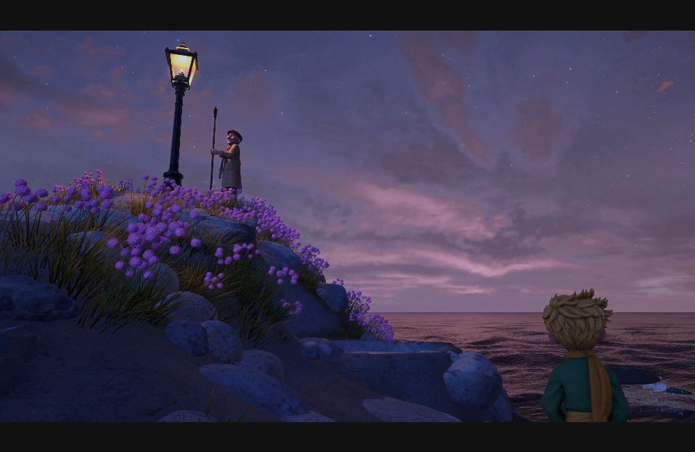
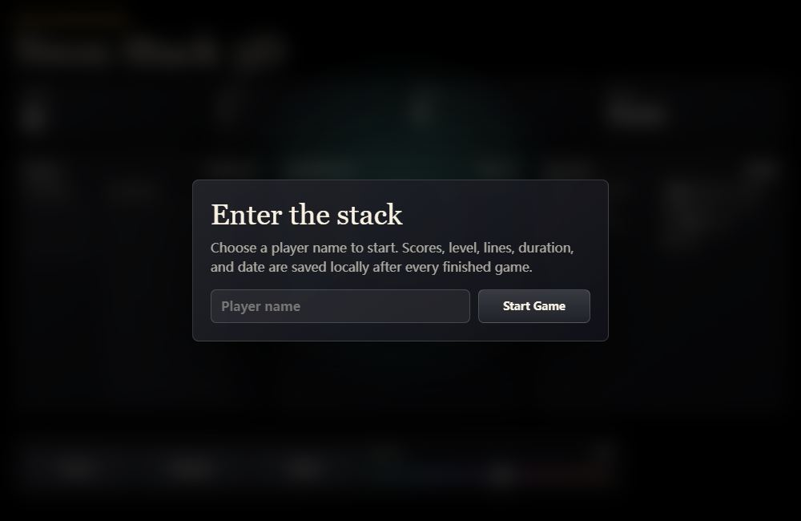

# 游戏开发

**简体中文** | [English](../en/categories/games.md)

> 不仅能看，还要能玩 · 共 **15 道**

[← 返回首页](../../README.zh-CN.md) · [全部案例](../INDEX.md)

> 下文简介和观察点为本库整理，不是原始提示词或官方评分规则。

## Neon Arena 多人激光对战

**编号**：`google-studio-neon_arena_laser_tag` · **收录来源**：[Google AI Studio / Build mode](https://blog.google/innovation-and-ai/technology/developers-tools/full-stack-vibe-coding-google-ai-studio/)（本库来源组内序号 1）

**英文标题**：Neon Arena multiplayer laser tag

**模型：** Google AI Studio agent（未列具体模型 / exact model undisclosed） · **作者 / 发布者：** Google

图片署名：Google · [原图 / 作品出处](https://storage.googleapis.com/gweb-uniblog-publish-prod/original_videos/Google-AIS-FSR_LaserTag_06-DR.mp4) · [素材说明](../../THIRD_PARTY_MEDIA.md)

Google 官方演示视频的画面截图，点击播放原视频。

多人房间、机器人对手与限时计分组成联机游戏闭环。

**原站署名 / 来源线索**：Google AI Studio / Build mode

**题面情况**：示例请求或部分题面

**可以观察什么？**

- 不同玩家的状态是否同步
- 计时结束和积分是否一致

**标签**：`游戏开发`, `来源整理`

**提示词与作品**：[前往原站查看](https://blog.google/innovation-and-ai/technology/developers-tools/full-stack-vibe-coding-google-ai-studio/) · **本库测试情况**：未实测

### 历史效果

**Google AI Studio agent（未列具体模型 / exact model undisclosed）** · 运行日期未公开 · Google

[查看效果 / 体验](https://aistudio.google.com/apps/bundled/neon_arena_laser_tag) · [来源记录](https://blog.google/innovation-and-ai/technology/developers-tools/full-stack-vibe-coding-google-ai-studio/) · [测试背景](https://blog.google/innovation-and-ai/technology/developers-tools/full-stack-vibe-coding-google-ai-studio/)

官方文章介绍并链接的作品；打开 Remix / 试玩需要 Google 登录。本库核对了官方说明和入口，未登录运行，完整原始提示词与迭代过程未公开。

---

## Neon Claw 物理抓娃娃机

**编号**：`google-studio-neon_claw` · **收录来源**：[Google AI Studio / Build mode](https://blog.google/innovation-and-ai/technology/developers-tools/full-stack-vibe-coding-google-ai-studio/)（本库来源组内序号 3）

**英文标题**：Neon Claw physics claw machine

**模型：** Google AI Studio agent（未列具体模型 / exact model undisclosed） · **作者 / 发布者：** Google

图片署名：Google · [原图 / 作品出处](https://storage.googleapis.com/gweb-uniblog-publish-prod/original_videos/FSR_NeonClaw_v06_1.mp4) · [素材说明](../../THIRD_PARTY_MEDIA.md)

Google 官方演示视频的画面截图，点击播放原视频。

把夹爪控制、碰撞、计时与排行榜结合成三维游戏。

**原站署名 / 来源线索**：Google AI Studio / Build mode

**题面情况**：示例请求或部分题面

**可以观察什么？**

- 夹爪是否通过碰撞抓取物体
- 成功判定与计时是否正确

**标签**：`游戏开发`, `来源整理`

**提示词与作品**：[前往原站查看](https://blog.google/innovation-and-ai/technology/developers-tools/full-stack-vibe-coding-google-ai-studio/) · **本库测试情况**：未实测

### 历史效果

**Google AI Studio agent（未列具体模型 / exact model undisclosed）** · 运行日期未公开 · Google

[查看效果 / 体验](https://aistudio.google.com/apps/bundled/neon_claw) · [来源记录](https://blog.google/innovation-and-ai/technology/developers-tools/full-stack-vibe-coding-google-ai-studio/) · [测试背景](https://blog.google/innovation-and-ai/technology/developers-tools/full-stack-vibe-coding-google-ai-studio/)

官方文章介绍并链接的作品；打开 Remix / 试玩需要 Google 登录。本库核对了官方说明和入口，未登录运行，完整原始提示词与迭代过程未公开。

---

## 一次写出卡丁车游戏

**编号**：`museum-006` · **收录来源**：[AI 考题博物馆](https://aitestmuseum.com/zh/tests/kart-racer)（本库来源组内序号 6）

**英文标题**：One-shot kart racing game

**模型：** Claude Opus 5.5 · **作者 / 发布者：** AI Test Museum

图片署名：AI Test Museum · [原图 / 作品出处](https://aitestmuseum.com/results/claude-opus-5-5/kart-racer/output.html) · [素材说明](../../THIRD_PARTY_MEDIA.md)

来源方已发布历史作品的浏览器截图（2026-11-08），不是重新调用模型；静帧不代表功能实测通过。

一句话挑战单文件 3D 卡丁车游戏。

**原站署名 / 来源线索**：BridgeMind（题面改写）

**可以观察什么？**

- 能否驾驶、漂移并完成赛道
- 对手、道具和圈数是否互相协调
- 能按题目要求运行或交互，不以截图代替验收

**标签**：`游戏`, `操控`

**提示词与作品**：[前往原站查看](https://aitestmuseum.com/zh/tests/kart-racer) · **本库测试情况**：未实测

### 历史效果

**Claude Opus 5.5** · 2026-10-19 · AI Test Museum

[查看效果 / 体验](https://aitestmuseum.com/results/claude-opus-5-5/kart-racer/output.html) · [来源记录](https://aitestmuseum.com/zh/tests/kart-racer) · [测试背景](https://aitestmuseum.com/zh#methodology)

原站 Claude Code agent 环境，包含其系统提示词；不等同裸 API。原站说明失败题可能重答，不将页面展示视作统一的一次成功记录。

---

## 一个文件写出 Flappy Bird

**编号**：`museum-009` · **收录来源**：[AI 考题博物馆](https://aitestmuseum.com/zh/tests/flappy-bird)（本库来源组内序号 9）

**英文标题**：Flappy Bird in one file

**模型：** Claude Opus 5.5 · **作者 / 发布者：** AI Test Museum

图片署名：AI Test Museum · [原图 / 作品出处](https://aitestmuseum.com/results/claude-opus-5-5/flappy-bird/output.html) · [素材说明](../../THIRD_PARTY_MEDIA.md)

来源方已发布历史作品的浏览器截图（2026-11-08），不是重新调用模型；静帧不代表功能实测通过。

用单文件网页制作可玩的 Flappy Bird 风格游戏。

**原站署名 / 来源线索**：社区经典题

**可以观察什么？**

- 点击或按键是否让角色跳跃
- 碰撞、计分、重新开始是否正常
- 能按题目要求运行或交互，不以截图代替验收

**标签**：`游戏`, `单文件`

**提示词与作品**：[前往原站查看](https://aitestmuseum.com/zh/tests/flappy-bird) · **本库测试情况**：未实测

### 历史效果

**Claude Opus 5.5** · 2026-10-19 · AI Test Museum

[查看效果 / 体验](https://aitestmuseum.com/results/claude-opus-5-5/flappy-bird/output.html) · [来源记录](https://aitestmuseum.com/zh/tests/flappy-bird) · [测试背景](https://aitestmuseum.com/zh#methodology)

原站 Claude Code agent 环境，包含其系统提示词；不等同裸 API。原站说明失败题可能重答，不将页面展示视作统一的一次成功记录。

---

## 一个文件写出俄罗斯方块

**编号**：`museum-010` · **收录来源**：[AI 考题博物馆](https://aitestmuseum.com/zh/tests/tetris)（本库来源组内序号 10）

**英文标题**：Tetris in one file

**模型：** Claude Opus 5.5 · **作者 / 发布者：** AI Test Museum

图片署名：AI Test Museum · [原图 / 作品出处](https://aitestmuseum.com/results/claude-opus-5-5/tetris/output.html) · [素材说明](../../THIRD_PARTY_MEDIA.md)

来源方已发布历史作品的浏览器截图（2026-11-08），不是重新调用模型；静帧不代表功能实测通过。

让 AI 生成包含旋转、消行和升级机制的俄罗斯方块。

**原站署名 / 来源线索**：社区经典题

**可以观察什么？**

- 旋转、移动、下落和消行是否正确
- 下一块预览与得分是否更新
- 能按题目要求运行或交互，不以截图代替验收

**标签**：`游戏`, `逻辑`

**提示词与作品**：[前往原站查看](https://aitestmuseum.com/zh/tests/tetris) · **本库测试情况**：未实测

### 历史效果

**Claude Opus 5.5** · 2026-10-19 · AI Test Museum

[查看效果 / 体验](https://aitestmuseum.com/results/claude-opus-5-5/tetris/output.html) · [来源记录](https://aitestmuseum.com/zh/tests/tetris) · [测试背景](https://aitestmuseum.com/zh#methodology)

原站 Claude Code agent 环境，包含其系统提示词；不等同裸 API。原站说明失败题可能重答，不将页面展示视作统一的一次成功记录。

---

## 摩天楼间的 3D 飞行游戏

**编号**：`museum-015` · **收录来源**：[AI 考题博物馆](https://aitestmuseum.com/zh/tests/flight-sim)（本库来源组内序号 15）

**英文标题**：3D flight game among skyscrapers

**模型：** Claude Opus 5.5 · **作者 / 发布者：** AI Test Museum

图片署名：AI Test Museum · [原图 / 作品出处](https://aitestmuseum.com/results/claude-opus-5-5/flight-sim/output.html) · [素材说明](../../THIRD_PARTY_MEDIA.md)

来源方已发布历史作品的浏览器截图（2026-11-08），不是重新调用模型；静帧不代表功能实测通过。

用很短的指令生成穿越摩天楼的浏览器飞行游戏。

**原站署名 / 来源线索**：@levelsio

**可以观察什么？**

- 飞行控制与跟随相机是否顺手
- 城市生成和游戏目标是否明确
- 能按题目要求运行或交互，不以截图代替验收

**标签**：`游戏`, `3D`

**提示词与作品**：[前往原站查看](https://aitestmuseum.com/zh/tests/flight-sim) · **本库测试情况**：未实测

### 历史效果

**Claude Opus 5.5** · 2026-10-19 · AI Test Museum

[查看效果 / 体验](https://aitestmuseum.com/results/claude-opus-5-5/flight-sim/output.html) · [来源记录](https://aitestmuseum.com/zh/tests/flight-sim) · [测试背景](https://aitestmuseum.com/zh#methodology)

原站 Claude Code agent 环境，包含其系统提示词；不等同裸 API。原站说明失败题可能重答，不将页面展示视作统一的一次成功记录。

---

## 小王子：星辰之旅

**编号**：`sac-little-prince` · **收录来源**：[Sac (@Saccc_c)](https://x.com/Saccc_c/status/2109962425512734739)（本库来源组内序号 1）

**英文标题**：The Little Prince: Across the Stars

**模型：** Claude Opus 5.5 · Tripo · Blender · Unity · **作者 / 发布者：** Sac (@Saccc_c)

图片署名：Sac (@Saccc_c) · [原图 / 作品出处](https://video.twimg.com/amplify_video/2109941568253927424/vid/avc1/3840x2160/_NUImXhsfraGu0Tb.mp4?tag=29) · [素材说明](../../THIRD_PARTY_MEDIA.md)

封面取自 Sac 首发演示视频的实际游戏画面。

在浏览器里走进《小王子》的故事，探索一颗颗星球。作者 Sac 用 AI 辅助制作角色、场景和游戏代码。官网目前仅支持电脑游玩。

**原站署名 / 来源线索**：Sac (@Saccc_c) · [作者制作教程](https://x.com/Saccc_c/status/2110694725640474759)

**题面情况**：示例请求或部分题面

**可以观察什么？**

- 在不同星球之间探索
- 查看作者如何从角色素材做到可玩场景

**标签**：`3D 剧情探索`, `AI 辅助创作`

**提示词与作品**：[前往原站查看](https://x.com/Saccc_c/status/2109962425512734739) · **本库测试情况**：未实测

### 历史效果

**Claude Opus 5.5 · Tripo · Blender · Unity** · 多步骤创作，非单次运行 · Sac (@Saccc_c)

[查看效果 / 体验](https://littleprince.dev/) · [来源记录](https://x.com/Saccc_c/status/2109962425512734739) · [测试背景](https://x.com/Saccc_c/status/2110694725640474759)

原帖及作者教程记录了 AI 辅助的多步骤制作流程；未独立复现，不作为单次模型输出。

---

## 带音效与排行榜的 3D 风格俄罗斯方块

**编号**：`stock42-tetris-3d` · **收录来源**：[Stock42 Creative Coding Challenges](https://github.com/stock42/test-llm-coding/blob/5dd2e8e63f026337ddfa39195d7f1008806bca1d/promptings/tetris-3d.md)（本库来源组内序号 4）

**英文标题**：3D-style Tetris with sound and scores

**模型：** GPT-5.5 / Codex · **作者 / 发布者：** stock42

图片署名：stock42 · [原图 / 作品出处](https://raw.githubusercontent.com/stock42/test-llm-coding/5dd2e8e63f026337ddfa39195d7f1008806bca1d/codex/gpt-5.5/tetris-3d/index.html) · [素材说明](../../THIRD_PARTY_MEDIA.md)

来源方已发布历史作品的浏览器截图（2026-11-08），不是重新调用模型；静帧不代表功能实测通过。

把投影展示、落块规则、声音和持久化分数放进单文件游戏。

**原站署名 / 来源线索**：Stock42 Creative Coding Challenges

**题面情况**：公开题面

**可以观察什么？**

- 消行与碰撞规则是否正确
- 重开与排行榜是否正确保存

**标签**：`游戏开发`, `来源整理`

**提示词与作品**：[前往原站查看](https://github.com/stock42/test-llm-coding/blob/5dd2e8e63f026337ddfa39195d7f1008806bca1d/promptings/tetris-3d.md) · **本库测试情况**：未实测

### 历史效果

**GPT-5.5 / Codex** · 运行日期未公开 · stock42

[查看效果 / 体验](https://github.com/stock42/test-llm-coding/blob/5dd2e8e63f026337ddfa39195d7f1008806bca1d/codex/gpt-5.5/tetris-3d/index.html) · [来源记录](https://github.com/stock42/test-llm-coding/blob/5dd2e8e63f026337ddfa39195d7f1008806bca1d/promptings/tetris-3d.md) · [测试背景](https://github.com/stock42/test-llm-coding/blob/5dd2e8e63f026337ddfa39195d7f1008806bca1d/RESULTS.md)

链接打开的是历史 HTML 源码，不是托管试玩；两组 Agent / 模型输出见原站 RESULTS.md。未在本库执行。

---

## 海岸钓鱼与买卖升级游戏

**编号**：`x-dangreenheck-2103004432786993341` · **收录来源**：[@dangreenheck / X](https://x.com/dangreenheck/status/2103004432786993341)（本库来源组内序号 1）

**英文标题**：Coastal fishing and trading game

**模型：** Claude Opus 5.5（作者报告 / creator-reported） · **作者 / 发布者：** Dan Greenheck / DRG Software Solutions LLC

图片署名：Dan Greenheck / DRG Software Solutions LLC · [原图 / 作品出处](https://raw.githubusercontent.com/dgreenheck/tidewater/4811ba48d795197de5621985f404e765c0b7c0ef/docs/screenshot.jpg) · [MIT](../../assets/licenses/tidewater-MIT.txt)

原项目截图；多轮迭代作品，试玩需要 WebGPU。

由公开作品整理的挑战方向：海岸钓鱼与买卖升级游戏。完整题面未逐字确认时，请勿当成原始提示词。

**原站署名 / 来源线索**：@dangreenheck；发现入口：[Awesome Opus Animation](https://github.com/krillinai/awesome-opus-animation/blob/main/categories/games.md#case-2103004432786993341)；原帖通过公开读取服务核对。

**题面情况**：完整原题未确认，按作品整理

**可以观察什么？**

- 捕鱼卖鱼买装备是否构成闭环
- 保存与重开是否保持合理状态

**标签**：`游戏开发`, `来源整理`

**提示词与作品**：[前往原站查看](https://x.com/dangreenheck/status/2103004432786993341) · **本库测试情况**：未实测

### 历史效果

**Opus 5.5** · 运行日期未公开 · @dangreenheck

[查看效果 / 体验](https://x.com/dangreenheck/status/2103004432786993341) · [来源记录](https://x.com/dangreenheck/status/2103004432786993341) · [测试背景](https://dgreenheck.github.io/tidewater/)

通过 FxTwitter 公共读取接口核对原帖 ID、账号和文字；未直接登录 X，也未独立运行或验证视频。作品介绍部分参考发现索引；完整题面、素材来源与迭代次数未公开的部分不推测。发布时间不是运行时间。

---

## 鱼叉捕鱼小游戏

**编号**：`x-nachat_dayo-2102773498037023140` · **收录来源**：[@nachat_dayo / X](https://x.com/nachat_dayo/status/2102773498037023140)（本库来源组内序号 1）

**英文标题**：Harpoon fishing game

**模型：** Opus5.5 · **作者 / 发布者：** @nachat_dayo

图片署名：@nachat_dayo · [原图 / 作品出处](https://pbs.twimg.com/amplify_video_thumb/2102773165420331009/img/imY1rCvKML0OZfNt.jpg) · [素材说明](../../THIRD_PARTY_MEDIA.md)

原帖视频封面，点击封面播放原视频。

由公开作品整理的挑战方向：鱼叉捕鱼小游戏。完整题面未逐字确认时，请勿当成原始提示词。

**原站署名 / 来源线索**：@nachat_dayo；发现入口：[Awesome Opus Animation](https://github.com/krillinai/awesome-opus-animation/blob/main/categories/games.md#case-2102773498037023140)；原帖通过公开读取服务核对。

**题面情况**：完整原题未确认，按作品整理

**可以观察什么？**

- 命中与得分判定是否一致
- 重开与操作反馈是否清晰

**标签**：`游戏开发`, `来源整理`

**提示词与作品**：[前往原站查看](https://x.com/nachat_dayo/status/2102773498037023140) · **本库测试情况**：未实测

### 历史效果

**Opus5.5** · 运行日期未公开 · @nachat_dayo

[查看效果 / 体验](https://x.com/nachat_dayo/status/2102773498037023140) · [来源记录](https://x.com/nachat_dayo/status/2102773498037023140) · [测试背景](https://claude.ai/artifact/X7xKcMxVJjjoCZ9ZSYyFUa)

通过 FxTwitter 公共读取接口核对原帖 ID、账号和文字；未直接登录 X，也未独立运行或验证视频。作品介绍部分参考发现索引；完整题面、素材来源与迭代次数未公开的部分不推测。发布时间不是运行时间。

---

## 种花养蜂与采蜜游戏

**编号**：`x-oguzthedev-2102476490344730950` · **收录来源**：[@oguzthedev / X](https://x.com/oguzthedev/status/2102476490344730950)（本库来源组内序号 1）

**英文标题**：Flower planting and beekeeping game

**模型：** Opus 5.5 · **作者 / 发布者：** @oguzthedev

图片署名：@oguzthedev · [原图 / 作品出处](https://pbs.twimg.com/amplify_video_thumb/2102475876294160385/img/62UkVvph1tnyLBye.jpg) · [素材说明](../../THIRD_PARTY_MEDIA.md)

原帖视频封面，点击封面播放原视频。

由公开作品整理的挑战方向：种花养蜂与采蜜游戏。完整题面未逐字确认时，请勿当成原始提示词。

**原站署名 / 来源线索**：@oguzthedev；发现入口：[Awesome Opus Animation](https://github.com/krillinai/awesome-opus-animation/blob/main/categories/games.md#case-2102476490344730950)；原帖通过公开读取服务核对。

**题面情况**：完整原题未确认，按作品整理

**可以观察什么？**

- 花朵蜜蜂蜂箱是否有实际关联
- 采蜜是否改变资源状态

**标签**：`游戏开发`, `来源整理`

**提示词与作品**：[前往原站查看](https://x.com/oguzthedev/status/2102476490344730950) · **本库测试情况**：未实测

### 历史效果

**Opus 5.5** · 运行日期未公开 · @oguzthedev

[查看效果 / 体验](https://x.com/oguzthedev/status/2102476490344730950) · [来源记录](https://x.com/oguzthedev/status/2102476490344730950) · [测试背景](https://github.com/krillinai/awesome-opus-animation/blob/main/categories/games.md#case-2102476490344730950)

通过 FxTwitter 公共读取接口核对原帖 ID、账号和文字；未直接登录 X，也未独立运行或验证视频。作品介绍部分参考发现索引；完整题面、素材来源与迭代次数未公开的部分不推测。发布时间不是运行时间。

---

待补效果 · 4 条案例

以下案例暂缺可直接展示的真实预览，保留完整介绍和来源方作品入口。

## 单文件光线投射 FPS

**编号**：`psydox-01` · **收录来源**：[psydox / Local LLM Coding Benchmark](https://github.com/psydox/Local-LLM-Coding-Benchmark/blob/061dec9d8918b0b1d302678e070247f866471fa9/01_Browser_FPS_Raycasting_Game_Test.txt)（本库来源组内序号 1）

**英文标题**：Single-file raycasting FPS

用受限浏览器技术实现第一人称地图、敌人和射击闭环。

**原站署名 / 来源线索**：psydox / Local LLM Coding Benchmark

**题面情况**：公开题面

尚未找到历史效果；本条仅提供原始题面，不补造模型输出。

**可以观察什么？**

- 墙体碰撞与敌人行为是否可用
- 胜负、HUD 与重开是否完整

**标签**：`游戏开发`, `来源整理`

**提示词与作品**：[前往原站查看](https://github.com/psydox/Local-LLM-Coding-Benchmark/blob/061dec9d8918b0b1d302678e070247f866471fa9/01_Browser_FPS_Raycasting_Game_Test.txt) · **本库测试情况**：未实测

---

## 带最佳成绩的记忆翻牌

**编号**：`psydox-03` · **收录来源**：[psydox / Local LLM Coding Benchmark](https://github.com/psydox/Local-LLM-Coding-Benchmark/blob/061dec9d8918b0b1d302678e070247f866471fa9/03_Memory_Card_Matching_Game_Test.txt)（本库来源组内序号 2）

**英文标题**：Memory matching with best scores

考察洗牌、翻牌状态与本地成绩保存。

**原站署名 / 来源线索**：psydox / Local LLM Coding Benchmark

**题面情况**：公开题面

尚未找到历史效果；本条仅提供原始题面，不补造模型输出。

**可以观察什么？**

- 是否阻止重复点击和多翻牌
- 重开后状态与存档是否正确

**标签**：`游戏开发`, `来源整理`

**提示词与作品**：[前往原站查看](https://github.com/psydox/Local-LLM-Coding-Benchmark/blob/061dec9d8918b0b1d302678e070247f866471fa9/03_Memory_Card_Matching_Game_Test.txt) · **本库测试情况**：未实测

---

## Canvas 打砖块

**编号**：`psydox-04` · **收录来源**：[psydox / Local LLM Coding Benchmark](https://github.com/psydox/Local-LLM-Coding-Benchmark/blob/061dec9d8918b0b1d302678e070247f866471fa9/04_Breakout_Canvas_Game_Test.txt)（本库来源组内序号 3）

**英文标题**：Canvas Breakout

完成球拍、砖块、生命与关卡结束条件。

**原站署名 / 来源线索**：psydox / Local LLM Coding Benchmark

**题面情况**：公开题面

尚未找到历史效果；本条仅提供原始题面，不补造模型输出。

**可以观察什么？**

- 球拍与砖块碰撞是否可靠
- 胜负后能否正确重新开始

**标签**：`游戏开发`, `来源整理`

**提示词与作品**：[前往原站查看](https://github.com/psydox/Local-LLM-Coding-Benchmark/blob/061dec9d8918b0b1d302678e070247f866471fa9/04_Breakout_Canvas_Game_Test.txt) · **本库测试情况**：未实测

---

## 俯视角 2D 驾驶游戏

**编号**：`psydox-06` · **收录来源**：[psydox / Local LLM Coding Benchmark](https://github.com/psydox/Local-LLM-Coding-Benchmark/blob/061dec9d8918b0b1d302678e070247f866471fa9/06_Top_Down_2D_Driving_Game_Test.txt)（本库来源组内序号 5）

**英文标题**：Top-down 2D driving game

在滚动赛道中处理操控、障碍和终点流程。

**原站署名 / 来源线索**：psydox / Local LLM Coding Benchmark

**题面情况**：公开题面

尚未找到历史效果；本条仅提供原始题面，不补造模型输出。

**可以观察什么？**

- 相机与车辆位置是否一致
- 碰撞重置与终点是否可达

**标签**：`游戏开发`, `来源整理`

**提示词与作品**：[前往原站查看](https://github.com/psydox/Local-LLM-Coding-Benchmark/blob/061dec9d8918b0b1d302678e070247f866471fa9/06_Top_Down_2D_Driving_Game_Test.txt) · **本库测试情况**：未实测

---

