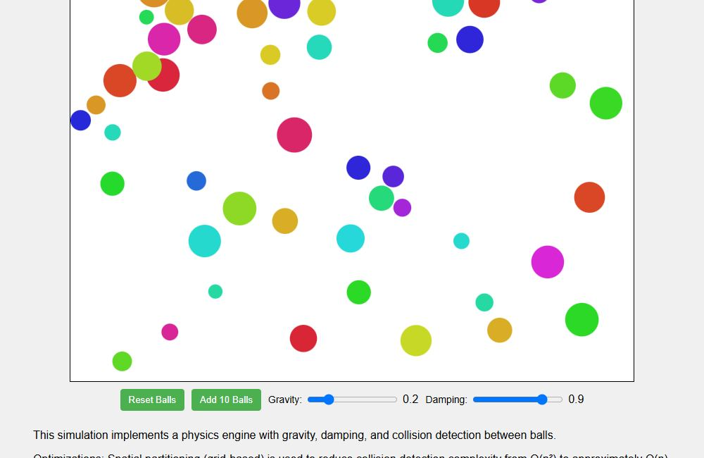
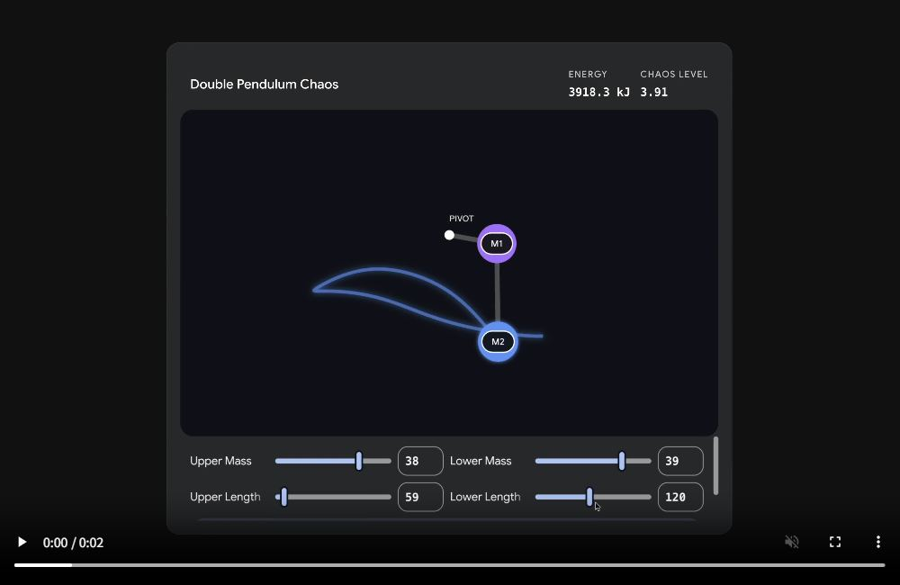
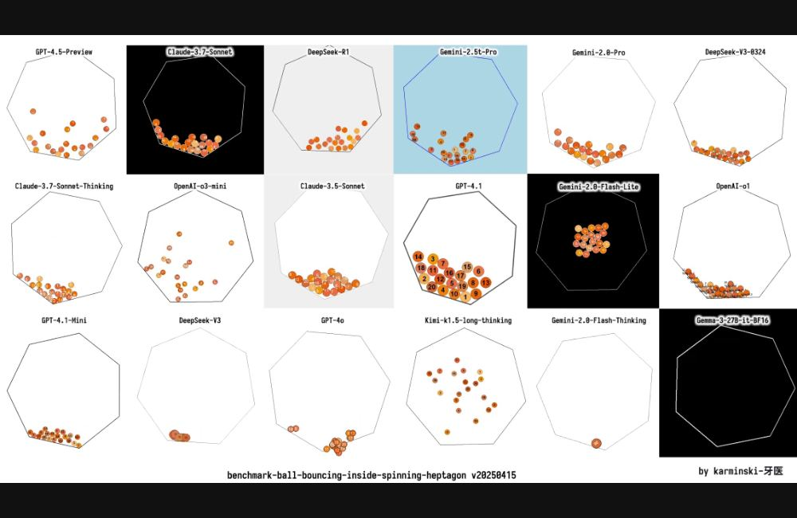
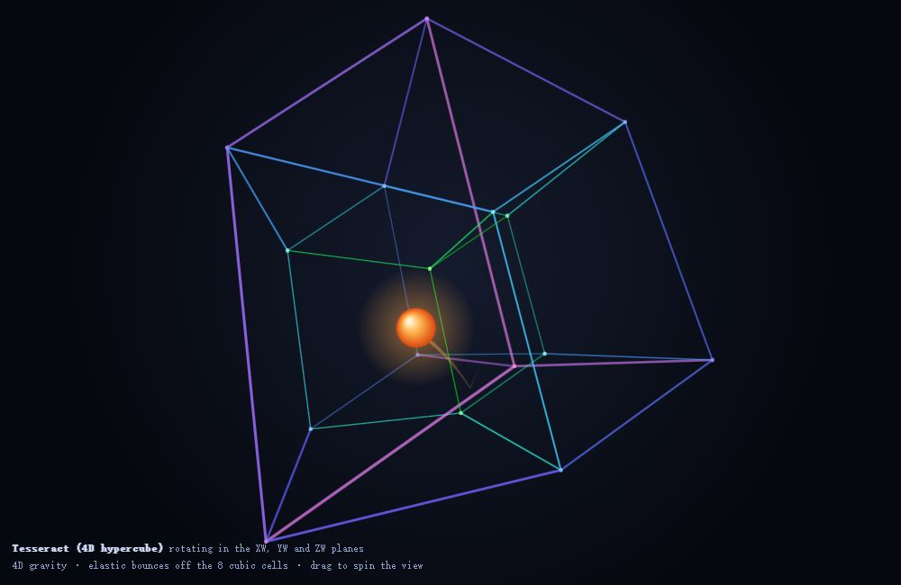

# Animation & Physics

[简体中文](../../categories/animation.md) | **English**

> Make motion and simulation work · **31 challenges**

[← Home](../../../README.md) · [All challenges](../INDEX.md)

> The summaries and observation points below are our editorial descriptions, not original prompts or official scoring rules.

## Autonomous aquarium

**ID**: `electricazimuth-aquarium` · **Source**: [David Harris / LocalLLM Visual Code Test](https://github.com/electricazimuth/LocalLLM_VisualCodeTest/blob/7e7004885221fafb8b1de360cacc2b8281cf934a/code_prompts/aquarium.md) (catalog source position 1)

**Model:** GLM-4-32B-0414-F16-Q4_K_M · **Author / publisher:** David Harris / electricazimuth

Image: David Harris / electricazimuth · [Original image / work](https://electricazimuth.github.io/LocalLLM_VisualCodeTest/results/2025.04.28/html/GLM-4-32B-0414-F16-Q4_K_M_aquarium_20250425_171639.html) · [Media notice](../../../THIRD_PARTY_MEDIA.en.md)

Browser capture of a source-published historical work (2026-11-08), not a new model run. A still does not establish functional correctness.

Multiple fish wander and turn within a bounded tank.

**Source credit / attribution lead**: David Harris / LocalLLM Visual Code Test

**Prompt availability**: Public prompt

**What to observe**

- Fish turn and stay within the tank
- Motion remains consistent across frame rates

**Tags**: `animation and physics`, `source collection`

**Prompts and outputs**: [View the source](https://github.com/electricazimuth/LocalLLM_VisualCodeTest/blob/7e7004885221fafb8b1de360cacc2b8281cf934a/code_prompts/aquarium.md) · **Test status in this repository**: Not tested

### Historical outputs

**GLM-4-32B-0414-F16-Q4_K_M** · 2025-04-25 · David Harris / electricazimuth

[View output / demo](https://electricazimuth.github.io/LocalLLM_VisualCodeTest/results/2025.04.28/html/GLM-4-32B-0414-F16-Q4_K_M_aquarium_20250425_171639.html) · [Source record](https://github.com/electricazimuth/LocalLLM_VisualCodeTest/blob/7e7004885221fafb8b1de360cacc2b8281cf934a/code_prompts/aquarium.md) · [Test context](https://azimuth.substack.com/p/local-llm-visual-benchmark)

Source-published output, not executed here. Refer to the source for the prompt, model label and conditions.

---

## Many-ball gravity and damping

**ID**: `electricazimuth-ball_bound` · **Source**: [David Harris / LocalLLM Visual Code Test](https://github.com/electricazimuth/LocalLLM_VisualCodeTest/blob/7e7004885221fafb8b1de360cacc2b8281cf934a/code_prompts/ball_bound.md) (catalog source position 2)

**Model:** GLM-4-32B-0414-F16-Q4_K_M · **Author / publisher:** David Harris / electricazimuth

Image: David Harris / electricazimuth · [Original image / work](https://electricazimuth.github.io/LocalLLM_VisualCodeTest/results/2025.04.28/html/GLM-4-32B-0414-F16-Q4_K_M_ball_bound_20250425_172122.html) · [Media notice](../../../THIRD_PARTY_MEDIA.en.md)

Browser capture of a source-published historical work (2026-11-08), not a new model run. A still does not establish functional correctness.

Simulate interacting balls and dissipative collisions in a square container.

**Source credit / attribution lead**: David Harris / LocalLLM Visual Code Test

**Prompt availability**: Public prompt

**What to observe**

- Colliding balls separate
- Gravity and damping affect trajectories

**Tags**: `animation and physics`, `source collection`

**Prompts and outputs**: [View the source](https://github.com/electricazimuth/LocalLLM_VisualCodeTest/blob/7e7004885221fafb8b1de360cacc2b8281cf934a/code_prompts/ball_bound.md) · **Test status in this repository**: Not tested

### Historical outputs

**GLM-4-32B-0414-F16-Q4_K_M** · 2025-04-25 · David Harris / electricazimuth

[View output / demo](https://electricazimuth.github.io/LocalLLM_VisualCodeTest/results/2025.04.28/html/GLM-4-32B-0414-F16-Q4_K_M_ball_bound_20250425_172122.html) · [Source record](https://github.com/electricazimuth/LocalLLM_VisualCodeTest/blob/7e7004885221fafb8b1de360cacc2b8281cf934a/code_prompts/ball_bound.md) · [Test context](https://azimuth.substack.com/p/local-llm-visual-benchmark)

Source-published output, not executed here. Refer to the source for the prompt, model label and conditions.

---

## Wandering and egg-laying chicken

**ID**: `electricazimuth-chicken` · **Source**: [David Harris / LocalLLM Visual Code Test](https://github.com/electricazimuth/LocalLLM_VisualCodeTest/blob/7e7004885221fafb8b1de360cacc2b8281cf934a/code_prompts/chicken.md) (catalog source position 3)

**Model:** GLM-4-32B-0414-F16-Q4_K_M · **Author / publisher:** David Harris / electricazimuth

Image: David Harris / electricazimuth · [Original image / work](https://electricazimuth.github.io/LocalLLM_VisualCodeTest/results/2025.04.28/html/GLM-4-32B-0414-F16-Q4_K_M_chicken_20250425_172543.html) · [Media notice](../../../THIRD_PARTY_MEDIA.en.md)

Browser capture of a source-published historical work (2026-11-08), not a new model run. A still does not establish functional correctness.

A chicken switches between wandering and laying, leaving eggs behind.

**Source credit / attribution lead**: David Harris / LocalLLM Visual Code Test

**Prompt availability**: Public prompt

**What to observe**

- Movement pauses during laying
- Eggs are created and retained

**Tags**: `animation and physics`, `source collection`

**Prompts and outputs**: [View the source](https://github.com/electricazimuth/LocalLLM_VisualCodeTest/blob/7e7004885221fafb8b1de360cacc2b8281cf934a/code_prompts/chicken.md) · **Test status in this repository**: Not tested

### Historical outputs

**GLM-4-32B-0414-F16-Q4_K_M** · 2025-04-25 · David Harris / electricazimuth

[View output / demo](https://electricazimuth.github.io/LocalLLM_VisualCodeTest/results/2025.04.28/html/GLM-4-32B-0414-F16-Q4_K_M_chicken_20250425_172543.html) · [Source record](https://github.com/electricazimuth/LocalLLM_VisualCodeTest/blob/7e7004885221fafb8b1de360cacc2b8281cf934a/code_prompts/chicken.md) · [Test context](https://azimuth.substack.com/p/local-llm-visual-benchmark)

Source-published output, not executed here. Refer to the source for the prompt, model label and conditions.

---

## Autonomous fireworks particles

**ID**: `electricazimuth-fireworks` · **Source**: [David Harris / LocalLLM Visual Code Test](https://github.com/electricazimuth/LocalLLM_VisualCodeTest/blob/7e7004885221fafb8b1de360cacc2b8281cf934a/code_prompts/fireworks.md) (catalog source position 4)

**Model:** GLM-4-32B-0414-F16-Q4_K_M · **Author / publisher:** David Harris / electricazimuth

Image: David Harris / electricazimuth · [Original image / work](https://electricazimuth.github.io/LocalLLM_VisualCodeTest/results/2025.04.28/html/GLM-4-32B-0414-F16-Q4_K_M_fireworks_20250425_172956.html) · [Media notice](../../../THIRD_PARTY_MEDIA.en.md)

Browser capture of a source-published historical work (2026-11-08), not a new model run. A still does not establish functional correctness.

Rockets launch and burst into fading particles affected by gravity.

**Source credit / attribution lead**: David Harris / LocalLLM Visual Code Test

**Prompt availability**: Public prompt

**What to observe**

- Rocket and burst lifecycles are distinct
- Expired particles are removed

**Tags**: `animation and physics`, `source collection`

**Prompts and outputs**: [View the source](https://github.com/electricazimuth/LocalLLM_VisualCodeTest/blob/7e7004885221fafb8b1de360cacc2b8281cf934a/code_prompts/fireworks.md) · **Test status in this repository**: Not tested

### Historical outputs

**GLM-4-32B-0414-F16-Q4_K_M** · 2025-04-25 · David Harris / electricazimuth

[View output / demo](https://electricazimuth.github.io/LocalLLM_VisualCodeTest/results/2025.04.28/html/GLM-4-32B-0414-F16-Q4_K_M_fireworks_20250425_172956.html) · [Source record](https://github.com/electricazimuth/LocalLLM_VisualCodeTest/blob/7e7004885221fafb8b1de360cacc2b8281cf934a/code_prompts/fireworks.md) · [Test context](https://azimuth.substack.com/p/local-llm-visual-benchmark)

Source-published output, not executed here. Refer to the source for the prompt, model label and conditions.

---

## Vehicle collision and restart

**ID**: `electricazimuth-vehicles` · **Source**: [David Harris / LocalLLM Visual Code Test](https://github.com/electricazimuth/LocalLLM_VisualCodeTest/blob/7e7004885221fafb8b1de360cacc2b8281cf934a/code_prompts/vehicles.md) (catalog source position 6)

**Model:** claude37（原站名称 / source label） · **Author / publisher:** David Harris / electricazimuth

Image: David Harris / electricazimuth · [Original image / work](https://electricazimuth.github.io/LocalLLM_VisualCodeTest/results/2025.04.28/html/claude37_vehicles_20250425_174000.html) · [Media notice](../../../THIRD_PARTY_MEDIA.en.md)

Browser capture of a source-published historical work (2026-11-08), not a new model run. A still does not establish functional correctness.

Vehicles wrap around the screen, collide, explode and restart.

**Source credit / attribution lead**: David Harris / LocalLLM Visual Code Test

**Prompt availability**: Public prompt

**What to observe**

- Vehicles wrap to the opposite edge
- The scene resets after the explosion

**Tags**: `animation and physics`, `source collection`

**Prompts and outputs**: [View the source](https://github.com/electricazimuth/LocalLLM_VisualCodeTest/blob/7e7004885221fafb8b1de360cacc2b8281cf934a/code_prompts/vehicles.md) · **Test status in this repository**: Not tested

### Historical outputs

**GLM-4-32B-0414-F16-Q4_K_M** · 2025-04-25 · David Harris / electricazimuth

[View output / demo](https://electricazimuth.github.io/LocalLLM_VisualCodeTest/results/2025.04.28/html/GLM-4-32B-0414-F16-Q4_K_M_vehicles_20250425_174812.html) · [Source record](https://github.com/electricazimuth/LocalLLM_VisualCodeTest/blob/7e7004885221fafb8b1de360cacc2b8281cf934a/code_prompts/vehicles.md) · [Test context](https://azimuth.substack.com/p/local-llm-visual-benchmark)

Source-published output, not executed here. Refer to the source for the prompt, model label and conditions.

---

## Interactive fractal visualization

**ID**: `google-sim-fractals` · **Source**: [Google / Gemini interactive visualizations](https://blog.google/innovation-and-ai/products/gemini-app/3d-models-charts/) (catalog source position 1)

**Model:** Gemini Pro（官方未列完整版本 / exact version not listed） · **Author / publisher:** Google

Image: Google · [Original image / work](https://storage.googleapis.com/gweb-uniblog-publish-prod/original_videos/2_GeminiHacks_Fractal_NoPrompt_16x9.mp4) · [Media notice](../../../THIRD_PARTY_MEDIA.en.md)

A frame captured from the official Google demo video; click to play the original.

Explore zoom and detail through the official fractal demo.

**Source credit / attribution lead**: Google / Gemini interactive visualizations

**Prompt availability**: Example request / partial prompt

**What to observe**

- Zoom produces coherent detail
- Interaction changes computed results

**Tags**: `animation and physics`, `source collection`

**Prompts and outputs**: [View the source](https://blog.google/innovation-and-ai/products/gemini-app/3d-models-charts/) · **Test status in this repository**: Not tested

### Historical outputs

**Gemini Pro（官方未列完整版本 / exact version not listed）** · Run date not disclosed · Google

[View output / demo](https://blog.google/innovation-and-ai/products/gemini-app/3d-models-charts/) · [Source record](https://blog.google/innovation-and-ai/products/gemini-app/3d-models-charts/) · [Test context](https://blog.google/innovation-and-ai/products/gemini-app/3d-models-charts/)

Demo videos appear in the official article. Example requests are public; full system prompts, sampling settings and standalone output code are not. Not reproduced here.

---

## Interactive double-slit interference

**ID**: `google-sim-double-slit` · **Source**: [Google / Gemini interactive visualizations](https://blog.google/innovation-and-ai/products/gemini-app/3d-models-charts/) (catalog source position 2)

**Model:** Gemini Pro（官方未列完整版本 / exact version not listed） · **Author / publisher:** Google

Image: Google · [Original image / work](https://storage.googleapis.com/gweb-uniblog-publish-prod/original_videos/4_GeminiHacks_DoubleSlit_NoPrompt_16x9.mp4) · [Media notice](../../../THIRD_PARTY_MEDIA.en.md)

A frame captured from the official Google demo video; click to play the original.

Use the official double-slit demo to explore parameters and interference patterns.

**Source credit / attribution lead**: Google / Gemini interactive visualizations

**Prompt availability**: Example request / partial prompt

**What to observe**

- Parameter changes affect fringes
- Demonstration approximations are distinguished from physics claims

**Tags**: `animation and physics`, `source collection`

**Prompts and outputs**: [View the source](https://blog.google/innovation-and-ai/products/gemini-app/3d-models-charts/) · **Test status in this repository**: Not tested

### Historical outputs

**Gemini Pro（官方未列完整版本 / exact version not listed）** · Run date not disclosed · Google

[View output / demo](https://blog.google/innovation-and-ai/products/gemini-app/3d-models-charts/) · [Source record](https://blog.google/innovation-and-ai/products/gemini-app/3d-models-charts/) · [Test context](https://blog.google/innovation-and-ai/products/gemini-app/3d-models-charts/)

Demo videos appear in the official article. Example requests are public; full system prompts, sampling settings and standalone output code are not. Not reproduced here.

---

## Interactive double-pendulum chaos

**ID**: `google-sim-double-pendulum` · **Source**: [Google / Gemini interactive visualizations](https://blog.google/innovation-and-ai/products/gemini-app/3d-models-charts/) (catalog source position 3)

**Model:** Gemini Pro（官方未列完整版本 / exact version not listed） · **Author / publisher:** Google

Image: Google · [Original image / work](https://storage.googleapis.com/gweb-uniblog-publish-prod/original_videos/PENDULUM_NEW_FINAL_1.mp4) · [Media notice](../../../THIRD_PARTY_MEDIA.en.md)

A frame captured from the official Google demo video; click to play the original.

Explore initial conditions and motion with the official double-pendulum demo.

**Source credit / attribution lead**: Google / Gemini interactive visualizations

**Prompt availability**: Example request / partial prompt

**What to observe**

- Trajectories follow coupled pendulum motion
- Parameters can be adjusted and the simulation restarted

**Tags**: `animation and physics`, `source collection`

**Prompts and outputs**: [View the source](https://blog.google/innovation-and-ai/products/gemini-app/3d-models-charts/) · **Test status in this repository**: Not tested

### Historical outputs

**Gemini Pro（官方未列完整版本 / exact version not listed）** · Run date not disclosed · Google

[View output / demo](https://blog.google/innovation-and-ai/products/gemini-app/3d-models-charts/) · [Source record](https://blog.google/innovation-and-ai/products/gemini-app/3d-models-charts/) · [Test context](https://blog.google/innovation-and-ai/products/gemini-app/3d-models-charts/)

Demo videos appear in the official article. Example requests are public; full system prompts, sampling settings and standalone output code are not. Not reproduced here.

---

## 20 numbered balls in a spinning heptagon

**ID**: `kcores-ball-bouncing-inside-spinning-heptagon` · **Source**: [KCORES LLM Arena](https://github.com/KCORES/kcores-llm-arena/blob/8f09c63e78189858377a760d03f69fb744b19aa2/benchmark-ball-bouncing-inside-spinning-heptagon/README.md) (catalog source position 1)

**Model:** 原仓库未标明 / Not disclosed · **Author / publisher:** KCORES team

Image: KCORES team · [Original image / work](https://raw.githubusercontent.com/KCORES/kcores-llm-arena/8f09c63e78189858377a760d03f69fb744b19aa2/assets/images/ball-bouncing-gif.gif) · [Media notice](../../../THIRD_PARTY_MEDIA.en.md)

Multi-model view from the source heptagon animation; click to open the original.

Simulate ball-ball and rotating-wall collisions with spin and friction; distinct from the existing single-ball hexagon task.

**Source credit / attribution lead**: KCORES LLM Arena

**Prompt availability**: Public prompt

**What to observe**

- Both ball-ball and moving-wall collisions are handled
- Number labels reflect ball spin

**Tags**: `animation and physics`, `source collection`

**Prompts and outputs**: [View the source](https://github.com/KCORES/kcores-llm-arena/blob/8f09c63e78189858377a760d03f69fb744b19aa2/benchmark-ball-bouncing-inside-spinning-heptagon/README.md) · **Test status in this repository**: Not tested

### Historical outputs

**多个模型，见原站 / Multiple models; see source** · Run date not disclosed · KCORES team

[View output / demo](https://github.com/KCORES/kcores-llm-arena/tree/8f09c63e78189858377a760d03f69fb744b19aa2/benchmark-ball-bouncing-inside-spinning-heptagon/src) · [Source record](https://github.com/KCORES/kcores-llm-arena/blob/8f09c63e78189858377a760d03f69fb744b19aa2/benchmark-ball-bouncing-inside-spinning-heptagon/README.md) · [Test context](https://github.com/KCORES/kcores-llm-arena/blob/8f09c63e78189858377a760d03f69fb744b19aa2/benchmark-ball-bouncing-inside-spinning-heptagon/README.md)

The source selects the best of three runs per model. Not directly comparable with one-shot outputs. Links point to output-code directories; code and score images are not mirrored.

---

## Mandelbrot fractal drawn with Li Bai characters

**ID**: `kcores-mandelbrot-set-meet-libai` · **Source**: [KCORES LLM Arena](https://github.com/KCORES/kcores-llm-arena/blob/8f09c63e78189858377a760d03f69fb744b19aa2/benchmark-mandelbrot-set-meet-libai/README.md) (catalog source position 2)

**Model:** Gemini-2.5-Pro-Experimental-03-25 · **Author / publisher:** KCORES team

Image: KCORES team · [Original image / work](https://raw.githubusercontent.com/KCORES/kcores-llm-arena/8f09c63e78189858377a760d03f69fb744b19aa2/benchmark-mandelbrot-set-meet-libai/src/mandelbrot-set-meet-libai-benchmark-Gemini-2.5-Pro-Experimental-03-25-turn-2-high-score.html) · [Media notice](../../../THIRD_PARTY_MEDIA.en.md)

Browser capture of a source-published historical work (2026-11-08), not a new model run. A still does not establish functional correctness.

Combine poem-character processing, fractal zoom and frame-rate reporting in Canvas.

**Source credit / attribution lead**: KCORES LLM Arena

**Prompt availability**: Public prompt

**What to observe**

- Character deduplication preserves order
- Zoom center, looping and frame-rate reporting follow the prompt

**Tags**: `animation and physics`, `source collection`

**Prompts and outputs**: [View the source](https://github.com/KCORES/kcores-llm-arena/blob/8f09c63e78189858377a760d03f69fb744b19aa2/benchmark-mandelbrot-set-meet-libai/README.md) · **Test status in this repository**: Not tested

### Historical outputs

**多个模型，见原站 / Multiple models; see source** · Run date not disclosed · KCORES team

[View output / demo](https://github.com/KCORES/kcores-llm-arena/tree/8f09c63e78189858377a760d03f69fb744b19aa2/benchmark-mandelbrot-set-meet-libai/src) · [Source record](https://github.com/KCORES/kcores-llm-arena/blob/8f09c63e78189858377a760d03f69fb744b19aa2/benchmark-mandelbrot-set-meet-libai/README.md) · [Test context](https://github.com/KCORES/kcores-llm-arena/blob/8f09c63e78189858377a760d03f69fb744b19aa2/benchmark-mandelbrot-set-meet-libai/README.md)

The source selects the best of three runs per model. Not directly comparable with one-shot outputs. Links point to output-code directories; code and score images are not mirrored.

---

## Pelican riding a bicycle

**ID**: `museum-001` · **Source**: [AI Test Museum](https://aitestmuseum.com/zh/tests/pelican-bicycle) (catalog source position 1)

**Model:** Claude Opus 5.5 · **Author / publisher:** AI Test Museum

Image: AI Test Museum · [Original image / work](https://aitestmuseum.com/results/claude-opus-5-5/pelican-bicycle/output.html) · [Media notice](../../../THIRD_PARTY_MEDIA.en.md)

Browser capture of a source-published historical work (2026-11-08), not a new model run. A still does not establish functional correctness.

Generate an SVG animation of a pelican riding a bicycle, rather than a static drawing.

**Source credit / attribution lead**: Simon Willison (animation adaptation)

**What to observe**

- Are the wheels, pedals, and bird's legs synchronized?
- Can the animation run independently?
- Does the result run or support the required interaction, rather than only provide a screenshot?

**Tags**: `SVG`, `Motion`

**Prompts and outputs**: [View the source](https://aitestmuseum.com/zh/tests/pelican-bicycle) · **Test status in this repository**: Not tested

### Historical outputs

**Claude Opus 5.5** · 2026-10-19 · AI Test Museum

[View output / demo](https://aitestmuseum.com/results/claude-opus-5-5/pelican-bicycle/output.html) · [Source record](https://aitestmuseum.com/zh/tests/pelican-bicycle) · [Test context](https://aitestmuseum.com/zh#methodology)

Source Claude Code agent environment with its system context, not a bare API call. The source allows retries for failed tasks; a displayed result is not treated as proof of universal one-shot success.

---

## Bouncing ball inside a spinning hexagon

**ID**: `museum-002` · **Source**: [AI Test Museum](https://aitestmuseum.com/zh/tests/bouncing-ball-hexagon) (catalog source position 2)

**Model:** Claude Opus 5.5 · **Author / publisher:** AI Test Museum

Image: AI Test Museum · [Original image / work](https://aitestmuseum.com/results/claude-opus-5-5/bouncing-ball-hexagon/output.html) · [Media notice](../../../THIRD_PARTY_MEDIA.en.md)

Browser capture of a source-published historical work (2026-11-08), not a new model run. A still does not establish functional correctness.

Animate a ball bouncing inside a continuously rotating hexagon under gravity and friction.

**Source credit / attribution lead**: Flavio Adamo (adapted prompt)

**What to observe**

- Do rebounds account for the velocity of the rotating walls?
- Does the ball pass through walls or get stuck after running for a while?
- Does the result run or support the required interaction, rather than only provide a screenshot?

**Tags**: `Physics`, `Collisions`

**Prompts and outputs**: [View the source](https://aitestmuseum.com/zh/tests/bouncing-ball-hexagon) · **Test status in this repository**: Not tested

### Historical outputs

**Claude Opus 5.5** · 2026-10-19 · AI Test Museum

[View output / demo](https://aitestmuseum.com/results/claude-opus-5-5/bouncing-ball-hexagon/output.html) · [Source record](https://aitestmuseum.com/zh/tests/bouncing-ball-hexagon) · [Test context](https://aitestmuseum.com/zh#methodology)

Source Claude Code agent environment with its system context, not a bare API call. The source allows retries for failed tasks; a displayed result is not treated as proof of universal one-shot success.

---

## Supernova explosion

**ID**: `museum-008` · **Source**: [AI Test Museum](https://aitestmuseum.com/zh/tests/supernova) (catalog source position 8)

**Model:** Claude Opus 5.5 · **Author / publisher:** AI Test Museum

Image: AI Test Museum · [Original image / work](https://aitestmuseum.com/results/claude-opus-5-5/supernova/output.html) · [Media notice](../../../THIRD_PARTY_MEDIA.en.md)

Browser capture of a source-published historical work (2026-11-08), not a new model run. A still does not establish functional correctness.

Animate a star's evolution into a supernova and its remnant.

**Source credit / attribution lead**: AI/ML API model comparison

**What to observe**

- Are expansion, collapse, and explosion shown coherently?
- Are the animation stages and visual layers clear?
- Does the result run or support the required interaction, rather than only provide a screenshot?

**Tags**: `Animation`, `Science communication`

**Prompts and outputs**: [View the source](https://aitestmuseum.com/zh/tests/supernova) · **Test status in this repository**: Not tested

### Historical outputs

**Claude Opus 5.5** · 2026-10-19 · AI Test Museum

[View output / demo](https://aitestmuseum.com/results/claude-opus-5-5/supernova/output.html) · [Source record](https://aitestmuseum.com/zh/tests/supernova) · [Test context](https://aitestmuseum.com/zh#methodology)

Source Claude Code agent environment with its system context, not a bare API call. The source allows retries for failed tasks; a displayed result is not treated as proof of universal one-shot success.

---

## Drowned Gothic city shader

**ID**: `museum-013` · **Source**: [AI Test Museum](https://aitestmuseum.com/zh/tests/drowned-gothic-city) (catalog source position 13)

**Model:** Claude Opus 5.5 · **Author / publisher:** AI Test Museum

Image: AI Test Museum · [Original image / work](https://aitestmuseum.com/results/claude-opus-5-5/drowned-gothic-city/output.html) · [Media notice](../../../THIRD_PARTY_MEDIA.en.md)

Browser capture of a source-published historical work (2026-11-08), not a new model run. A still does not establish functional correctness.

Use a shader to draw a partially submerged Gothic city in a storm.

**Source credit / attribution lead**: Ethan Mollick

**What to observe**

- Do the towers, rain, and atmosphere form a convincing scene?
- Does rendering remain stable over time?
- Does the result run or support the required interaction, rather than only provide a screenshot?

**Tags**: `Shader`, `Aesthetics`

**Prompts and outputs**: [View the source](https://aitestmuseum.com/zh/tests/drowned-gothic-city) · **Test status in this repository**: Not tested

### Historical outputs

**Claude Opus 5.5** · 2026-10-19 · AI Test Museum

[View output / demo](https://aitestmuseum.com/results/claude-opus-5-5/drowned-gothic-city/output.html) · [Source record](https://aitestmuseum.com/zh/tests/drowned-gothic-city) · [Test context](https://aitestmuseum.com/zh#methodology)

Source Claude Code agent environment with its system context, not a bare API call. The source allows retries for failed tasks; a displayed result is not treated as proof of universal one-shot success.

---

## Hand-controlled particles

**ID**: `museum-016` · **Source**: [AI Test Museum](https://aitestmuseum.com/zh/tests/hand-gesture-particles) (catalog source position 16)

**Model:** Claude Opus 5.5 · **Author / publisher:** AI Test Museum

Image: AI Test Museum · [Original image / work](https://aitestmuseum.com/results/claude-opus-5-5/hand-gesture-particles/output.html) · [Media notice](../../../THIRD_PARTY_MEDIA.en.md)

Browser capture of a source-published historical work (2026-11-08), not a new model run. A still does not establish functional correctness.

Use webcam hand gestures to change the shapes of Three.js particles.

**Source credit / attribution lead**: @EHuanglu

**What to observe**

- Are webcam permissions and gesture recognition reliable?
- Can particles change in real time and switch shapes?
- Does the result run or support the required interaction, rather than only provide a screenshot?

**Tags**: `Animation`, `Gestures`

**Prompts and outputs**: [View the source](https://aitestmuseum.com/zh/tests/hand-gesture-particles) · **Test status in this repository**: Not tested

### Historical outputs

**Claude Opus 5.5** · 2026-10-19 · AI Test Museum

[View output / demo](https://aitestmuseum.com/results/claude-opus-5-5/hand-gesture-particles/output.html) · [Source record](https://aitestmuseum.com/zh/tests/hand-gesture-particles) · [Test context](https://aitestmuseum.com/zh#methodology)

Source Claude Code agent environment with its system context, not a bare API call. The source allows retries for failed tasks; a displayed result is not treated as proof of universal one-shot success.

---

## Bouncing ball inside a hypercube

**ID**: `museum-017` · **Source**: [AI Test Museum](https://aitestmuseum.com/zh/tests/tesseract-ball) (catalog source position 17)

**Model:** Claude Opus 5.5 · **Author / publisher:** AI Test Museum

Image: AI Test Museum · [Original image / work](https://aitestmuseum.com/results/claude-opus-5-5/tesseract-ball/output.html) · [Media notice](../../../THIRD_PARTY_MEDIA.en.md)

Browser capture of a source-published historical work (2026-11-08), not a new model run. A still does not establish functional correctness.

Animate a bouncing ball inside a rotating four-dimensional hypercube.

**Source credit / attribution lead**: @Yuchenj_UW (adapted prompt)

**What to observe**

- Is the projection of the higher-dimensional structure understandable?
- Do collisions agree with the displayed scene?
- Does the result run or support the required interaction, rather than only provide a screenshot?

**Tags**: `Physics`, `Higher dimensions`

**Prompts and outputs**: [View the source](https://aitestmuseum.com/zh/tests/tesseract-ball) · **Test status in this repository**: Not tested

### Historical outputs

**Claude Opus 5.5** · 2026-10-19 · AI Test Museum

[View output / demo](https://aitestmuseum.com/results/claude-opus-5-5/tesseract-ball/output.html) · [Source record](https://aitestmuseum.com/zh/tests/tesseract-ball) · [Test context](https://aitestmuseum.com/zh#methodology)

Source Claude Code agent environment with its system context, not a bare API call. The source allows retries for failed tasks; a displayed result is not treated as proof of universal one-shot success.

---

## Starship control panel

**ID**: `museum-018` · **Source**: [AI Test Museum](https://aitestmuseum.com/zh/tests/starship-control-panel) (catalog source position 18)

**Model:** Claude Opus 5.5 · **Author / publisher:** AI Test Museum

Image: AI Test Museum · [Original image / work](https://aitestmuseum.com/results/claude-opus-5-5/starship-control-panel/output.html) · [Media notice](../../../THIRD_PARTY_MEDIA.en.md)

Browser capture of a source-published historical work (2026-11-08), not a new model run. A still does not establish functional correctness.

Use p5.js to generate an imaginative futuristic starship control panel.

**Source credit / attribution lead**: Ethan Mollick

**What to observe**

- Are the instruments and visual design inventive?
- Is interaction feedback clear?
- Does the result run or support the required interaction, rather than only provide a screenshot?

**Tags**: `Creativity`, `p5.js`

**Prompts and outputs**: [View the source](https://aitestmuseum.com/zh/tests/starship-control-panel) · **Test status in this repository**: Not tested

### Historical outputs

**Claude Opus 5.5** · 2026-10-19 · AI Test Museum

[View output / demo](https://aitestmuseum.com/results/claude-opus-5-5/starship-control-panel/output.html) · [Source record](https://aitestmuseum.com/zh/tests/starship-control-panel) · [Test context](https://aitestmuseum.com/zh#methodology)

Source Claude Code agent environment with its system context, not a bare API call. The source allows retries for failed tasks; a displayed result is not treated as proof of universal one-shot success.

---

## Analog clock showing 10:10

**ID**: `museum-019` · **Source**: [AI Test Museum](https://aitestmuseum.com/zh/tests/ai-world-clock) (catalog source position 19)

**Model:** Claude Opus 5.5 · **Author / publisher:** AI Test Museum

Image: AI Test Museum · [Original image / work](https://aitestmuseum.com/results/claude-opus-5-5/ai-world-clock/output.html) · [Media notice](../../../THIRD_PARTY_MEDIA.en.md)

Browser capture of a source-published historical work (2026-11-08), not a new model run. A still does not establish functional correctness.

Draw an HTML/CSS clock showing 10:10 with a continuously moving second hand.

**Source credit / attribution lead**: Brian Moore / AI World Clocks

**What to observe**

- Are the hour-hand and minute-hand angles correct?
- Do the second-hand animation and responsive layout work?
- Does the result run or support the required interaction, rather than only provide a screenshot?

**Tags**: `Animation`, `Spatial reasoning`

**Prompts and outputs**: [View the source](https://aitestmuseum.com/zh/tests/ai-world-clock) · **Test status in this repository**: Not tested

### Historical outputs

**Claude Opus 5.5** · 2026-10-19 · AI Test Museum

[View output / demo](https://aitestmuseum.com/results/claude-opus-5-5/ai-world-clock/output.html) · [Source record](https://aitestmuseum.com/zh/tests/ai-world-clock) · [Test context](https://aitestmuseum.com/zh#methodology)

Source Claude Code agent environment with its system context, not a bare API call. The source allows retries for failed tasks; a displayed result is not treated as proof of universal one-shot success.

---

## Glass bridge fracture and loading

**ID**: `reddit-glass-bridge-glass-bridge` · **Source**: [EntelligenceAI / u/entelligenceai17](https://www.reddit.com/r/LLMDevs/comments/1urypfg/benchmarking_gpt56_sol_vs_grok_45_pro_with_the/) (catalog source position 1)

**Model:** GPT-5.6 SOL / Grok 4.5 Pro（来源标记 / source label） · **Author / publisher:** @EntelligenceAI

Image: @EntelligenceAI · [Original image / work](https://pbs.twimg.com/amplify_video_thumb/2075281891473952768/img/VhOVFPL17_NDgdBU.jpg) · [Media notice](../../../THIRD_PARTY_MEDIA.en.md)

Original-post video poster; click to play the source video.

Show loading, crack propagation, shattering and particles in one file.

**Source credit / attribution lead**: EntelligenceAI / u/entelligenceai17

**Prompt availability**: Example request / partial prompt

**What to observe**

- Cracks respond to load position
- Visual effects are distinguished from accurate mechanics

**Tags**: `animation and physics`, `source collection`

**Prompts and outputs**: [View the source](https://www.reddit.com/r/LLMDevs/comments/1urypfg/benchmarking_gpt56_sol_vs_grok_45_pro_with_the/) · **Test status in this repository**: Not tested

### Historical outputs

**GPT-5.6 SOL / Grok 4.5 Pro** · Run date not disclosed · EntelligenceAI / u/entelligenceai17

[View output / demo](https://x.com/EntelligenceAI/status/2075282696008532097) · [Source record](https://www.reddit.com/r/LLMDevs/comments/1urypfg/benchmarking_gpt56_sol_vs_grok_45_pro_with_the/) · [Test context](https://www.reddit.com/r/LLMDevs/comments/1urypfg/benchmarking_gpt56_sol_vs_grok_45_pro_with_the/)

Historical outputs in the post or comments, reported by participants. Execution success and scientific accuracy were not verified here. Quantization, hardware, tools and iteration conditions differ.

---

## Triple-pendulum chaos painter

**ID**: `stock42-triple-pendulum` · **Source**: [Stock42 Creative Coding Challenges](https://github.com/stock42/test-llm-coding/blob/5dd2e8e63f026337ddfa39195d7f1008806bca1d/promptings/triple-pendulum.md) (catalog source position 1)

**Model:** GPT-5.5 / Codex · **Author / publisher:** stock42

Image: stock42 · [Original image / work](https://raw.githubusercontent.com/stock42/test-llm-coding/5dd2e8e63f026337ddfa39195d7f1008806bca1d/codex/gpt-5.5/triple-pendulum/index.html) · [Media notice](../../../THIRD_PARTY_MEDIA.en.md)

Browser capture of a source-published historical work (2026-11-08), not a new model run. A still does not establish functional correctness.

Explore chaos and numerical stability through the endpoint of a three-link pendulum.

**Source credit / attribution lead**: Stock42 Creative Coding Challenges

**Prompt availability**: Public prompt

**What to observe**

- Trails follow coupled pendulum motion
- Pause and reset work consistently

**Tags**: `animation and physics`, `source collection`

**Prompts and outputs**: [View the source](https://github.com/stock42/test-llm-coding/blob/5dd2e8e63f026337ddfa39195d7f1008806bca1d/promptings/triple-pendulum.md) · **Test status in this repository**: Not tested

### Historical outputs

**GPT-5.5 / Codex** · Run date not disclosed · stock42

[View output / demo](https://github.com/stock42/test-llm-coding/blob/5dd2e8e63f026337ddfa39195d7f1008806bca1d/codex/gpt-5.5/triple-pendulum/index.html) · [Source record](https://github.com/stock42/test-llm-coding/blob/5dd2e8e63f026337ddfa39195d7f1008806bca1d/promptings/triple-pendulum.md) · [Test context](https://github.com/stock42/test-llm-coding/blob/5dd2e8e63f026337ddfa39195d7f1008806bca1d/RESULTS.md)

The link opens historical HTML source, not a hosted demo. RESULTS.md lists two agent/model output sets. Not executed here.

---

## Pi through block collisions

**ID**: `stock42-1kg-block-bounces` · **Source**: [Stock42 Creative Coding Challenges](https://github.com/stock42/test-llm-coding/blob/5dd2e8e63f026337ddfa39195d7f1008806bca1d/promptings/1kg-block-bounces.md) (catalog source position 2)

**Model:** GPT-5.5 / Codex · **Author / publisher:** stock42

Image: stock42 · [Original image / work](https://raw.githubusercontent.com/stock42/test-llm-coding/5dd2e8e63f026337ddfa39195d7f1008806bca1d/codex/gpt-5.5/1kg-block-bounces/index.html) · [Media notice](../../../THIRD_PARTY_MEDIA.en.md)

Browser capture of a source-published historical work (2026-11-08), not a new model run. A still does not establish functional correctness.

Compare elastic-collision counts across mass ratios, separating exact results from visual approximations.

**Source credit / attribution lead**: Stock42 Creative Coding Challenges

**Prompt availability**: Public prompt

**What to observe**

- Collisions preserve momentum and energy
- Mass-ratio and counting assumptions are explained

**Tags**: `animation and physics`, `source collection`

**Prompts and outputs**: [View the source](https://github.com/stock42/test-llm-coding/blob/5dd2e8e63f026337ddfa39195d7f1008806bca1d/promptings/1kg-block-bounces.md) · **Test status in this repository**: Not tested

### Historical outputs

**GPT-5.5 / Codex** · Run date not disclosed · stock42

[View output / demo](https://github.com/stock42/test-llm-coding/blob/5dd2e8e63f026337ddfa39195d7f1008806bca1d/codex/gpt-5.5/1kg-block-bounces/index.html) · [Source record](https://github.com/stock42/test-llm-coding/blob/5dd2e8e63f026337ddfa39195d7f1008806bca1d/promptings/1kg-block-bounces.md) · [Test context](https://github.com/stock42/test-llm-coding/blob/5dd2e8e63f026337ddfa39195d7f1008806bca1d/RESULTS.md)

The link opens historical HTML source, not a hosted demo. RESULTS.md lists two agent/model output sets. Not executed here.

---

## Galton board and bell curve

**ID**: `stock42-balls-fall` · **Source**: [Stock42 Creative Coding Challenges](https://github.com/stock42/test-llm-coding/blob/5dd2e8e63f026337ddfa39195d7f1008806bca1d/promptings/balls-fall.md) (catalog source position 3)

**Model:** GPT-5.5 / Codex · **Author / publisher:** stock42

Image: stock42 · [Original image / work](https://raw.githubusercontent.com/stock42/test-llm-coding/5dd2e8e63f026337ddfa39195d7f1008806bca1d/codex/gpt-5.5/balls-fall/index.html) · [Media notice](../../../THIRD_PARTY_MEDIA.en.md)

Browser capture of a source-published historical work (2026-11-08), not a new model run. A still does not establish functional correctness.

Balls pass through pegs into bins to build a distribution.

**Source credit / attribution lead**: Stock42 Creative Coding Challenges

**Prompt availability**: Public prompt

**What to observe**

- Falling balls correspond to histogram counts
- Probability animation is distinguished from physical collision simulation

**Tags**: `animation and physics`, `source collection`

**Prompts and outputs**: [View the source](https://github.com/stock42/test-llm-coding/blob/5dd2e8e63f026337ddfa39195d7f1008806bca1d/promptings/balls-fall.md) · **Test status in this repository**: Not tested

### Historical outputs

**GPT-5.5 / Codex** · Run date not disclosed · stock42

[View output / demo](https://github.com/stock42/test-llm-coding/blob/5dd2e8e63f026337ddfa39195d7f1008806bca1d/codex/gpt-5.5/balls-fall/index.html) · [Source record](https://github.com/stock42/test-llm-coding/blob/5dd2e8e63f026337ddfa39195d7f1008806bca1d/promptings/balls-fall.md) · [Test context](https://github.com/stock42/test-llm-coding/blob/5dd2e8e63f026337ddfa39195d7f1008806bca1d/RESULTS.md)

The link opens historical HTML source, not a hosted demo. RESULTS.md lists two agent/model output sets. Not executed here.

---

## 40-second coded browser explainer

**ID**: `x-addyosmani-2103009037164110327` · **Source**: [@addyosmani / X](https://x.com/addyosmani/status/2103009037164110327) (catalog source position 1)

**Model:** Opus 5.5 · **Author / publisher:** @addyosmani

Image: @addyosmani · [Original image / work](https://pbs.twimg.com/amplify_video_thumb/2102980713603887104/img/XgCaV0YvE_TaH9Oi.jpg) · [Media notice](../../../THIRD_PARTY_MEDIA.en.md)

Original-post video poster; click to play the source video.

A challenge direction adapted from the public work: 40-second coded browser explainer. Do not treat this description as the original prompt.

**Source credit / attribution lead**: @addyosmani; discovery: [Awesome Opus Animation](https://github.com/krillinai/awesome-opus-animation/blob/main/categories/explainers.md#case-2103009037164110327); post metadata checked through a public reader.

**Prompt availability**: Full prompt unconfirmed; adapted from work

**What to observe**

- Parsing, layout and painting are explained accurately
- Captions and animation timing are readable

**Tags**: `animation and physics`, `source collection`

**Prompts and outputs**: [View the source](https://x.com/addyosmani/status/2103009037164110327) · **Test status in this repository**: Not tested

### Historical outputs

**Opus 5.5** · Run date not disclosed · @addyosmani

[View output / demo](https://x.com/addyosmani/status/2103009037164110327) · [Source record](https://x.com/addyosmani/status/2103009037164110327) · [Test context](https://github.com/krillinai/awesome-opus-animation/blob/main/categories/explainers.md#case-2103009037164110327)

Post ID, account and text checked via the public FxTwitter reader; no X login, independent execution or video verification. Discovery-index descriptions supplement the post. Missing prompt, asset and iteration details are not inferred. Publication time is not run time.

---

## Blender claymation-style animation

**ID**: `x-alexalbert__-2102458348511879448` · **Source**: [@alexalbert__ / X](https://x.com/alexalbert__/status/2102458348511879448) (catalog source position 1)

**Model:** Opus 5.5 · **Author / publisher:** @alexalbert__

Image: @alexalbert__ · [Original image / work](https://pbs.twimg.com/amplify_video_thumb/2102457816820916224/img/UNnuG_dYWVbvKNZu.jpg) · [Media notice](../../../THIRD_PARTY_MEDIA.en.md)

Original-post video poster; click to play the source video.

A challenge direction adapted from the public work: Blender claymation-style animation. Do not treat this description as the original prompt.

**Source credit / attribution lead**: @alexalbert__; discovery: [Awesome Opus Animation](https://github.com/krillinai/awesome-opus-animation/blob/main/categories/3d-scenes.md#case-2102458348511879448); post metadata checked through a public reader.

**Prompt availability**: Full prompt unconfirmed; adapted from work

**What to observe**

- Materials and lighting sustain the clay style
- Frame-to-frame motion is coherent

**Tags**: `animation and physics`, `source collection`

**Prompts and outputs**: [View the source](https://x.com/alexalbert__/status/2102458348511879448) · **Test status in this repository**: Not tested

### Historical outputs

**Opus 5.5** · Run date not disclosed · @alexalbert__

[View output / demo](https://x.com/alexalbert__/status/2102458348511879448) · [Source record](https://x.com/alexalbert__/status/2102458348511879448) · [Test context](https://github.com/krillinai/awesome-opus-animation/blob/main/categories/3d-scenes.md#case-2102458348511879448)

Post ID, account and text checked via the public FxTwitter reader; no X login, independent execution or video verification. Discovery-index descriptions supplement the post. Missing prompt, asset and iteration details are not inferred. Publication time is not run time.

---

## Interactive steam-morph stop motion

**ID**: `x-chetaslua-2102501773705670994` · **Source**: [@chetaslua / X](https://x.com/chetaslua/status/2102501773705670994) (catalog source position 1)

**Model:** Opus 5.5 · **Author / publisher:** @chetaslua

Image: @chetaslua · [Original image / work](https://pbs.twimg.com/amplify_video_thumb/2102501285840986112/img/-MZF7O6nDoIBOzRo.jpg) · [Media notice](../../../THIRD_PARTY_MEDIA.en.md)

Original-post video poster; click to play the source video.

A challenge direction adapted from the public work: Interactive steam-morph stop motion. Do not treat this description as the original prompt.

**Source credit / attribution lead**: @chetaslua; discovery: [Awesome Opus Animation](https://github.com/krillinai/awesome-opus-animation/blob/main/categories/code-animation.md#case-2102501773705670994); post metadata checked through a public reader.

**Prompt availability**: Full prompt unconfirmed; adapted from work

**What to observe**

- Shape transformations remain coherent
- Dragging and frame stepping work

**Tags**: `animation and physics`, `source collection`

**Prompts and outputs**: [View the source](https://x.com/chetaslua/status/2102501773705670994) · **Test status in this repository**: Not tested

### Historical outputs

**Opus 5.5** · Run date not disclosed · @chetaslua

[View output / demo](https://x.com/chetaslua/status/2102501773705670994) · [Source record](https://x.com/chetaslua/status/2102501773705670994) · [Test context](https://codepen.io/editor/ChetasLua/pen/01a0cadf-5b81-756f-8647-8cf5a47e7adf)

Post ID, account and text checked via the public FxTwitter reader; no X login, independent execution or video verification. Discovery-index descriptions supplement the post. Missing prompt, asset and iteration details are not inferred. Publication time is not run time.

---

## JavaScript music-theory audiovisual

**ID**: `x-dadabots-2103039181266338276` · **Source**: [@dadabots / X](https://x.com/dadabots/status/2103039181266338276) (catalog source position 1)

**Model:** Opus 5.5 · **Author / publisher:** @dadabots

Image: @dadabots · [Original image / work](https://pbs.twimg.com/amplify_video_thumb/2103038366216294400/img/yB5hzAfoYKrVTEBZ.jpg) · [Media notice](../../../THIRD_PARTY_MEDIA.en.md)

Original-post video poster; click to play the source video.

A challenge direction adapted from the public work: JavaScript music-theory audiovisual. Do not treat this description as the original prompt.

**Source credit / attribution lead**: @dadabots; discovery: [Awesome Opus Animation](https://github.com/krillinai/awesome-opus-animation/blob/main/categories/code-animation.md#case-2103039181266338276); post metadata checked through a public reader.

**Prompt availability**: Full prompt unconfirmed; adapted from work

**What to observe**

- Sound corresponds to note labels
- Synthesized sound is distinguished from external samples

**Tags**: `animation and physics`, `source collection`

**Prompts and outputs**: [View the source](https://x.com/dadabots/status/2103039181266338276) · **Test status in this repository**: Not tested

### Historical outputs

**Opus 5.5** · Run date not disclosed · @dadabots

[View output / demo](https://x.com/dadabots/status/2103039181266338276) · [Source record](https://x.com/dadabots/status/2103039181266338276) · [Test context](https://github.com/krillinai/awesome-opus-animation/blob/main/categories/code-animation.md#case-2103039181266338276)

Post ID, account and text checked via the public FxTwitter reader; no X login, independent execution or video verification. Discovery-index descriptions supplement the post. Missing prompt, asset and iteration details are not inferred. Publication time is not run time.

---

## Pixel animation of neural-network training

**ID**: `x-dotcsv-2102737776219168939` · **Source**: [@DotCSV / X](https://x.com/DotCSV/status/2102737776219168939) (catalog source position 1)

**Model:** Opus 5.5 · **Author / publisher:** @DotCSV

Image: @DotCSV · [Original image / work](https://pbs.twimg.com/amplify_video_thumb/2102736360750579712/img/dCHBu9qqCypGbT9v.jpg) · [Media notice](../../../THIRD_PARTY_MEDIA.en.md)

Original-post video poster; click to play the source video.

A challenge direction adapted from the public work: Pixel animation of neural-network training. Do not treat this description as the original prompt.

**Source credit / attribution lead**: @DotCSV; discovery: [Awesome Opus Animation](https://github.com/krillinai/awesome-opus-animation/blob/main/categories/explainers.md#case-2102737776219168939); post metadata checked through a public reader.

**Prompt availability**: Full prompt unconfirmed; adapted from work

**What to observe**

- Animation distinguishes prediction from updating
- Decorative changes are not mislabeled as training

**Tags**: `animation and physics`, `source collection`

**Prompts and outputs**: [View the source](https://x.com/DotCSV/status/2102737776219168939) · **Test status in this repository**: Not tested

### Historical outputs

**Opus 5.5** · Run date not disclosed · @DotCSV

[View output / demo](https://x.com/DotCSV/status/2102737776219168939) · [Source record](https://x.com/DotCSV/status/2102737776219168939) · [Test context](https://github.com/krillinai/awesome-opus-animation/blob/main/categories/explainers.md#case-2102737776219168939)

Post ID, account and text checked via the public FxTwitter reader; no X login, independent execution or video verification. Discovery-index descriptions supplement the post. Missing prompt, asset and iteration details are not inferred. Publication time is not run time.

---

## Code film of four seasons through a train window

**ID**: `x-itsolelehmann-2103124033365762215` · **Source**: [@itsolelehmann / X](https://x.com/itsolelehmann/status/2103124033365762215) (catalog source position 1)

**Model:** Opus 5.5 · **Author / publisher:** @itsolelehmann

Image: @itsolelehmann · [Original image / work](https://pbs.twimg.com/amplify_video_thumb/2103123980039458816/img/DDPjksrlzGkxSB1K.jpg) · [Media notice](../../../THIRD_PARTY_MEDIA.en.md)

Original-post video poster; click to play the source video.

A challenge direction adapted from the public work: Code film of four seasons through a train window. Do not treat this description as the original prompt.

**Source credit / attribution lead**: @itsolelehmann; discovery: [Awesome Opus Animation](https://github.com/krillinai/awesome-opus-animation/blob/main/categories/code-animation.md#case-2103124033365762215); post metadata checked through a public reader.

**Prompt availability**: Full prompt unconfirmed; adapted from work

**What to observe**

- Layered parallax produces continuous motion
- Season transitions and sound remain coherent

**Tags**: `animation and physics`, `source collection`

**Prompts and outputs**: [View the source](https://x.com/itsolelehmann/status/2103124033365762215) · **Test status in this repository**: Not tested

### Historical outputs

**Opus 5.5** · Run date not disclosed · @itsolelehmann

[View output / demo](https://x.com/itsolelehmann/status/2103124033365762215) · [Source record](https://x.com/itsolelehmann/status/2103124033365762215) · [Test context](https://github.com/krillinai/awesome-opus-animation/blob/main/categories/code-animation.md#case-2103124033365762215)

Post ID, account and text checked via the public FxTwitter reader; no X login, independent execution or video verification. Discovery-index descriptions supplement the post. Missing prompt, asset and iteration details are not inferred. Publication time is not run time.

---

## Reassembling glass-and-gold mosaic

**ID**: `x-lcslates-2102503027340988559` · **Source**: [@LCSlates / X](https://x.com/LCSlates/status/2102503027340988559) (catalog source position 1)

**Model:** Opus 5.5 · **Author / publisher:** @LCSlates

Image: @LCSlates · [Original image / work](https://video.twimg.com/amplify_video/2102502315185803264/vid/avc1/1080x1080/sAv8kDNKSV7KmtgO.mp4?tag=29) · [Media notice](../../../THIRD_PARTY_MEDIA.en.md)

A frame captured from the source demo video; click to play the original.

A challenge direction adapted from the public work: Reassembling glass-and-gold mosaic. Do not treat this description as the original prompt.

**Source credit / attribution lead**: @LCSlates; discovery: [Awesome Opus Animation](https://github.com/krillinai/awesome-opus-animation/blob/main/categories/code-animation.md#case-2102503027340988559); post metadata checked through a public reader.

**Prompt availability**: Full prompt unconfirmed; adapted from work

**What to observe**

- Tiles move continuously rather than swap images
- Sound aligns with tile motion

**Tags**: `animation and physics`, `source collection`

**Prompts and outputs**: [View the source](https://x.com/LCSlates/status/2102503027340988559) · **Test status in this repository**: Not tested

### Historical outputs

**Opus 5.5** · Run date not disclosed · @LCSlates

[View output / demo](https://x.com/LCSlates/status/2102503027340988559) · [Source record](https://x.com/LCSlates/status/2102503027340988559) · [Test context](https://github.com/krillinai/awesome-opus-animation/blob/main/categories/code-animation.md#case-2102503027340988559)

Post ID, account and text checked via the public FxTwitter reader; no X login, independent execution or video verification. Discovery-index descriptions supplement the post. Missing prompt, asset and iteration details are not inferred. Publication time is not run time.

---

## Autonomous cosmic pixel dash

**ID**: `x-riku720720-2102515055116063144` · **Source**: [@riku720720 / X](https://x.com/riku720720/status/2102515055116063144) (catalog source position 1)

**Model:** opus 5.5 · **Author / publisher:** @riku720720

Image: @riku720720 · [Original image / work](https://pbs.twimg.com/amplify_video_thumb/2102513096682336256/img/kyN5TvYWMLX_TPAt.jpg) · [Media notice](../../../THIRD_PARTY_MEDIA.en.md)

Original-post video poster; click to play the source video.

A challenge direction adapted from the public work: Autonomous cosmic pixel dash. Do not treat this description as the original prompt.

**Source credit / attribution lead**: @riku720720; discovery: [Awesome Opus Animation](https://github.com/krillinai/awesome-opus-animation/blob/main/categories/code-animation.md#case-2102515055116063144); post metadata checked through a public reader.

**Prompt availability**: Full prompt unconfirmed; adapted from work

**What to observe**

- Obstacles and character motion share consistent timing
- An automatic demo is identified as such

**Tags**: `animation and physics`, `source collection`

**Prompts and outputs**: [View the source](https://x.com/riku720720/status/2102515055116063144) · **Test status in this repository**: Not tested

### Historical outputs

**opus 5.5** · Run date not disclosed · @riku720720

[View output / demo](https://x.com/riku720720/status/2102515055116063144) · [Source record](https://x.com/riku720720/status/2102515055116063144) · [Test context](https://github.com/krillinai/awesome-opus-animation/blob/main/categories/code-animation.md#case-2102515055116063144)

Post ID, account and text checked via the public FxTwitter reader; no X login, independent execution or video verification. Discovery-index descriptions supplement the post. Missing prompt, asset and iteration details are not inferred. Publication time is not run time.

---

## Inverse-kinematics pixel horse

**ID**: `x-victormustar-2102707412704919910` · **Source**: [@victormustar / X](https://x.com/victormustar/status/2102707412704919910) (catalog source position 1)

**Model:** Opus 5.5 · **Author / publisher:** @victormustar

Image: @victormustar · [Original image / work](https://pbs.twimg.com/amplify_video_thumb/2102707356932993024/img/eRYCNlEvczUBPd03.jpg) · [Media notice](../../../THIRD_PARTY_MEDIA.en.md)

Original-post video poster; click to play the source video.

A challenge direction adapted from the public work: Inverse-kinematics pixel horse. Do not treat this description as the original prompt.

**Source credit / attribution lead**: @victormustar; discovery: [Awesome Opus Animation](https://github.com/krillinai/awesome-opus-animation/blob/main/categories/code-animation.md#case-2102707412704919910); post metadata checked through a public reader.

**Prompt availability**: Full prompt unconfirmed; adapted from work

**What to observe**

- Leg joints remain connected
- The cycle loops without jumps

**Tags**: `animation and physics`, `source collection`

**Prompts and outputs**: [View the source](https://x.com/victormustar/status/2102707412704919910) · **Test status in this repository**: Not tested

### Historical outputs

**Opus 5.5** · Run date not disclosed · @victormustar

[View output / demo](https://x.com/victormustar/status/2102707412704919910) · [Source record](https://x.com/victormustar/status/2102707412704919910) · [Test context](https://github.com/krillinai/awesome-opus-animation/blob/main/categories/code-animation.md#case-2102707412704919910)

Post ID, account and text checked via the public FxTwitter reader; no X login, independent execution or video verification. Discovery-index descriptions supplement the post. Missing prompt, asset and iteration details are not inferred. Publication time is not run time.

---
