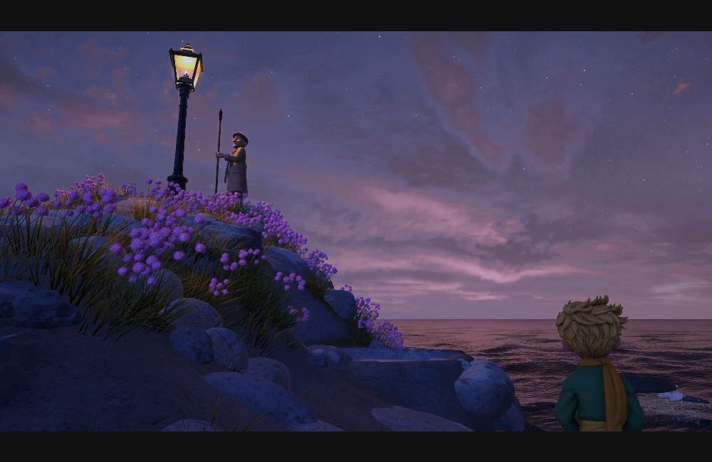
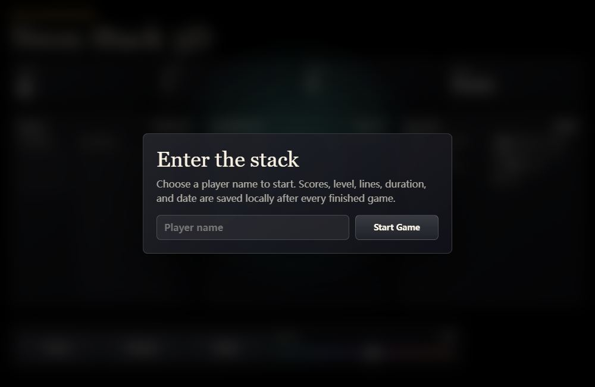

# Games

[简体中文](../../categories/games.md) | **English**

[← Home](../../../README.md) · [Work index](../INDEX.md)

> We provide the summaries and viewing notes. Follow the source links for original works and any published prompts.

## Aiden's Revenge

**ID**: `aidens-revenge` · **Source**: [Notes by Lex · Lex Toumbourou](https://notesbylex.com/fable-5-2-one-shotted-my-nephews-dream-game) (catalog source position 1)

**Model:** Claude Fable 5.2 · **Author / publisher:** Lex Toumbourou

Image: Lex Toumbourou · [Original image / work](https://notesbylex.com/_media/aidens-revenge/hulk-owen.jpg) · [Media notice](../../../docs/en/THIRD_PARTY_MEDIA.md)

The cover links to a gameplay screenshot from the creator’s article, showing Hulk Owen slamming the boardwalk.

Aiden drew the heroes and villains. His uncle Lex used Claude to turn the drawings into a browser beat ’em up with 12 stages, 18 playable characters, and local four-player co-op.

**Source credit / attribution lead**: Lex Toumbourou (development and article) · Aiden (game concept and character drawings)

**Prompt availability**: Public prompt

**What to look for**

- Compare the game sprites with Aiden’s drawings in the original article
- Try the side-scrolling combat and each character’s special move

**Tags**: `side-scrolling beat ’em up`, `local co-op`, `hand-drawn characters`

### Historical outputs

**Claude Fable 5.2** · Built on an earlier prototype and refined after playtesting · Lex Toumbourou

[View output / demo](https://aidens-revenge.pages.dev/) · [Source record](https://notesbylex.com/fable-5-2-one-shotted-my-nephews-dream-game) · [Test context](https://notesbylex.com/fable-5-2-one-shotted-my-nephews-dream-game)

The creator reports that Fable 5.2 largely rewrote an existing prototype. Moves and characters were added or refined after playtesting. The article also credits ChatGPT Images 2.5 for the sprites.

---

## Neon Arena multiplayer laser tag

**ID**: `google-studio-neon_arena_laser_tag` · **Source**: [Google AI Studio / Build mode](https://blog.google/innovation-and-ai/technology/developers-tools/full-stack-vibe-coding-google-ai-studio/) (catalog source position 1)

**Model:** Google AI Studio agent（未列具体模型 / exact model undisclosed） · **Author / publisher:** Google

Image: Google · [Original image / work](https://storage.googleapis.com/gweb-uniblog-publish-prod/original_videos/Google-AIS-FSR_LaserTag_06-DR.mp4) · [Media notice](../../../docs/en/THIRD_PARTY_MEDIA.md)

A frame captured from the official Google demo video; click to play the original.

Combine multiplayer sessions, bot opponents and timed scores.

**Source credit / attribution lead**: Google AI Studio / Build mode

**Prompt availability**: Example request / partial prompt

**What to look for**

- Player states synchronize
- Round endings and scores remain consistent

**Tags**: `game development`, `source collection`

### Historical outputs

**Google AI Studio agent（未列具体模型 / exact model undisclosed）** · Run date not disclosed · Google

[View output / demo](https://aistudio.google.com/apps/bundled/neon_arena_laser_tag) · [Source record](https://blog.google/innovation-and-ai/technology/developers-tools/full-stack-vibe-coding-google-ai-studio/) · [Test context](https://blog.google/innovation-and-ai/technology/developers-tools/full-stack-vibe-coding-google-ai-studio/)

Linked and described in the official article. Remix/play requires Google sign-in. Official descriptions and links were checked; the apps were not run after login. Full prompts and iteration history are not public.

---

## Neon Claw physics claw machine

**ID**: `google-studio-neon_claw` · **Source**: [Google AI Studio / Build mode](https://blog.google/innovation-and-ai/technology/developers-tools/full-stack-vibe-coding-google-ai-studio/) (catalog source position 3)

**Model:** Google AI Studio agent（未列具体模型 / exact model undisclosed） · **Author / publisher:** Google

Image: Google · [Original image / work](https://storage.googleapis.com/gweb-uniblog-publish-prod/original_videos/FSR_NeonClaw_v06_1.mp4) · [Media notice](../../../docs/en/THIRD_PARTY_MEDIA.md)

A frame captured from the official Google demo video; click to play the original.

Combine claw controls, collisions, a timer and scores in 3D.

**Source credit / attribution lead**: Google AI Studio / Build mode

**Prompt availability**: Example request / partial prompt

**What to look for**

- The claw grips objects through collisions
- Success detection and timing work

**Tags**: `game development`, `source collection`

### Historical outputs

**Google AI Studio agent（未列具体模型 / exact model undisclosed）** · Run date not disclosed · Google

[View output / demo](https://aistudio.google.com/apps/bundled/neon_claw) · [Source record](https://blog.google/innovation-and-ai/technology/developers-tools/full-stack-vibe-coding-google-ai-studio/) · [Test context](https://blog.google/innovation-and-ai/technology/developers-tools/full-stack-vibe-coding-google-ai-studio/)

Linked and described in the official article. Remix/play requires Google sign-in. Official descriptions and links were checked; the apps were not run after login. Full prompts and iteration history are not public.

---

## One-shot kart racing game

**ID**: `museum-006` · **Source**: [AI Test Museum](https://aitestmuseum.com/zh/tests/kart-racer) (catalog source position 6)

**Model:** Claude Opus 5.5 · **Author / publisher:** AI Test Museum

Image: AI Test Museum · [Original image / work](https://aitestmuseum.com/results/claude-opus-5-5/kart-racer/output.html) · [Media notice](../../../docs/en/THIRD_PARTY_MEDIA.md)

Browser capture of a source-published historical work (2026-11-08), not a new model run. A still does not establish functional correctness.

Use a short request to generate a single-file 3D kart racing game.

**Source credit / attribution lead**: BridgeMind (adapted prompt)

**What to look for**

- Can the player drive, drift, and finish the course?
- Do opponents, items, and lap counts work together?
- Does the result run or support the required interaction, rather than only provide a screenshot?

**Tags**: `Games`, `Controls`

### Historical outputs

**Claude Opus 5.5** · 2026-10-19 · AI Test Museum

[View output / demo](https://aitestmuseum.com/results/claude-opus-5-5/kart-racer/output.html) · [Source record](https://aitestmuseum.com/zh/tests/kart-racer) · [Test context](https://aitestmuseum.com/zh#methodology)

Source Claude Code agent environment with its system context, not a bare API call. The source allows retries for failed tasks; a displayed result is not treated as proof of universal one-shot success.

---

## Flappy Bird in one file

**ID**: `museum-009` · **Source**: [AI Test Museum](https://aitestmuseum.com/zh/tests/flappy-bird) (catalog source position 9)

**Model:** Claude Opus 5.5 · **Author / publisher:** AI Test Museum

Image: AI Test Museum · [Original image / work](https://aitestmuseum.com/results/claude-opus-5-5/flappy-bird/output.html) · [Media notice](../../../docs/en/THIRD_PARTY_MEDIA.md)

Browser capture of a source-published historical work (2026-11-08), not a new model run. A still does not establish functional correctness.

Create a playable Flappy Bird-style game in a single web page.

**Source credit / attribution lead**: Community classic

**What to look for**

- Do clicks or key presses make the character jump?
- Do collisions, scoring, and restarting work?
- Does the result run or support the required interaction, rather than only provide a screenshot?

**Tags**: `Games`, `Single file`

### Historical outputs

**Claude Opus 5.5** · 2026-10-19 · AI Test Museum

[View output / demo](https://aitestmuseum.com/results/claude-opus-5-5/flappy-bird/output.html) · [Source record](https://aitestmuseum.com/zh/tests/flappy-bird) · [Test context](https://aitestmuseum.com/zh#methodology)

Source Claude Code agent environment with its system context, not a bare API call. The source allows retries for failed tasks; a displayed result is not treated as proof of universal one-shot success.

---

## Tetris in one file

**ID**: `museum-010` · **Source**: [AI Test Museum](https://aitestmuseum.com/zh/tests/tetris) (catalog source position 10)

**Model:** Claude Opus 5.5 · **Author / publisher:** AI Test Museum

Image: AI Test Museum · [Original image / work](https://aitestmuseum.com/results/claude-opus-5-5/tetris/output.html) · [Media notice](../../../docs/en/THIRD_PARTY_MEDIA.md)

Browser capture of a source-published historical work (2026-11-08), not a new model run. A still does not establish functional correctness.

Generate a Tetris game with rotation, line clearing, and level progression.

**Source credit / attribution lead**: Community classic

**What to look for**

- Do rotation, movement, falling, and line clearing work correctly?
- Do the next-piece preview and score update?
- Does the result run or support the required interaction, rather than only provide a screenshot?

**Tags**: `Games`, `Logic`

### Historical outputs

**Claude Opus 5.5** · 2026-10-19 · AI Test Museum

[View output / demo](https://aitestmuseum.com/results/claude-opus-5-5/tetris/output.html) · [Source record](https://aitestmuseum.com/zh/tests/tetris) · [Test context](https://aitestmuseum.com/zh#methodology)

Source Claude Code agent environment with its system context, not a bare API call. The source allows retries for failed tasks; a displayed result is not treated as proof of universal one-shot success.

---

## 3D flight game among skyscrapers

**ID**: `museum-015` · **Source**: [AI Test Museum](https://aitestmuseum.com/zh/tests/flight-sim) (catalog source position 15)

**Model:** Claude Opus 5.5 · **Author / publisher:** AI Test Museum

Image: AI Test Museum · [Original image / work](https://aitestmuseum.com/results/claude-opus-5-5/flight-sim/output.html) · [Media notice](../../../docs/en/THIRD_PARTY_MEDIA.md)

Browser capture of a source-published historical work (2026-11-08), not a new model run. A still does not establish functional correctness.

Generate a browser flight game through skyscrapers from a short instruction.

**Source credit / attribution lead**: @levelsio

**What to look for**

- Are the flight controls and following camera comfortable to use?
- Are city generation and the game objective clear?
- Does the result run or support the required interaction, rather than only provide a screenshot?

**Tags**: `Games`, `3D`

### Historical outputs

**Claude Opus 5.5** · 2026-10-19 · AI Test Museum

[View output / demo](https://aitestmuseum.com/results/claude-opus-5-5/flight-sim/output.html) · [Source record](https://aitestmuseum.com/zh/tests/flight-sim) · [Test context](https://aitestmuseum.com/zh#methodology)

Source Claude Code agent environment with its system context, not a bare API call. The source allows retries for failed tasks; a displayed result is not treated as proof of universal one-shot success.

---

## The Little Prince: Across the Stars

**ID**: `sac-little-prince` · **Source**: [Sac (@Saccc_c)](https://x.com/Saccc_c/status/2109962425512734739) (catalog source position 1)

**Model:** Claude Opus 5.5 · Tripo · Blender · Unity · **Author / publisher:** Sac (@Saccc_c)

Image: Sac (@Saccc_c) · [Original image / work](https://video.twimg.com/amplify_video/2109941568253927424/vid/avc1/3840x2160/_NUImXhsfraGu0Tb.mp4?tag=29) · [Media notice](../../../docs/en/THIRD_PARTY_MEDIA.md)

The cover is a game frame from Sac’s original demo video.

Walk through the planets of The Little Prince in a browser. Creator Sac used AI to help make the characters, scenes, and game code. The official site currently supports desktop play only.

**Source credit / attribution lead**: Sac (@Saccc_c) · [Creator’s making-of guide](https://x.com/Saccc_c/status/2110694725640474759)

**Prompt availability**: Example request / partial prompt

**What to look for**

- Explore the different planets
- See how the creator turned character assets into playable scenes

**Tags**: `3D narrative exploration`, `AI-assisted creation`

### Historical outputs

**Claude Opus 5.5 · Tripo · Blender · Unity** · Multi-step creation; no single run · Sac (@Saccc_c)

[View output / demo](https://littleprince.dev/) · [Source record](https://x.com/Saccc_c/status/2109962425512734739) · [Test context](https://x.com/Saccc_c/status/2110694725640474759)

The original post and making-of guide document an AI-assisted workflow. This is not a single model output or an independent reproduction.

---

## 3D-style Tetris with sound and scores

**ID**: `stock42-tetris-3d` · **Source**: [Stock42 Creative Coding Challenges](https://github.com/stock42/test-llm-coding/blob/5dd2e8e63f026337ddfa39195d7f1008806bca1d/promptings/tetris-3d.md) (catalog source position 4)

**Model:** GPT-5.5 / Codex · **Author / publisher:** stock42

Image: stock42 · [Original image / work](https://raw.githubusercontent.com/stock42/test-llm-coding/5dd2e8e63f026337ddfa39195d7f1008806bca1d/codex/gpt-5.5/tetris-3d/index.html) · [Media notice](../../../docs/en/THIRD_PARTY_MEDIA.md)

Browser capture of a source-published historical work (2026-11-08), not a new model run. A still does not establish functional correctness.

Combine projected visuals, falling-block rules, audio and persistent scores in one file.

**Source credit / attribution lead**: Stock42 Creative Coding Challenges

**Prompt availability**: Public prompt

**What to look for**

- Line clearing and collision rules work
- Restart and score persistence work

**Tags**: `game development`, `source collection`

### Historical outputs

**GPT-5.5 / Codex** · Run date not disclosed · stock42

[View output / demo](https://github.com/stock42/test-llm-coding/blob/5dd2e8e63f026337ddfa39195d7f1008806bca1d/codex/gpt-5.5/tetris-3d/index.html) · [Source record](https://github.com/stock42/test-llm-coding/blob/5dd2e8e63f026337ddfa39195d7f1008806bca1d/promptings/tetris-3d.md) · [Test context](https://github.com/stock42/test-llm-coding/blob/5dd2e8e63f026337ddfa39195d7f1008806bca1d/RESULTS.md)

The link opens historical HTML source, not a hosted demo. RESULTS.md lists two agent/model output sets. Not executed here.

---

## Coastal fishing and trading game

**ID**: `x-dangreenheck-2103004432786993341` · **Source**: [@dangreenheck / X](https://x.com/dangreenheck/status/2103004432786993341) (catalog source position 1)

**Model:** Claude Opus 5.5（作者报告 / creator-reported） · **Author / publisher:** Dan Greenheck / DRG Software Solutions LLC

Image: Dan Greenheck / DRG Software Solutions LLC · [Original image / work](https://raw.githubusercontent.com/dgreenheck/tidewater/4811ba48d795197de5621985f404e765c0b7c0ef/docs/screenshot.jpg) · [MIT](../../../assets/licenses/tidewater-MIT.txt)

Original project screenshot; an iterative work. Playing requires WebGPU.

A challenge direction adapted from the public work: Coastal fishing and trading game. Do not treat this description as the original prompt.

**Source credit / attribution lead**: @dangreenheck; discovery: [Awesome Opus Animation](https://github.com/krillinai/awesome-opus-animation/blob/main/categories/games.md#case-2103004432786993341); post metadata checked through a public reader.

**Prompt availability**: Full prompt unconfirmed; adapted from work

**What to look for**

- Fishing, selling and equipment purchases form a working loop
- Saving and restart preserve sensible state

**Tags**: `game development`, `source collection`

### Historical outputs

**Opus 5.5** · Run date not disclosed · @dangreenheck

[View output / demo](https://x.com/dangreenheck/status/2103004432786993341) · [Source record](https://x.com/dangreenheck/status/2103004432786993341) · [Test context](https://dgreenheck.github.io/tidewater/)

Post ID, account and text checked via the public FxTwitter reader; no X login, independent execution or video verification. Discovery-index descriptions supplement the post. Missing prompt, asset and iteration details are not inferred. Publication time is not run time.

---

## Harpoon fishing game

**ID**: `x-nachat_dayo-2102773498037023140` · **Source**: [@nachat_dayo / X](https://x.com/nachat_dayo/status/2102773498037023140) (catalog source position 1)

**Model:** Opus5.5 · **Author / publisher:** @nachat_dayo

Image: @nachat_dayo · [Original image / work](https://pbs.twimg.com/amplify_video_thumb/2102773165420331009/img/imY1rCvKML0OZfNt.jpg) · [Media notice](../../../docs/en/THIRD_PARTY_MEDIA.md)

Original-post video poster; click to play the source video.

A challenge direction adapted from the public work: Harpoon fishing game. Do not treat this description as the original prompt.

**Source credit / attribution lead**: @nachat_dayo; discovery: [Awesome Opus Animation](https://github.com/krillinai/awesome-opus-animation/blob/main/categories/games.md#case-2102773498037023140); post metadata checked through a public reader.

**Prompt availability**: Full prompt unconfirmed; adapted from work

**What to look for**

- Hit detection and scoring agree
- Restart and controls give clear feedback

**Tags**: `game development`, `source collection`

### Historical outputs

**Opus5.5** · Run date not disclosed · @nachat_dayo

[View output / demo](https://x.com/nachat_dayo/status/2102773498037023140) · [Source record](https://x.com/nachat_dayo/status/2102773498037023140) · [Test context](https://claude.ai/artifact/X7xKcMxVJjjoCZ9ZSYyFUa)

Post ID, account and text checked via the public FxTwitter reader; no X login, independent execution or video verification. Discovery-index descriptions supplement the post. Missing prompt, asset and iteration details are not inferred. Publication time is not run time.

---

## Flower planting and beekeeping game

**ID**: `x-oguzthedev-2102476490344730950` · **Source**: [@oguzthedev / X](https://x.com/oguzthedev/status/2102476490344730950) (catalog source position 1)

**Model:** Opus 5.5 · **Author / publisher:** @oguzthedev

Image: @oguzthedev · [Original image / work](https://pbs.twimg.com/amplify_video_thumb/2102475876294160385/img/62UkVvph1tnyLBye.jpg) · [Media notice](../../../docs/en/THIRD_PARTY_MEDIA.md)

Original-post video poster; click to play the source video.

A challenge direction adapted from the public work: Flower planting and beekeeping game. Do not treat this description as the original prompt.

**Source credit / attribution lead**: @oguzthedev; discovery: [Awesome Opus Animation](https://github.com/krillinai/awesome-opus-animation/blob/main/categories/games.md#case-2102476490344730950); post metadata checked through a public reader.

**Prompt availability**: Full prompt unconfirmed; adapted from work

**What to look for**

- Flowers, bees and hives interact
- Harvesting changes resource state

**Tags**: `game development`, `source collection`

### Historical outputs

**Opus 5.5** · Run date not disclosed · @oguzthedev

[View output / demo](https://x.com/oguzthedev/status/2102476490344730950) · [Source record](https://x.com/oguzthedev/status/2102476490344730950) · [Test context](https://github.com/krillinai/awesome-opus-animation/blob/main/categories/games.md#case-2102476490344730950)

Post ID, account and text checked via the public FxTwitter reader; no X login, independent execution or video verification. Discovery-index descriptions supplement the post. Missing prompt, asset and iteration details are not inferred. Publication time is not run time.

---
