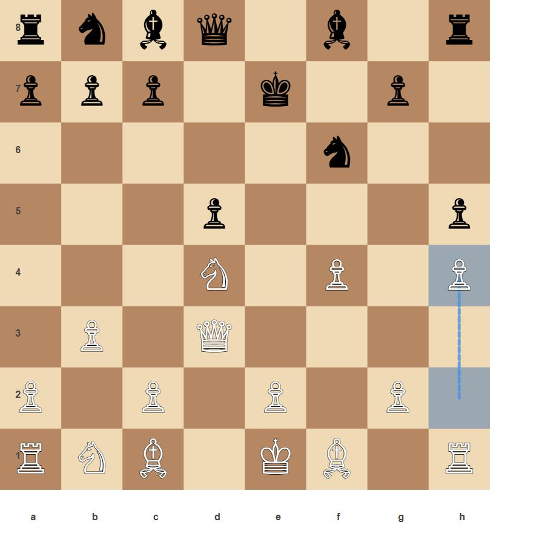
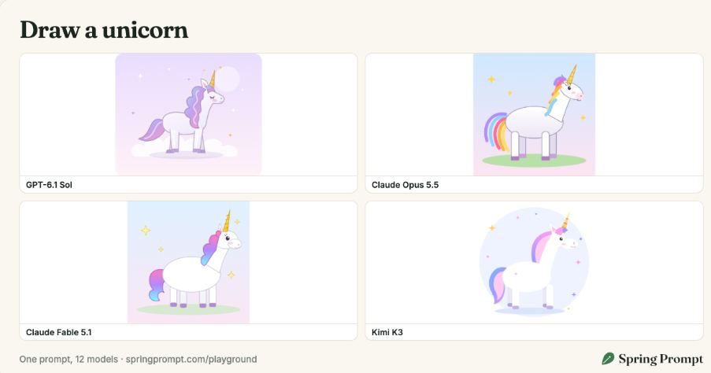

# SVG Drawing

[简体中文](../../categories/svg.md) | **English**

> Draw recognizable objects and believable relationships · **32 challenges**

[← Home](../../../README.en.md) · [All challenges](../INDEX.md)

> The summaries and observation points below are our editorial descriptions, not original prompts or official scoring rules.

## An octopus operating a pipe organ

**ID**: `svg-001` · **Source**: [Pelican-bicycle alternatives](https://gally.net/temp/20260914pelican-alternatives/index.html) (catalog source position 1)

**Model:** Gemini 2.5 Pro · **Author / publisher:** Tom Gally / Pelican-bicycle alternatives

Image: Tom Gally / Pelican-bicycle alternatives · [Original image / work](https://gally.net/temp/20260914pelican-alternatives/svgs/google_gemini-2.5-pro_prompt1.svg) · [Media notice](../../../THIRD_PARTY_MEDIA.en.md)

Historical Gemini 2.5 Pro SVG output displayed by the source; click to view it.

An octopus plays a pipe organ, testing both tentacle anatomy and a convincing playing pose.

**Source credit / attribution lead**: Tom Gally / Claude-generated challenge collection

**What to observe**

- Are the octopus and pipe organ recognizable?
- Do the tentacles visibly operate the keys?
- Does the SVG render correctly with all key structures present?

**Tags**: `SVG`, `Creative drawing`, `Relational understanding`

**Prompts and outputs**: [View the source](https://gally.net/temp/20260914pelican-alternatives/index.html) · **Test status in this repository**: Not tested

> All Gally challenges share one page. Find source item **1** after opening it.

### Historical outputs

**Gemini 2.5 Pro** · Autumn 2025 · Tom Gally / Pelican-bicycle alternatives

[View output / demo](https://gally.net/temp/20260914pelican-alternatives/svgs/google_gemini-2.5-pro_prompt1.svg) · [Source record](https://gally.net/temp/20260914pelican-alternatives/index.html#prompt-1) · [Test context](https://gally.net/temp/20260914pelican-alternatives/about.html)

Source 2025 round: default settings, one plain user message, no system prompt. Exact run day was not published.

---

## A giraffe assembling a grandfather clock

**ID**: `svg-002` · **Source**: [Pelican-bicycle alternatives](https://gally.net/temp/20260914pelican-alternatives/index.html) (catalog source position 2)

**Model:** Gemini 2.5 Pro · **Author / publisher:** Tom Gally / Pelican-bicycle alternatives

Image: Tom Gally / Pelican-bicycle alternatives · [Original image / work](https://gally.net/temp/20260914pelican-alternatives/svgs/google_gemini-2.5-pro_prompt2.svg) · [Media notice](../../../THIRD_PARTY_MEDIA.en.md)

Historical Gemini 2.5 Pro SVG output displayed by the source; click to view it.

A giraffe assembles a grandfather clock, combining a long-necked animal with delicate machinery.

**Source credit / attribution lead**: Tom Gally / Claude-generated challenge collection

**What to observe**

- Are the clock face, pendulum, and tall case clear?
- Does the giraffe assemble the clock rather than just stand beside it?
- Does the SVG render correctly with all key structures present?

**Tags**: `SVG`, `Creative drawing`, `Relational understanding`

**Prompts and outputs**: [View the source](https://gally.net/temp/20260914pelican-alternatives/index.html) · **Test status in this repository**: Not tested

> All Gally challenges share one page. Find source item **2** after opening it.

### Historical outputs

**Gemini 2.5 Pro** · Autumn 2025 · Tom Gally / Pelican-bicycle alternatives

[View output / demo](https://gally.net/temp/20260914pelican-alternatives/svgs/google_gemini-2.5-pro_prompt2.svg) · [Source record](https://gally.net/temp/20260914pelican-alternatives/index.html#prompt-2) · [Test context](https://gally.net/temp/20260914pelican-alternatives/about.html)

Source 2025 round: default settings, one plain user message, no system prompt. Exact run day was not published.

---

## A starfish driving a bulldozer

**ID**: `svg-003` · **Source**: [Pelican-bicycle alternatives](https://gally.net/temp/20260914pelican-alternatives/index.html) (catalog source position 3)

**Model:** Gemini 2.5 Pro · **Author / publisher:** Tom Gally / Pelican-bicycle alternatives

Image: Tom Gally / Pelican-bicycle alternatives · [Original image / work](https://gally.net/temp/20260914pelican-alternatives/svgs/google_gemini-2.5-pro_prompt3.svg) · [Media notice](../../../THIRD_PARTY_MEDIA.en.md)

Historical Gemini 2.5 Pro SVG output displayed by the source; click to view it.

A starfish sits at the controls of a bulldozer, testing machinery detail and the driving pose.

**Source credit / attribution lead**: Tom Gally / Claude-generated challenge collection

**What to observe**

- Are the tracks, blade, and cab recognizable?
- Is the starfish actually driving rather than lying on the vehicle?
- Does the SVG render correctly with all key structures present?

**Tags**: `SVG`, `Creative drawing`, `Relational understanding`

**Prompts and outputs**: [View the source](https://gally.net/temp/20260914pelican-alternatives/index.html) · **Test status in this repository**: Not tested

> All Gally challenges share one page. Find source item **3** after opening it.

### Historical outputs

**Gemini 2.5 Pro** · Autumn 2025 · Tom Gally / Pelican-bicycle alternatives

[View output / demo](https://gally.net/temp/20260914pelican-alternatives/svgs/google_gemini-2.5-pro_prompt3.svg) · [Source record](https://gally.net/temp/20260914pelican-alternatives/index.html#prompt-3) · [Test context](https://gally.net/temp/20260914pelican-alternatives/about.html)

Source 2025 round: default settings, one plain user message, no system prompt. Exact run day was not published.

---

## A moose conducting a carousel

**ID**: `svg-004` · **Source**: [Pelican-bicycle alternatives](https://gally.net/temp/20260914pelican-alternatives/index.html) (catalog source position 4)

**Model:** Gemini 2.5 Pro · **Author / publisher:** Tom Gally / Pelican-bicycle alternatives

Image: Tom Gally / Pelican-bicycle alternatives · [Original image / work](https://gally.net/temp/20260914pelican-alternatives/svgs/google_gemini-2.5-pro_prompt4.svg) · [Media notice](../../../THIRD_PARTY_MEDIA.en.md)

Historical Gemini 2.5 Pro SVG output displayed by the source; click to view it.

A moose conducts a carousel like an orchestra, testing the relationship between two different actions.

**Source credit / attribution lead**: Tom Gally / Claude-generated challenge collection

**What to observe**

- Is the carousel structure complete?
- Does the pose communicate conducting?
- Does the SVG render correctly with all key structures present?

**Tags**: `SVG`, `Creative drawing`, `Relational understanding`

**Prompts and outputs**: [View the source](https://gally.net/temp/20260914pelican-alternatives/index.html) · **Test status in this repository**: Not tested

> All Gally challenges share one page. Find source item **4** after opening it.

### Historical outputs

**Gemini 2.5 Pro** · Autumn 2025 · Tom Gally / Pelican-bicycle alternatives

[View output / demo](https://gally.net/temp/20260914pelican-alternatives/svgs/google_gemini-2.5-pro_prompt4.svg) · [Source record](https://gally.net/temp/20260914pelican-alternatives/index.html#prompt-4) · [Test context](https://gally.net/temp/20260914pelican-alternatives/about.html)

Source 2025 round: default settings, one plain user message, no system prompt. Exact run day was not published.

---

## A flamingo repairing a telescope

**ID**: `svg-005` · **Source**: [Pelican-bicycle alternatives](https://gally.net/temp/20260914pelican-alternatives/index.html) (catalog source position 5)

**Model:** Gemini 2.5 Pro · **Author / publisher:** Tom Gally / Pelican-bicycle alternatives

Image: Tom Gally / Pelican-bicycle alternatives · [Original image / work](https://gally.net/temp/20260914pelican-alternatives/svgs/google_gemini-2.5-pro_prompt5.svg) · [Media notice](../../../THIRD_PARTY_MEDIA.en.md)

Historical Gemini 2.5 Pro SVG output displayed by the source; click to view it.

A flamingo repairs a telescope, combining slender limbs with detailed equipment.

**Source credit / attribution lead**: Tom Gally / Claude-generated challenge collection

**What to observe**

- Are the telescope tube and mount coherent?
- Are the repair action and contact points plausible?
- Does the SVG render correctly with all key structures present?

**Tags**: `SVG`, `Creative drawing`, `Relational understanding`

**Prompts and outputs**: [View the source](https://gally.net/temp/20260914pelican-alternatives/index.html) · **Test status in this repository**: Not tested

> All Gally challenges share one page. Find source item **5** after opening it.

### Historical outputs

**Gemini 2.5 Pro** · Autumn 2025 · Tom Gally / Pelican-bicycle alternatives

[View output / demo](https://gally.net/temp/20260914pelican-alternatives/svgs/google_gemini-2.5-pro_prompt5.svg) · [Source record](https://gally.net/temp/20260914pelican-alternatives/index.html#prompt-5) · [Test context](https://gally.net/temp/20260914pelican-alternatives/about.html)

Source 2025 round: default settings, one plain user message, no system prompt. Exact run day was not published.

---

## A hedgehog playing an accordion

**ID**: `svg-006` · **Source**: [Pelican-bicycle alternatives](https://gally.net/temp/20260914pelican-alternatives/index.html) (catalog source position 6)

**Model:** Gemini 2.5 Pro · **Author / publisher:** Tom Gally / Pelican-bicycle alternatives

Image: Tom Gally / Pelican-bicycle alternatives · [Original image / work](https://gally.net/temp/20260914pelican-alternatives/svgs/google_gemini-2.5-pro_prompt6.svg) · [Media notice](../../../THIRD_PARTY_MEDIA.en.md)

Historical Gemini 2.5 Pro SVG output displayed by the source; click to view it.

A hedgehog plays an accordion, coordinating its body with the bellows and keyboard.

**Source credit / attribution lead**: Tom Gally / Claude-generated challenge collection

**What to observe**

- Are the bellows and buttons clear?
- Does the playing pose suggest stretching the bellows?
- Does the SVG render correctly with all key structures present?

**Tags**: `SVG`, `Creative drawing`, `Relational understanding`

**Prompts and outputs**: [View the source](https://gally.net/temp/20260914pelican-alternatives/index.html) · **Test status in this repository**: Not tested

> All Gally challenges share one page. Find source item **6** after opening it.

### Historical outputs

**Gemini 2.5 Pro** · Autumn 2025 · Tom Gally / Pelican-bicycle alternatives

[View output / demo](https://gally.net/temp/20260914pelican-alternatives/svgs/google_gemini-2.5-pro_prompt6.svg) · [Source record](https://gally.net/temp/20260914pelican-alternatives/index.html#prompt-6) · [Test context](https://gally.net/temp/20260914pelican-alternatives/about.html)

Source 2025 round: default settings, one plain user message, no system prompt. Exact run day was not published.

---

## A jellyfish piloting a Ferris wheel

**ID**: `svg-007` · **Source**: [Pelican-bicycle alternatives](https://gally.net/temp/20260914pelican-alternatives/index.html) (catalog source position 7)

**Model:** Gemini 2.5 Pro · **Author / publisher:** Tom Gally / Pelican-bicycle alternatives

Image: Tom Gally / Pelican-bicycle alternatives · [Original image / work](https://gally.net/temp/20260914pelican-alternatives/svgs/google_gemini-2.5-pro_prompt7.svg) · [Media notice](../../../THIRD_PARTY_MEDIA.en.md)

Historical Gemini 2.5 Pro SVG output displayed by the source; click to view it.

A jellyfish operates a Ferris wheel, connecting tentacles, controls, and a large machine.

**Source credit / attribution lead**: Tom Gally / Claude-generated challenge collection

**What to observe**

- Are the wheel and passenger cabins complete?
- Is the jellyfish clearly operating the wheel?
- Does the SVG render correctly with all key structures present?

**Tags**: `SVG`, `Creative drawing`, `Relational understanding`

**Prompts and outputs**: [View the source](https://gally.net/temp/20260914pelican-alternatives/index.html) · **Test status in this repository**: Not tested

> All Gally challenges share one page. Find source item **7** after opening it.

### Historical outputs

**Gemini 2.5 Pro** · Autumn 2025 · Tom Gally / Pelican-bicycle alternatives

[View output / demo](https://gally.net/temp/20260914pelican-alternatives/svgs/google_gemini-2.5-pro_prompt7.svg) · [Source record](https://gally.net/temp/20260914pelican-alternatives/index.html#prompt-7) · [Test context](https://gally.net/temp/20260914pelican-alternatives/about.html)

Source 2025 round: default settings, one plain user message, no system prompt. Exact run day was not published.

---

## An elephant typing on a typewriter

**ID**: `svg-008` · **Source**: [Pelican-bicycle alternatives](https://gally.net/temp/20260914pelican-alternatives/index.html) (catalog source position 8)

**Model:** Gemini 2.5 Pro · **Author / publisher:** Tom Gally / Pelican-bicycle alternatives

Image: Tom Gally / Pelican-bicycle alternatives · [Original image / work](https://gally.net/temp/20260914pelican-alternatives/svgs/google_gemini-2.5-pro_prompt8.svg) · [Media notice](../../../THIRD_PARTY_MEDIA.en.md)

Historical Gemini 2.5 Pro SVG output displayed by the source; click to view it.

An elephant types on a typewriter, testing how its trunk or limbs interact with small keys.

**Source credit / attribution lead**: Tom Gally / Claude-generated challenge collection

**What to observe**

- Are the keyboard and paper roller clear?
- Is the body part pressing the keys used plausibly?
- Does the SVG render correctly with all key structures present?

**Tags**: `SVG`, `Creative drawing`, `Relational understanding`

**Prompts and outputs**: [View the source](https://gally.net/temp/20260914pelican-alternatives/index.html) · **Test status in this repository**: Not tested

> All Gally challenges share one page. Find source item **8** after opening it.

### Historical outputs

**Gemini 2.5 Pro** · Autumn 2025 · Tom Gally / Pelican-bicycle alternatives

[View output / demo](https://gally.net/temp/20260914pelican-alternatives/svgs/google_gemini-2.5-pro_prompt8.svg) · [Source record](https://gally.net/temp/20260914pelican-alternatives/index.html#prompt-8) · [Test context](https://gally.net/temp/20260914pelican-alternatives/about.html)

Source 2025 round: default settings, one plain user message, no system prompt. Exact run day was not published.

---

## A chameleon tuning a grand piano

**ID**: `svg-009` · **Source**: [Pelican-bicycle alternatives](https://gally.net/temp/20260914pelican-alternatives/index.html) (catalog source position 9)

**Model:** Gemini 2.5 Pro · **Author / publisher:** Tom Gally / Pelican-bicycle alternatives

Image: Tom Gally / Pelican-bicycle alternatives · [Original image / work](https://gally.net/temp/20260914pelican-alternatives/svgs/google_gemini-2.5-pro_prompt9.svg) · [Media notice](../../../THIRD_PARTY_MEDIA.en.md)

Historical Gemini 2.5 Pro SVG output displayed by the source; click to view it.

A chameleon tunes a grand piano, testing a complex instrument and a precise action.

**Source credit / attribution lead**: Tom Gally / Claude-generated challenge collection

**What to observe**

- Are the grand piano case and strings recognizable?
- Does the action show tuning rather than playing?
- Does the SVG render correctly with all key structures present?

**Tags**: `SVG`, `Creative drawing`, `Relational understanding`

**Prompts and outputs**: [View the source](https://gally.net/temp/20260914pelican-alternatives/index.html) · **Test status in this repository**: Not tested

> All Gally challenges share one page. Find source item **9** after opening it.

### Historical outputs

**Gemini 2.5 Pro** · Autumn 2025 · Tom Gally / Pelican-bicycle alternatives

[View output / demo](https://gally.net/temp/20260914pelican-alternatives/svgs/google_gemini-2.5-pro_prompt9.svg) · [Source record](https://gally.net/temp/20260914pelican-alternatives/index.html#prompt-9) · [Test context](https://gally.net/temp/20260914pelican-alternatives/about.html)

Source 2025 round: default settings, one plain user message, no system prompt. Exact run day was not published.

---

## A penguin juggling chainsaws

**ID**: `svg-010` · **Source**: [Pelican-bicycle alternatives](https://gally.net/temp/20260914pelican-alternatives/index.html) (catalog source position 10)

**Model:** Gemini 2.5 Pro · **Author / publisher:** Tom Gally / Pelican-bicycle alternatives

Image: Tom Gally / Pelican-bicycle alternatives · [Original image / work](https://gally.net/temp/20260914pelican-alternatives/svgs/google_gemini-2.5-pro_prompt10.svg) · [Media notice](../../../THIRD_PARTY_MEDIA.en.md)

Historical Gemini 2.5 Pro SVG output displayed by the source; click to view it.

A penguin juggles several chainsaws, testing object recognition and implied motion.

**Source credit / attribution lead**: Tom Gally / Claude-generated challenge collection

**What to observe**

- Are the penguin and chainsaws distinct?
- Are the airborne objects positioned plausibly for juggling?
- Does the SVG render correctly with all key structures present?

**Tags**: `SVG`, `Creative drawing`, `Relational understanding`

**Prompts and outputs**: [View the source](https://gally.net/temp/20260914pelican-alternatives/index.html) · **Test status in this repository**: Not tested

> All Gally challenges share one page. Find source item **10** after opening it.

### Historical outputs

**Gemini 2.5 Pro** · Autumn 2025 · Tom Gally / Pelican-bicycle alternatives

[View output / demo](https://gally.net/temp/20260914pelican-alternatives/svgs/google_gemini-2.5-pro_prompt10.svg) · [Source record](https://gally.net/temp/20260914pelican-alternatives/index.html#prompt-10) · [Test context](https://gally.net/temp/20260914pelican-alternatives/about.html)

Source 2025 round: default settings, one plain user message, no system prompt. Exact run day was not published.

---

## A sloth steering an excavator

**ID**: `svg-011` · **Source**: [Pelican-bicycle alternatives](https://gally.net/temp/20260914pelican-alternatives/index.html) (catalog source position 11)

**Model:** Gemini 2.5 Pro · **Author / publisher:** Tom Gally / Pelican-bicycle alternatives

Image: Tom Gally / Pelican-bicycle alternatives · [Original image / work](https://gally.net/temp/20260914pelican-alternatives/svgs/google_gemini-2.5-pro_prompt11.svg) · [Media notice](../../../THIRD_PARTY_MEDIA.en.md)

Historical Gemini 2.5 Pro SVG output displayed by the source; click to view it.

A sloth drives an excavator, linking the animal to the cab and mechanical arm.

**Source credit / attribution lead**: Tom Gally / Claude-generated challenge collection

**What to observe**

- Are the excavator arm and bucket coherent?
- Is the sloth visibly operating the controls?
- Does the SVG render correctly with all key structures present?

**Tags**: `SVG`, `Creative drawing`, `Relational understanding`

**Prompts and outputs**: [View the source](https://gally.net/temp/20260914pelican-alternatives/index.html) · **Test status in this repository**: Not tested

> All Gally challenges share one page. Find source item **11** after opening it.

### Historical outputs

**Gemini 2.5 Pro** · Autumn 2025 · Tom Gally / Pelican-bicycle alternatives

[View output / demo](https://gally.net/temp/20260914pelican-alternatives/svgs/google_gemini-2.5-pro_prompt11.svg) · [Source record](https://gally.net/temp/20260914pelican-alternatives/index.html#prompt-11) · [Test context](https://gally.net/temp/20260914pelican-alternatives/about.html)

Source 2025 round: default settings, one plain user message, no system prompt. Exact run day was not published.

---

## A dragonfly balancing a chandelier

**ID**: `svg-012` · **Source**: [Pelican-bicycle alternatives](https://gally.net/temp/20260914pelican-alternatives/index.html) (catalog source position 12)

**Model:** Gemini 2.5 Pro · **Author / publisher:** Tom Gally / Pelican-bicycle alternatives

Image: Tom Gally / Pelican-bicycle alternatives · [Original image / work](https://gally.net/temp/20260914pelican-alternatives/svgs/google_gemini-2.5-pro_prompt12.svg) · [Media notice](../../../THIRD_PARTY_MEDIA.en.md)

Historical Gemini 2.5 Pro SVG output displayed by the source; click to view it.

A dragonfly balances a large chandelier, combining a delicate creature with an intricate object.

**Source credit / attribution lead**: Tom Gally / Claude-generated challenge collection

**What to observe**

- Are the chandelier arms and hanging ornaments visible?
- Does the scene convey balancing?
- Does the SVG render correctly with all key structures present?

**Tags**: `SVG`, `Creative drawing`, `Relational understanding`

**Prompts and outputs**: [View the source](https://gally.net/temp/20260914pelican-alternatives/index.html) · **Test status in this repository**: Not tested

> All Gally challenges share one page. Find source item **12** after opening it.

### Historical outputs

**Gemini 2.5 Pro** · Autumn 2025 · Tom Gally / Pelican-bicycle alternatives

[View output / demo](https://gally.net/temp/20260914pelican-alternatives/svgs/google_gemini-2.5-pro_prompt12.svg) · [Source record](https://gally.net/temp/20260914pelican-alternatives/index.html#prompt-12) · [Test context](https://gally.net/temp/20260914pelican-alternatives/about.html)

Source 2025 round: default settings, one plain user message, no system prompt. Exact run day was not published.

---

## A rhinoceros painting a lighthouse

**ID**: `svg-013` · **Source**: [Pelican-bicycle alternatives](https://gally.net/temp/20260914pelican-alternatives/index.html) (catalog source position 13)

**Model:** Gemini 2.5 Pro · **Author / publisher:** Tom Gally / Pelican-bicycle alternatives

Image: Tom Gally / Pelican-bicycle alternatives · [Original image / work](https://gally.net/temp/20260914pelican-alternatives/svgs/google_gemini-2.5-pro_prompt13.svg) · [Media notice](../../../THIRD_PARTY_MEDIA.en.md)

Historical Gemini 2.5 Pro SVG output displayed by the source; click to view it.

A rhinoceros paints a tall lighthouse, testing scale differences and a painting pose.

**Source credit / attribution lead**: Tom Gally / Claude-generated challenge collection

**What to observe**

- Are the lighthouse outline and lantern room clear?
- Are a painting tool and the painting action visible?
- Does the SVG render correctly with all key structures present?

**Tags**: `SVG`, `Creative drawing`, `Relational understanding`

**Prompts and outputs**: [View the source](https://gally.net/temp/20260914pelican-alternatives/index.html) · **Test status in this repository**: Not tested

> All Gally challenges share one page. Find source item **13** after opening it.

### Historical outputs

**Gemini 2.5 Pro** · Autumn 2025 · Tom Gally / Pelican-bicycle alternatives

[View output / demo](https://gally.net/temp/20260914pelican-alternatives/svgs/google_gemini-2.5-pro_prompt13.svg) · [Source record](https://gally.net/temp/20260914pelican-alternatives/index.html#prompt-13) · [Test context](https://gally.net/temp/20260914pelican-alternatives/about.html)

Source 2025 round: default settings, one plain user message, no system prompt. Exact run day was not published.

---

## A seahorse examining a microscope

**ID**: `svg-014` · **Source**: [Pelican-bicycle alternatives](https://gally.net/temp/20260914pelican-alternatives/index.html) (catalog source position 14)

**Model:** Gemini 2.5 Pro · **Author / publisher:** Tom Gally / Pelican-bicycle alternatives

Image: Tom Gally / Pelican-bicycle alternatives · [Original image / work](https://gally.net/temp/20260914pelican-alternatives/svgs/google_gemini-2.5-pro_prompt14.svg) · [Media notice](../../../THIRD_PARTY_MEDIA.en.md)

Historical Gemini 2.5 Pro SVG output displayed by the source; click to view it.

A seahorse examines a microscope, combining a small animal with a precision instrument.

**Source credit / attribution lead**: Tom Gally / Claude-generated challenge collection

**What to observe**

- Are the eyepiece and stage recognizable?
- Does the pose convey examination or observation?
- Does the SVG render correctly with all key structures present?

**Tags**: `SVG`, `Creative drawing`, `Relational understanding`

**Prompts and outputs**: [View the source](https://gally.net/temp/20260914pelican-alternatives/index.html) · **Test status in this repository**: Not tested

> All Gally challenges share one page. Find source item **14** after opening it.

### Historical outputs

**Gemini 2.5 Pro** · Autumn 2025 · Tom Gally / Pelican-bicycle alternatives

[View output / demo](https://gally.net/temp/20260914pelican-alternatives/svgs/google_gemini-2.5-pro_prompt14.svg) · [Source record](https://gally.net/temp/20260914pelican-alternatives/index.html#prompt-14) · [Test context](https://gally.net/temp/20260914pelican-alternatives/about.html)

Source 2025 round: default settings, one plain user message, no system prompt. Exact run day was not published.

---

## A peacock spinning a pottery wheel

**ID**: `svg-015` · **Source**: [Pelican-bicycle alternatives](https://gally.net/temp/20260914pelican-alternatives/index.html) (catalog source position 15)

**Model:** Gemini 2.5 Pro · **Author / publisher:** Tom Gally / Pelican-bicycle alternatives

Image: Tom Gally / Pelican-bicycle alternatives · [Original image / work](https://gally.net/temp/20260914pelican-alternatives/svgs/google_gemini-2.5-pro_prompt15.svg) · [Media notice](../../../THIRD_PARTY_MEDIA.en.md)

Historical Gemini 2.5 Pro SVG output displayed by the source; click to view it.

A peacock spins a pottery wheel, combining elaborate feathers with a rotating tool.

**Source credit / attribution lead**: Tom Gally / Claude-generated challenge collection

**What to observe**

- Are the pottery wheel and unfinished pot clear?
- Is the interaction between the peacock and wheel plausible?
- Does the SVG render correctly with all key structures present?

**Tags**: `SVG`, `Creative drawing`, `Relational understanding`

**Prompts and outputs**: [View the source](https://gally.net/temp/20260914pelican-alternatives/index.html) · **Test status in this repository**: Not tested

> All Gally challenges share one page. Find source item **15** after opening it.

### Historical outputs

**Gemini 2.5 Pro** · Autumn 2025 · Tom Gally / Pelican-bicycle alternatives

[View output / demo](https://gally.net/temp/20260914pelican-alternatives/svgs/google_gemini-2.5-pro_prompt15.svg) · [Source record](https://gally.net/temp/20260914pelican-alternatives/index.html#prompt-15) · [Test context](https://gally.net/temp/20260914pelican-alternatives/about.html)

Source 2025 round: default settings, one plain user message, no system prompt. Exact run day was not published.

---

## A kangaroo climbing a radio tower

**ID**: `svg-016` · **Source**: [Pelican-bicycle alternatives](https://gally.net/temp/20260914pelican-alternatives/index.html) (catalog source position 16)

**Model:** Gemini 2.5 Pro · **Author / publisher:** Tom Gally / Pelican-bicycle alternatives

Image: Tom Gally / Pelican-bicycle alternatives · [Original image / work](https://gally.net/temp/20260914pelican-alternatives/svgs/google_gemini-2.5-pro_prompt16.svg) · [Media notice](../../../THIRD_PARTY_MEDIA.en.md)

Historical Gemini 2.5 Pro SVG output displayed by the source; click to view it.

A kangaroo climbs a radio tower, testing pose, support points, and tall structures.

**Source credit / attribution lead**: Tom Gally / Claude-generated challenge collection

**What to observe**

- Are the tower framework and antennas recognizable?
- Are the limbs placed plausibly to support climbing?
- Does the SVG render correctly with all key structures present?

**Tags**: `SVG`, `Creative drawing`, `Relational understanding`

**Prompts and outputs**: [View the source](https://gally.net/temp/20260914pelican-alternatives/index.html) · **Test status in this repository**: Not tested

> All Gally challenges share one page. Find source item **16** after opening it.

### Historical outputs

**Gemini 2.5 Pro** · Autumn 2025 · Tom Gally / Pelican-bicycle alternatives

[View output / demo](https://gally.net/temp/20260914pelican-alternatives/svgs/google_gemini-2.5-pro_prompt16.svg) · [Source record](https://gally.net/temp/20260914pelican-alternatives/index.html#prompt-16) · [Test context](https://gally.net/temp/20260914pelican-alternatives/about.html)

Source 2025 round: default settings, one plain user message, no system prompt. Exact run day was not published.

---

## A lobster polishing a harp

**ID**: `svg-017` · **Source**: [Pelican-bicycle alternatives](https://gally.net/temp/20260914pelican-alternatives/index.html) (catalog source position 17)

**Model:** Gemini 2.5 Pro · **Author / publisher:** Tom Gally / Pelican-bicycle alternatives

Image: Tom Gally / Pelican-bicycle alternatives · [Original image / work](https://gally.net/temp/20260914pelican-alternatives/svgs/google_gemini-2.5-pro_prompt17.svg) · [Media notice](../../../THIRD_PARTY_MEDIA.en.md)

Historical Gemini 2.5 Pro SVG output displayed by the source; click to view it.

A lobster polishes a harp, testing contact points and instrument details.

**Source credit / attribution lead**: Tom Gally / Claude-generated challenge collection

**What to observe**

- Are the harp strings and frame clear?
- Does the scene clearly show polishing or wiping?
- Does the SVG render correctly with all key structures present?

**Tags**: `SVG`, `Creative drawing`, `Relational understanding`

**Prompts and outputs**: [View the source](https://gally.net/temp/20260914pelican-alternatives/index.html) · **Test status in this repository**: Not tested

> All Gally challenges share one page. Find source item **17** after opening it.

### Historical outputs

**Gemini 2.5 Pro** · Autumn 2025 · Tom Gally / Pelican-bicycle alternatives

[View output / demo](https://gally.net/temp/20260914pelican-alternatives/svgs/google_gemini-2.5-pro_prompt17.svg) · [Source record](https://gally.net/temp/20260914pelican-alternatives/index.html#prompt-17) · [Test context](https://gally.net/temp/20260914pelican-alternatives/about.html)

Source 2025 round: default settings, one plain user message, no system prompt. Exact run day was not published.

---

## A porcupine pushing a lawnmower

**ID**: `svg-018` · **Source**: [Pelican-bicycle alternatives](https://gally.net/temp/20260914pelican-alternatives/index.html) (catalog source position 18)

**Model:** Gemini 2.5 Pro · **Author / publisher:** Tom Gally / Pelican-bicycle alternatives

Image: Tom Gally / Pelican-bicycle alternatives · [Original image / work](https://gally.net/temp/20260914pelican-alternatives/svgs/google_gemini-2.5-pro_prompt18.svg) · [Media notice](../../../THIRD_PARTY_MEDIA.en.md)

Historical Gemini 2.5 Pro SVG output displayed by the source; click to view it.

A porcupine pushes a lawnmower, combining spines, a handle, and a pushing pose.

**Source credit / attribution lead**: Tom Gally / Claude-generated challenge collection

**What to observe**

- Are the mower wheels and handle recognizable?
- Does the pose convey forward pushing?
- Does the SVG render correctly with all key structures present?

**Tags**: `SVG`, `Creative drawing`, `Relational understanding`

**Prompts and outputs**: [View the source](https://gally.net/temp/20260914pelican-alternatives/index.html) · **Test status in this repository**: Not tested

> All Gally challenges share one page. Find source item **18** after opening it.

### Historical outputs

**Gemini 2.5 Pro** · Autumn 2025 · Tom Gally / Pelican-bicycle alternatives

[View output / demo](https://gally.net/temp/20260914pelican-alternatives/svgs/google_gemini-2.5-pro_prompt18.svg) · [Source record](https://gally.net/temp/20260914pelican-alternatives/index.html#prompt-18) · [Test context](https://gally.net/temp/20260914pelican-alternatives/about.html)

Source 2025 round: default settings, one plain user message, no system prompt. Exact run day was not published.

---

## A gecko installing a satellite dish

**ID**: `svg-019` · **Source**: [Pelican-bicycle alternatives](https://gally.net/temp/20260914pelican-alternatives/index.html) (catalog source position 19)

**Model:** Gemini 2.5 Pro · **Author / publisher:** Tom Gally / Pelican-bicycle alternatives

Image: Tom Gally / Pelican-bicycle alternatives · [Original image / work](https://gally.net/temp/20260914pelican-alternatives/svgs/google_gemini-2.5-pro_prompt19.svg) · [Media notice](../../../THIRD_PARTY_MEDIA.en.md)

Historical Gemini 2.5 Pro SVG output displayed by the source; click to view it.

A gecko installs a satellite dish on a building, testing attachment and installation poses.

**Source credit / attribution lead**: Tom Gally / Claude-generated challenge collection

**What to observe**

- Are the dish and mounting bracket clear?
- Are the installation direction and fastening action credible?
- Does the SVG render correctly with all key structures present?

**Tags**: `SVG`, `Creative drawing`, `Relational understanding`

**Prompts and outputs**: [View the source](https://gally.net/temp/20260914pelican-alternatives/index.html) · **Test status in this repository**: Not tested

> All Gally challenges share one page. Find source item **19** after opening it.

### Historical outputs

**Gemini 2.5 Pro** · Autumn 2025 · Tom Gally / Pelican-bicycle alternatives

[View output / demo](https://gally.net/temp/20260914pelican-alternatives/svgs/google_gemini-2.5-pro_prompt19.svg) · [Source record](https://gally.net/temp/20260914pelican-alternatives/index.html#prompt-19) · [Test context](https://gally.net/temp/20260914pelican-alternatives/about.html)

Source 2025 round: default settings, one plain user message, no system prompt. Exact run day was not published.

---

## An iguana carving a totem pole

**ID**: `svg-020` · **Source**: [Pelican-bicycle alternatives](https://gally.net/temp/20260914pelican-alternatives/index.html) (catalog source position 20)

**Model:** Gemini 2.5 Pro · **Author / publisher:** Tom Gally / Pelican-bicycle alternatives

Image: Tom Gally / Pelican-bicycle alternatives · [Original image / work](https://gally.net/temp/20260914pelican-alternatives/svgs/google_gemini-2.5-pro_prompt20.svg) · [Media notice](../../../THIRD_PARTY_MEDIA.en.md)

Historical Gemini 2.5 Pro SVG output displayed by the source; click to view it.

An iguana carves a wooden totem pole, testing tool use and intricate patterns.

**Source credit / attribution lead**: Tom Gally / Claude-generated challenge collection

**What to observe**

- Do the totem patterns have clear layers?
- Are the carving tool and working action visible?
- Does the SVG render correctly with all key structures present?

**Tags**: `SVG`, `Creative drawing`, `Relational understanding`

**Prompts and outputs**: [View the source](https://gally.net/temp/20260914pelican-alternatives/index.html) · **Test status in this repository**: Not tested

> All Gally challenges share one page. Find source item **20** after opening it.

### Historical outputs

**Gemini 2.5 Pro** · Autumn 2025 · Tom Gally / Pelican-bicycle alternatives

[View output / demo](https://gally.net/temp/20260914pelican-alternatives/svgs/google_gemini-2.5-pro_prompt20.svg) · [Source record](https://gally.net/temp/20260914pelican-alternatives/index.html#prompt-20) · [Test context](https://gally.net/temp/20260914pelican-alternatives/about.html)

Source 2025 round: default settings, one plain user message, no system prompt. Exact run day was not published.

---

## An armadillo lifting a drawbridge

**ID**: `svg-021` · **Source**: [Pelican-bicycle alternatives](https://gally.net/temp/20260914pelican-alternatives/index.html) (catalog source position 21)

**Model:** Gemini 2.5 Pro · **Author / publisher:** Tom Gally / Pelican-bicycle alternatives

Image: Tom Gally / Pelican-bicycle alternatives · [Original image / work](https://gally.net/temp/20260914pelican-alternatives/svgs/google_gemini-2.5-pro_prompt21.svg) · [Media notice](../../../THIRD_PARTY_MEDIA.en.md)

Historical Gemini 2.5 Pro SVG output displayed by the source; click to view it.

An armadillo raises a drawbridge, testing the lifting mechanism and raised bridge state.

**Source credit / attribution lead**: Tom Gally / Claude-generated challenge collection

**What to observe**

- Are the hinge, bridge deck, and ropes clear?
- Does the action fit the bridge-lifting mechanism?
- Does the SVG render correctly with all key structures present?

**Tags**: `SVG`, `Creative drawing`, `Relational understanding`

**Prompts and outputs**: [View the source](https://gally.net/temp/20260914pelican-alternatives/index.html) · **Test status in this repository**: Not tested

> All Gally challenges share one page. Find source item **21** after opening it.

### Historical outputs

**Gemini 2.5 Pro** · Autumn 2025 · Tom Gally / Pelican-bicycle alternatives

[View output / demo](https://gally.net/temp/20260914pelican-alternatives/svgs/google_gemini-2.5-pro_prompt21.svg) · [Source record](https://gally.net/temp/20260914pelican-alternatives/index.html#prompt-21) · [Test context](https://gally.net/temp/20260914pelican-alternatives/about.html)

Source 2025 round: default settings, one plain user message, no system prompt. Exact run day was not published.

---

## A mantis studying a sextant

**ID**: `svg-022` · **Source**: [Pelican-bicycle alternatives](https://gally.net/temp/20260914pelican-alternatives/index.html) (catalog source position 22)

**Model:** Gemini 2.5 Pro · **Author / publisher:** Tom Gally / Pelican-bicycle alternatives

Image: Tom Gally / Pelican-bicycle alternatives · [Original image / work](https://gally.net/temp/20260914pelican-alternatives/svgs/google_gemini-2.5-pro_prompt22.svg) · [Media notice](../../../THIRD_PARTY_MEDIA.en.md)

Historical Gemini 2.5 Pro SVG output displayed by the source; click to view it.

A mantis studies a sextant, testing recognition of an unfamiliar precision instrument.

**Source credit / attribution lead**: Tom Gally / Claude-generated challenge collection

**What to observe**

- Are the lenses and curved scale of the sextant credible?
- Do the forelimbs convey examination of the instrument?
- Does the SVG render correctly with all key structures present?

**Tags**: `SVG`, `Creative drawing`, `Relational understanding`

**Prompts and outputs**: [View the source](https://gally.net/temp/20260914pelican-alternatives/index.html) · **Test status in this repository**: Not tested

> All Gally challenges share one page. Find source item **22** after opening it.

### Historical outputs

**Gemini 2.5 Pro** · Autumn 2025 · Tom Gally / Pelican-bicycle alternatives

[View output / demo](https://gally.net/temp/20260914pelican-alternatives/svgs/google_gemini-2.5-pro_prompt22.svg) · [Source record](https://gally.net/temp/20260914pelican-alternatives/index.html#prompt-22) · [Test context](https://gally.net/temp/20260914pelican-alternatives/about.html)

Source 2025 round: default settings, one plain user message, no system prompt. Exact run day was not published.

---

## An ostrich pulling a rickshaw

**ID**: `svg-023` · **Source**: [Pelican-bicycle alternatives](https://gally.net/temp/20260914pelican-alternatives/index.html) (catalog source position 23)

**Model:** Gemini 2.5 Pro · **Author / publisher:** Tom Gally / Pelican-bicycle alternatives

Image: Tom Gally / Pelican-bicycle alternatives · [Original image / work](https://gally.net/temp/20260914pelican-alternatives/svgs/google_gemini-2.5-pro_prompt23.svg) · [Media notice](../../../THIRD_PARTY_MEDIA.en.md)

Historical Gemini 2.5 Pro SVG output displayed by the source; click to view it.

An ostrich pulls a rickshaw, testing long legs and the direction of pulling forces.

**Source credit / attribution lead**: Tom Gally / Claude-generated challenge collection

**What to observe**

- Are the rickshaw wheels and passenger compartment correct?
- Are the pulling pose and connections clear?
- Does the SVG render correctly with all key structures present?

**Tags**: `SVG`, `Creative drawing`, `Relational understanding`

**Prompts and outputs**: [View the source](https://gally.net/temp/20260914pelican-alternatives/index.html) · **Test status in this repository**: Not tested

> All Gally challenges share one page. Find source item **23** after opening it.

### Historical outputs

**Gemini 2.5 Pro** · Autumn 2025 · Tom Gally / Pelican-bicycle alternatives

[View output / demo](https://gally.net/temp/20260914pelican-alternatives/svgs/google_gemini-2.5-pro_prompt23.svg) · [Source record](https://gally.net/temp/20260914pelican-alternatives/index.html#prompt-23) · [Test context](https://gally.net/temp/20260914pelican-alternatives/about.html)

Source 2025 round: default settings, one plain user message, no system prompt. Exact run day was not published.

---

## A squid disassembling a printing press

**ID**: `svg-024` · **Source**: [Pelican-bicycle alternatives](https://gally.net/temp/20260914pelican-alternatives/index.html) (catalog source position 24)

**Model:** Gemini 2.5 Pro · **Author / publisher:** Tom Gally / Pelican-bicycle alternatives

Image: Tom Gally / Pelican-bicycle alternatives · [Original image / work](https://gally.net/temp/20260914pelican-alternatives/svgs/google_gemini-2.5-pro_prompt24.svg) · [Media notice](../../../THIRD_PARTY_MEDIA.en.md)

Historical Gemini 2.5 Pro SVG output displayed by the source; click to view it.

A squid takes apart a printing press, testing many mechanical parts and tentacle actions.

**Source credit / attribution lead**: Tom Gally / Claude-generated challenge collection

**What to observe**

- Are the press rollers and frame clear?
- Do the parts and actions convey disassembly?
- Does the SVG render correctly with all key structures present?

**Tags**: `SVG`, `Creative drawing`, `Relational understanding`

**Prompts and outputs**: [View the source](https://gally.net/temp/20260914pelican-alternatives/index.html) · **Test status in this repository**: Not tested

> All Gally challenges share one page. Find source item **24** after opening it.

### Historical outputs

**Gemini 2.5 Pro** · Autumn 2025 · Tom Gally / Pelican-bicycle alternatives

[View output / demo](https://gally.net/temp/20260914pelican-alternatives/svgs/google_gemini-2.5-pro_prompt24.svg) · [Source record](https://gally.net/temp/20260914pelican-alternatives/index.html#prompt-24) · [Test context](https://gally.net/temp/20260914pelican-alternatives/about.html)

Source 2025 round: default settings, one plain user message, no system prompt. Exact run day was not published.

---

## A butterfly inspecting a steam engine

**ID**: `svg-025` · **Source**: [Pelican-bicycle alternatives](https://gally.net/temp/20260914pelican-alternatives/index.html) (catalog source position 25)

**Model:** Gemini 2.5 Pro · **Author / publisher:** Tom Gally / Pelican-bicycle alternatives

Image: Tom Gally / Pelican-bicycle alternatives · [Original image / work](https://gally.net/temp/20260914pelican-alternatives/svgs/google_gemini-2.5-pro_prompt25.svg) · [Media notice](../../../THIRD_PARTY_MEDIA.en.md)

Historical Gemini 2.5 Pro SVG output displayed by the source; click to view it.

A butterfly inspects a steam engine, combining organic wings with complex machinery.

**Source credit / attribution lead**: Tom Gally / Claude-generated challenge collection

**What to observe**

- Are features such as cylinders and pipes recognizable?
- Is the inspection action clear?
- Does the SVG render correctly with all key structures present?

**Tags**: `SVG`, `Creative drawing`, `Relational understanding`

**Prompts and outputs**: [View the source](https://gally.net/temp/20260914pelican-alternatives/index.html) · **Test status in this repository**: Not tested

> All Gally challenges share one page. Find source item **25** after opening it.

### Historical outputs

**Gemini 2.5 Pro** · Autumn 2025 · Tom Gally / Pelican-bicycle alternatives

[View output / demo](https://gally.net/temp/20260914pelican-alternatives/svgs/google_gemini-2.5-pro_prompt25.svg) · [Source record](https://gally.net/temp/20260914pelican-alternatives/index.html#prompt-25) · [Test context](https://gally.net/temp/20260914pelican-alternatives/about.html)

Source 2025 round: default settings, one plain user message, no system prompt. Exact run day was not published.

---

## A crab descending a fire escape

**ID**: `svg-026` · **Source**: [Pelican-bicycle alternatives](https://gally.net/temp/20260914pelican-alternatives/index.html) (catalog source position 26)

**Model:** Gemini 2.5 Pro · **Author / publisher:** Tom Gally / Pelican-bicycle alternatives

Image: Tom Gally / Pelican-bicycle alternatives · [Original image / work](https://gally.net/temp/20260914pelican-alternatives/svgs/google_gemini-2.5-pro_prompt26.svg) · [Media notice](../../../THIRD_PARTY_MEDIA.en.md)

Historical Gemini 2.5 Pro SVG output displayed by the source; click to view it.

A crab descends an external fire escape, testing spatial direction and gait.

**Source credit / attribution lead**: Tom Gally / Claude-generated challenge collection

**What to observe**

- Are the platforms, railings, and stairs clear?
- Does the pose convey downward movement?
- Does the SVG render correctly with all key structures present?

**Tags**: `SVG`, `Creative drawing`, `Relational understanding`

**Prompts and outputs**: [View the source](https://gally.net/temp/20260914pelican-alternatives/index.html) · **Test status in this repository**: Not tested

> All Gally challenges share one page. Find source item **26** after opening it.

### Historical outputs

**Gemini 2.5 Pro** · Autumn 2025 · Tom Gally / Pelican-bicycle alternatives

[View output / demo](https://gally.net/temp/20260914pelican-alternatives/svgs/google_gemini-2.5-pro_prompt26.svg) · [Source record](https://gally.net/temp/20260914pelican-alternatives/index.html#prompt-26) · [Test context](https://gally.net/temp/20260914pelican-alternatives/about.html)

Source 2025 round: default settings, one plain user message, no system prompt. Exact run day was not published.

---

## A venus flytrap swallowing a street lamp

**ID**: `svg-027` · **Source**: [Pelican-bicycle alternatives](https://gally.net/temp/20260914pelican-alternatives/index.html) (catalog source position 27)

**Model:** Gemini 2.5 Pro · **Author / publisher:** Tom Gally / Pelican-bicycle alternatives

Image: Tom Gally / Pelican-bicycle alternatives · [Original image / work](https://gally.net/temp/20260914pelican-alternatives/svgs/google_gemini-2.5-pro_prompt27.svg) · [Media notice](../../../THIRD_PARTY_MEDIA.en.md)

Historical Gemini 2.5 Pro SVG output displayed by the source; click to view it.

A giant Venus flytrap swallows a street lamp, testing scale and enclosure relationships.

**Source credit / attribution lead**: Tom Gally / Claude-generated challenge collection

**What to observe**

- Are the trap leaves and street lamp recognizable?
- Are swallowing and enclosure clearly expressed?
- Does the SVG render correctly with all key structures present?

**Tags**: `SVG`, `Creative drawing`, `Relational understanding`

**Prompts and outputs**: [View the source](https://gally.net/temp/20260914pelican-alternatives/index.html) · **Test status in this repository**: Not tested

> All Gally challenges share one page. Find source item **27** after opening it.

### Historical outputs

**Gemini 2.5 Pro** · Autumn 2025 · Tom Gally / Pelican-bicycle alternatives

[View output / demo](https://gally.net/temp/20260914pelican-alternatives/svgs/google_gemini-2.5-pro_prompt27.svg) · [Source record](https://gally.net/temp/20260914pelican-alternatives/index.html#prompt-27) · [Test context](https://gally.net/temp/20260914pelican-alternatives/about.html)

Source 2025 round: default settings, one plain user message, no system prompt. Exact run day was not published.

---

## Coral cleaning a ship's wheel

**ID**: `svg-028` · **Source**: [Pelican-bicycle alternatives](https://gally.net/temp/20260914pelican-alternatives/index.html) (catalog source position 28)

**Model:** Gemini 2.5 Pro · **Author / publisher:** Tom Gally / Pelican-bicycle alternatives

Image: Tom Gally / Pelican-bicycle alternatives · [Original image / work](https://gally.net/temp/20260914pelican-alternatives/svgs/google_gemini-2.5-pro_prompt28.svg) · [Media notice](../../../THIRD_PARTY_MEDIA.en.md)

Historical Gemini 2.5 Pro SVG output displayed by the source; click to view it.

Coral cleans a ship's wheel, testing how an unusual subject can express an action.

**Source credit / attribution lead**: Tom Gally / Claude-generated challenge collection

**What to observe**

- Are the wheel spokes and handles clear?
- Does the anthropomorphic cleaning action read convincingly?
- Does the SVG render correctly with all key structures present?

**Tags**: `SVG`, `Creative drawing`, `Relational understanding`

**Prompts and outputs**: [View the source](https://gally.net/temp/20260914pelican-alternatives/index.html) · **Test status in this repository**: Not tested

> All Gally challenges share one page. Find source item **28** after opening it.

### Historical outputs

**Gemini 2.5 Pro** · Autumn 2025 · Tom Gally / Pelican-bicycle alternatives

[View output / demo](https://gally.net/temp/20260914pelican-alternatives/svgs/google_gemini-2.5-pro_prompt28.svg) · [Source record](https://gally.net/temp/20260914pelican-alternatives/index.html#prompt-28) · [Test context](https://gally.net/temp/20260914pelican-alternatives/about.html)

Source 2025 round: default settings, one plain user message, no system prompt. Exact run day was not published.

---

## A sea anemone threading a loom

**ID**: `svg-029` · **Source**: [Pelican-bicycle alternatives](https://gally.net/temp/20260914pelican-alternatives/index.html) (catalog source position 29)

**Model:** Gemini 2.5 Pro · **Author / publisher:** Tom Gally / Pelican-bicycle alternatives

Image: Tom Gally / Pelican-bicycle alternatives · [Original image / work](https://gally.net/temp/20260914pelican-alternatives/svgs/google_gemini-2.5-pro_prompt29.svg) · [Media notice](../../../THIRD_PARTY_MEDIA.en.md)

Historical Gemini 2.5 Pro SVG output displayed by the source; click to view it.

A sea anemone threads a loom, testing dense thin lines and precise movements.

**Source credit / attribution lead**: Tom Gally / Claude-generated challenge collection

**What to observe**

- Are the warp threads and loom frame clear?
- Does the threading action follow a visible path?
- Does the SVG render correctly with all key structures present?

**Tags**: `SVG`, `Creative drawing`, `Relational understanding`

**Prompts and outputs**: [View the source](https://gally.net/temp/20260914pelican-alternatives/index.html) · **Test status in this repository**: Not tested

> All Gally challenges share one page. Find source item **29** after opening it.

### Historical outputs

**Gemini 2.5 Pro** · Autumn 2025 · Tom Gally / Pelican-bicycle alternatives

[View output / demo](https://gally.net/temp/20260914pelican-alternatives/svgs/google_gemini-2.5-pro_prompt29.svg) · [Source record](https://gally.net/temp/20260914pelican-alternatives/index.html#prompt-29) · [Test context](https://gally.net/temp/20260914pelican-alternatives/about.html)

Source 2025 round: default settings, one plain user message, no system prompt. Exact run day was not published.

---

## An orchid supporting a pergola

**ID**: `svg-030` · **Source**: [Pelican-bicycle alternatives](https://gally.net/temp/20260914pelican-alternatives/index.html) (catalog source position 30)

**Model:** Gemini 2.5 Pro · **Author / publisher:** Tom Gally / Pelican-bicycle alternatives

Image: Tom Gally / Pelican-bicycle alternatives · [Original image / work](https://gally.net/temp/20260914pelican-alternatives/svgs/google_gemini-2.5-pro_prompt30.svg) · [Media notice](../../../THIRD_PARTY_MEDIA.en.md)

Historical Gemini 2.5 Pro SVG output displayed by the source; click to view it.

An orchid supports a garden pergola, testing structural support and plant form.

**Source credit / attribution lead**: Tom Gally / Claude-generated challenge collection

**What to observe**

- Are the pergola posts and beams clear?
- Is the support relationship between orchid and pergola visible?
- Does the SVG render correctly with all key structures present?

**Tags**: `SVG`, `Creative drawing`, `Relational understanding`

**Prompts and outputs**: [View the source](https://gally.net/temp/20260914pelican-alternatives/index.html) · **Test status in this repository**: Not tested

> All Gally challenges share one page. Find source item **30** after opening it.

### Historical outputs

**Gemini 2.5 Pro** · Autumn 2025 · Tom Gally / Pelican-bicycle alternatives

[View output / demo](https://gally.net/temp/20260914pelican-alternatives/svgs/google_gemini-2.5-pro_prompt30.svg) · [Source record](https://gally.net/temp/20260914pelican-alternatives/index.html#prompt-30) · [Test context](https://gally.net/temp/20260914pelican-alternatives/about.html)

Source 2025 round: default settings, one plain user message, no system prompt. Exact run day was not published.

---

## Render the final PGN position as SVG

**ID**: `reddit-pgn-svg-pgn-svg` · **Source**: [u/bobaburger](https://www.reddit.com/r/LocalLLaMA/comments/1t53dhp/quality_comparison_between_qwen_36_27b/) (catalog source position 1)

**Model:** Qwen3.6 27B · BF16（原画廊首图 / first source-gallery image） · **Author / publisher:** u/bobaburger

Image: u/bobaburger · [Original image / work](https://qwen3-6-27b-benchmark.vercel.app/) · [Media notice](../../../THIRD_PARTY_MEDIA.en.md)

Browser capture of a source-published historical work (2026-11-08), not a new model run. A still does not establish functional correctness.

Track a specified chess game and highlight its last move in SVG.

**Source credit / attribution lead**: u/bobaburger

**Prompt availability**: Public prompt

**What to observe**

- Piece placement and board orientation are correct
- The highlighted move matches the PGN

**Tags**: `vector drawing`, `source collection`

**Prompts and outputs**: [View the source](https://www.reddit.com/r/LocalLLaMA/comments/1t53dhp/quality_comparison_between_qwen_36_27b/) · **Test status in this repository**: Not tested

### Historical outputs

**Qwen 3.6 27B（多种量化 / multiple quants）** · Run date not disclosed · u/bobaburger

[View output / demo](https://qwen3-6-27b-benchmark.vercel.app/) · [Source record](https://www.reddit.com/r/LocalLLaMA/comments/1t53dhp/quality_comparison_between_qwen_36_27b/) · [Test context](https://www.reddit.com/r/LocalLLaMA/comments/1t53dhp/quality_comparison_between_qwen_36_27b/)

Historical outputs in the post or comments, reported by participants. Execution success and scientific accuracy were not verified here. Quantization, hardware, tools and iteration conditions differ.

---

## Draw a unicorn in SVG

**ID**: `springprompt-unicorn` · **Source**: [Spring Prompt / SVG unicorn](https://springprompt.com/playground/unicorn) (catalog source position 1)

**Model:** 以来源画面为准 / See source · **Author / publisher:** Spring Prompt

Image: Spring Prompt · [Original image / work](https://springprompt.com/playground/unicorn) · [Media notice](../../../THIRD_PARTY_MEDIA.en.md)

Browser capture of a source-published historical work (2026-11-08), not a new model run. A still does not establish functional correctness.

Inspect the horn, legs, mane, tail and connected shapes; this is not a direct reproduction of the TikZ version.

**Source credit / attribution lead**: Spring Prompt / SVG unicorn

**Prompt availability**: Public prompt

**What to observe**

- Horn and legs are sensibly placed
- Paths avoid breaks and stray overlaps

**Tags**: `vector drawing`, `source collection`

**Prompts and outputs**: [View the source](https://springprompt.com/playground/unicorn) · **Test status in this repository**: Not tested

### Historical outputs

**多个模型，见原站 / Multiple models; see source** · Run date not disclosed · Spring Prompt

[View output / demo](https://springprompt.com/playground/unicorn) · [Source record](https://springprompt.com/playground/unicorn) · [Test context](https://springprompt.com/playground/unicorn)

The page changes over time and cached/live model counts differ, so no dynamic count, scores or ranking are copied. This SVG adaptation draws on the TikZ unicorn idea; this page is not claimed as the earliest origin.

---
